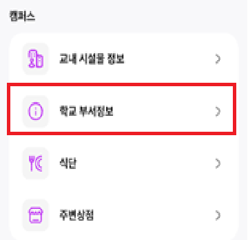
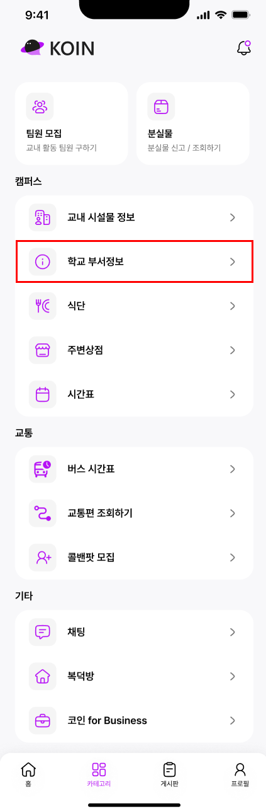

# [레거시] 1-0-2 학교 부서정보 접근 (카테고리 진입)

[← 학교 부서 정보 목록](README.md)

플랫폼: ANDROID, IOS  
원문 상태: 레거시  
[Notion 기준 명세](https://app.notion.com/p/ca80221954bc82da92b3814a11cb0f3d)  
원본 ID: `ca80221954bc82da92b3814a11cb0f3d`

<!-- notion-body:start -->
## 과거 로깅

- event\_label : category\_campus
- value : 학교 부서정보
- event\_category : click



- 설명: 앱 카테고리 화면에서 학교 부서정보를 클릭한다.
- screen\_view: <code>main_category</code>
- event\_label: <code>department__main_category__department_entry__category_entry__click</code>
- event\_name: <code>DA2</code>
- event\_category: <code>click</code>
- value: 학교 부서정보

<b>참고사진 (기능 표시)</b>

<b>모바일 (ANDROID, IOS) / 캡처 출처는 아래 참조</b>

화면 정의에 제공된 카테고리 캡처. 실제 Android 캡처 출처는 미확인; 메뉴 위치 참고.



## 새 로깅

레거시. [3-6 카테고리 내부 클릭 (현재 로깅) 2026.08.30 이후 찍히는 로깅](https://app.notion.com/p/ea70221954bc837d824b81d034d72403)를 따른다.
<!-- notion-body:end -->

<details>
<summary>Notion 원문 속성 전체</summary>

```json
{
  "platform": [
    "ANDROID",
    "IOS"
  ],
  "url": "https://app.notion.com/p/ca80221954bc82da92b3814a11cb0f3d",
  "구분": "학교 부서정보",
  "상태": "레거시",
  "생성일": "2026-11-23T13:38:53.443Z",
  "이벤트 이름": "\\[레거시\\] 1-0-2 학교 부서정보 접근 (카테고리 진입)"
}
```

</details>
