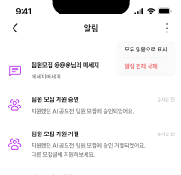

# 0-1. 알림 내부_알림 항목 클릭

[← 팀원 모집 로깅 목록](README.md)

플랫폼: IOS · ANDROID · WEB  
원문 상태: 로깅 필요

과거 로깅·새 로깅과 각 참고사진은 원문의 구간별 연결을 유지합니다.

<!-- logging-section:new:start -->
## 새 로깅 (26.11.11)

- 설명: 팀원 모집 전용 알림 목록에서 개별 알림 카드를 눌러 연결 화면으로 이동을 시도할 때 1회 기록한다. 이미 읽은 알림도 사용자 클릭이면 포함한다. 읽음 API 성공·화면 이동 성공·재렌더 시 중복 전송하지 않는다.
- screen\_view: <code>team_notification</code>
- event\_name: <code>DA1</code>
- event\_label: <code>team_recruit__team_notification__notification_list__item_entry__click</code>
- value: 팀원모집
- event\_category: <code>click</code>

검토사항

- value는 고정값 팀원모집이다. 닉네임·알림 제목·메시지 본문·모집글 제목을 value로 보내지 않는다. 기존 원문의 동적 알림 제목 value는 아래 참조 원문에 보존하며 이번 새 계약으로 소급 변환하지 않는다.
- [WEB 화면 코드](https://github.com/BCSDLab/KOIN_WEB_RECODE/blob/9b6b7a2a29e70f59409bb1136cf2ec7bb9765ab6/src/pages/team/notifications/index.tsx) · [상단 메뉴 코드](https://github.com/BCSDLab/KOIN_WEB_RECODE/blob/9b6b7a2a29e70f59409bb1136cf2ec7bb9765ab6/src/components/Team/components/TeamNotificationHeader/index.tsx)
- 문서·기능 코드 대조이며 배포·단일 전송·실수집 완료는 미확인이다. Silver·Gold 매핑과 데이터는 이번 작업에서 변경하지 않는다.
- 기존 원문: 1-2 알림 클릭 내부 (원문 ID: 4010221954bc82a9b0b7819eafa98396)

<!-- logging-section:new:end -->

### 참고사진 (알림 항목 클릭)

#### 모바일 앱

---

원문 정보

원본 ID: `e560221954bc83ed8df401626f83530e`  
[보존 원문](../../_archive/original/notion/pages/e560221954bc83ed8df401626f83530e.md)

