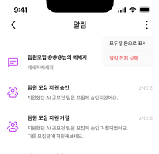

# 0-5. 알림 내부_알림 전체 삭제

[← 팀원 모집 목록](README.md)

플랫폼: ANDROID, IOS, WEB  
원문 상태: 로깅 필요  
[Notion 기준 명세](https://app.notion.com/p/a8a0221954bc833bac4f810a09106e7e)  
원본 ID: `a8a0221954bc833bac4f810a09106e7e`

<!-- notion-body:start -->
## 과거 로깅

- 없음 (새로 추가한 로깅)

사용자 요청으로 2026-11-11 추가한 팀원 모집 전용 알림 내부 명세다. service\_name=<code>team_recruit</code>, screen\_view=<code>team_notification</code>, event\_name=<code>DA1</code>을 공통으로 사용한다. 같은 기능은 웹·모바일에서 동일 label을 사용한다. 플랫폼 속성은 코드로 확인된 지원 범위만 표시하며 미확인 플랫폼의 지원 완료를 뜻하지 않는다.

공용 알림함의 <code>main__notification_list__…</code>와 구분한다. 실제 이벤트 발생 화면이 팀원 모집 전용 알림함인 경우에만 이 계약을 사용하고, 같은 동작에 공용·전용·구라벨을 중복 전송하지 않는다. 기존 팀원 모집 SDK 동결·과거 로깅은 그대로이며 이 문서 추가만으로 기존 수집값을 개명하거나 새 SDK 배포를 승인하지 않는다.

## 새 로깅 (26.11.11)

- 설명: 팀원 모집 전용 알림 목록 우측 상단 메뉴에서 알림 전체 삭제를 선택할 때 1회 기록한다. 팀원 모집 알림함 전체에 대한 사용자 삭제 시도이며 공용 알림함 전체를 삭제한다는 뜻이 아니다. 메뉴 열기·자동 보관기간 만료 삭제·API 성공 콜백은 제외한다.
- screen\_view: <code>team_notification</code>
- event\_name: <code>DA1</code>
- event\_label: <code>team_recruit__team_notification__notification_list__delete_all__click</code>
- value: 알림 전체 삭제
- event\_category: <code>click</code>

## 검토사항

- 조회한 WEB 코드에 전체 삭제 메뉴와 API 콜백이 있다. 확인 창을 두는 플랫폼에서도 최초 전체 삭제 메뉴 선택을 한 번 기록하며 확인·취소를 같은 label로 추가 전송하지 않는다. 비활성·빈 목록에서는 미전송한다.
- [WEB 화면 코드](https://github.com/BCSDLab/KOIN_WEB_RECODE/blob/9b6b7a2a29e70f59409bb1136cf2ec7bb9765ab6/src/pages/team/notifications/index.tsx) · [상단 메뉴 코드](https://github.com/BCSDLab/KOIN_WEB_RECODE/blob/9b6b7a2a29e70f59409bb1136cf2ec7bb9765ab6/src/components/Team/components/TeamNotificationHeader/index.tsx)
- 문서·기능 코드 대조이며 배포·단일 전송·실수집 완료는 미확인이다. Silver·Gold 매핑과 데이터는 이번 작업에서 변경하지 않는다.
- 기존 원문: [1-2 알림 클릭 내부](https://app.notion.com/p/4010221954bc82a9b0b7819eafa98396)

### 참고사진 (알림 전체 삭제)

<b>웹</b>

<b>참고사진 · 웹 (모바일)</b>

웹 (모바일) — 알림 화면 기능은 코드에서 확인했다. 현재 모바일 웹 실제 화면 캡처는 미확보다. PC 웹 지원과 사진은 별도 미확인이다.

<b>모바일</b>

<b>참고사진 · 모바일 앱</b>

모바일 앱 — 아래 이미지는 기존 모바일 디자인·공용 알림 참고자료다. 현재 팀원 모집 앱의 실기기 캡처나 지원 완료 증거는 아니다.

웹 모바일 사진과 모바일 앱 참고사진을 분리한다. 같은 이미지를 두 플랫폼의 실제 화면으로 중복 표기하지 않는다.

기존 팀원 모집 알림 목록 디자인 참고사진. 우측 상단 열린 메뉴의 빨간 알림 전체 삭제 항목이 대상이다. 현재 앱 실기기 검증 사진은 아니다.


<!-- notion-body:end -->

<details>
<summary>Notion 원문 속성 전체</summary>

```json
{
  "platform": [
    "ANDROID",
    "IOS",
    "WEB"
  ],
  "url": "https://app.notion.com/p/a8a0221954bc833bac4f810a09106e7e",
  "구분": "알림",
  "상태": "로깅 필요",
  "생성일": "2026-11-23T13:38:55.878Z",
  "이벤트 이름": "0-5. 알림 내부\\_알림 전체 삭제"
}
```

</details>
