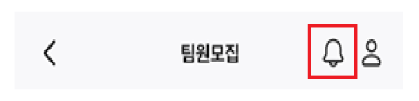
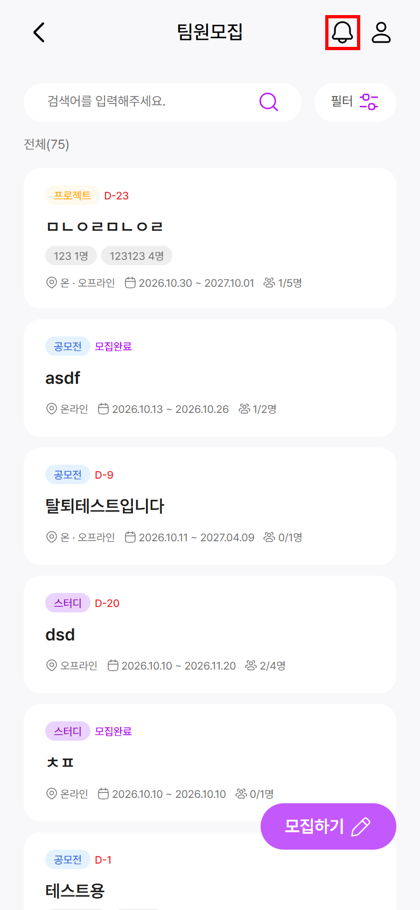

# 0. 알림 클릭

[← 팀원 모집 목록](README.md)

플랫폼: ANDROID, IOS  
원문 상태: 로깅 필요  
[Notion 기준 명세](https://app.notion.com/p/b0d0221954bc827696e8814684ed16d5)  
원본 ID: `b0d0221954bc827696e8814684ed16d5`

<!-- notion-body:start -->
## 과거 로깅

팀은 전부 다 CAMPUS로 해주세요!!

- event\_label : team\_recruitment\_notification
- value : 알림
- event\_category : “click”



## 새 로깅

- 설명: 팀원 모집 목록 화면 상단의 알림(종) 아이콘을 클릭해 팀원 모집 알림 목록(/team/notifications)으로 들어가는 경우
- screen\_view: <code>team_list</code>
- event\_name: <code>DA1</code>
- event\_label: <code>team_recruit__team_list__team_notification__entry__click</code>
- value: 알림
- event\_category: <code>click</code>

### 참고사진 (알림 클릭)

<b>웹</b>

<b>참고사진 · 웹</b>

웹 — 해당 없음 (모바일 전용)

<b>모바일</b>

<b>참고사진 · 모바일</b>

모바일 — 알림 클릭 (출처: stage 실제 캡처, 빨간 네모 = 클릭 위치)


<!-- notion-body:end -->

<details>
<summary>Notion 원문 속성 전체</summary>

```json
{
  "platform": [
    "ANDROID",
    "IOS"
  ],
  "url": "https://app.notion.com/p/b0d0221954bc827696e8814684ed16d5",
  "구분": "알림",
  "상태": "로깅 필요",
  "생성일": "2026-11-23T13:38:55.487Z",
  "이벤트 이름": "0. 알림 클릭"
}
```

</details>
