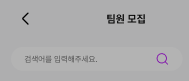
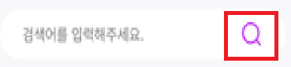
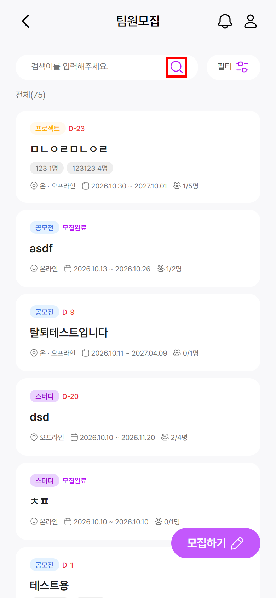

# 1. 검색 클릭

[← 팀원 모집 목록](README.md)

플랫폼: WEB, ANDROID, IOS  
원문 상태: 로깅 필요  
[Notion 기준 명세](https://app.notion.com/p/a2e0221954bc83a49be8011073641c03)  
원본 ID: `a2e0221954bc83a49be8011073641c03`

<!-- notion-body:start -->
## 과거 로깅

- event\_label : team\_recruitment\_search
- value : \{사용자가 입력한 검색어대로 나오게 해주세요!!\}
- event\_category : “click”

- mobile





- web

## 새 로깅

- 설명: 팀원 모집 목록 화면의 검색창에 검색어를 입력하고 검색(돋보기 버튼 클릭, web은 Enter)하면 같은 화면에 검색 결과 목록이 나오는 경우
- screen\_view: <code>team_list</code>
- event\_name: <code>DA1</code>
- event\_label: <code>team_recruit__team_list__search__click</code>
- value: 검색
- event\_category: <code>click</code>

### 참고사진 (검색 클릭)

<b>웹</b>

<b>참고사진 · 웹</b>


<b>모바일</b>

<b>참고사진 · 모바일</b>

모바일 — 검색 클릭 (출처: stage 실제 캡처, 빨간 네모 = 클릭 위치)


<!-- notion-body:end -->

<details>
<summary>Notion 원문 속성 전체</summary>

```json
{
  "platform": [
    "WEB",
    "ANDROID",
    "IOS"
  ],
  "url": "https://app.notion.com/p/a2e0221954bc83a49be8011073641c03",
  "구분": "모집글 검색 및 필터",
  "상태": "로깅 필요",
  "생성일": "2026-11-23T13:38:56.990Z",
  "이벤트 이름": "1. 검색 클릭"
}
```

</details>
