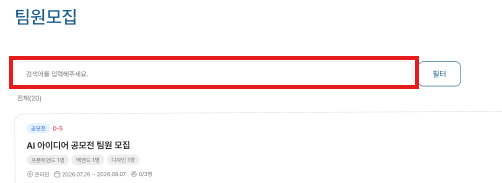

# 1. 검색 클릭

[← 팀원 모집 로깅 목록](README.md)

플랫폼: WEB · ANDROID · IOS  
원문 상태: 로깅 필요

과거 로깅·새 로깅과 각 참고사진은 원문의 구간별 연결을 유지합니다.

<!-- logging-section:past:start -->
## 과거 로깅

- event\_label : team\_recruitment\_search
- value : \{사용자가 입력한 검색어대로 나오게 해주세요!!\}
- event\_category : “click”

- mobile 

- web

<!-- logging-section:past:end -->

<!-- logging-section:new:start -->
## 새 로깅

- 설명: 팀원 모집 목록 화면의 검색창에 검색어를 입력하고 검색(돋보기 버튼 클릭, web은 Enter)하면 같은 화면에 검색 결과 목록이 나오는 경우
- screen\_view: <code>team_list</code>
- event\_name: <code>DA1</code>
- event\_label: <code>team_recruit__team_list__search__click</code>
- value: 검색
- event\_category: <code>click</code>

### 참고사진 (검색 클릭)

#### 웹

#### 모바일

모바일 — 검색 클릭 (출처: stage 실제 캡처, 빨간 네모 = 클릭 위치)

<!-- logging-section:new:end -->

---

원문 정보

원본 ID: `a460221954bc8275b64581594c73a82c`  
[보존 원문](../../_archive/original/notion/pages/a460221954bc8275b64581594c73a82c.md)

