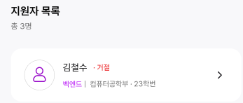
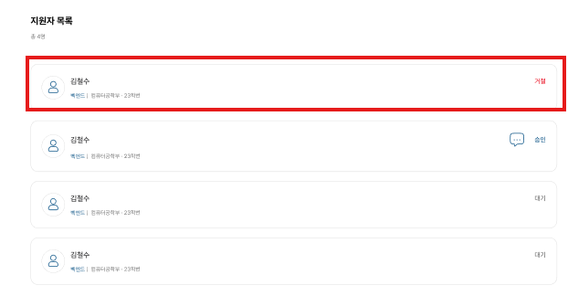
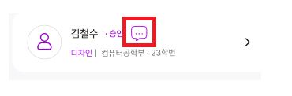
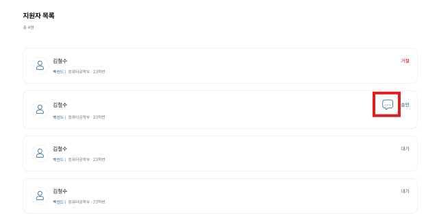
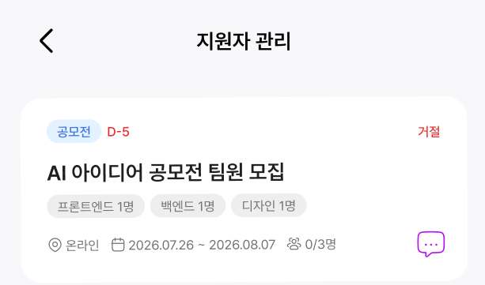
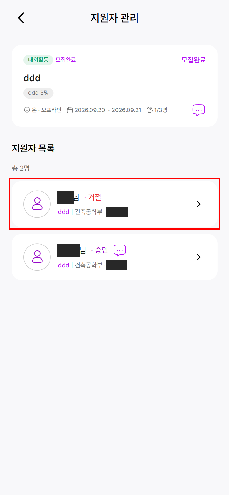
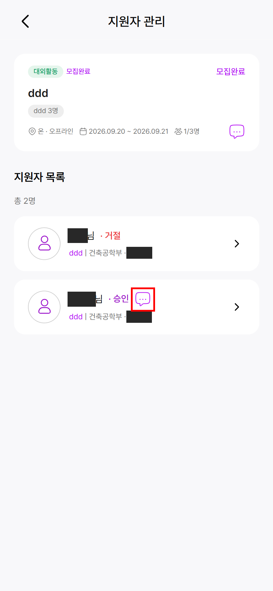
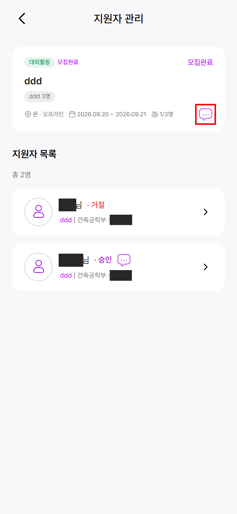

# 10. 지원자 관리

[← 팀원 모집 로깅 목록](README.md)

플랫폼: WEB · ANDROID · IOS  
원문 상태: 로깅 필요

과거 로깅·새 로깅과 각 참고사진은 원문의 구간별 연결을 유지합니다.

<!-- logging-section:past:start -->
## 과거 로깅

① 지원자 선택

- event\_label : team\_recruitment\_created\_post\_applicant\_select
- value : 지원자 선택
- event\_category : click

② 지원자 채팅 클릭

- event\_label : team\_recruitment\_created\_post\_applicant\_chat
- value : 채팅
- event\_category : click

1. 채팅 클릭

- event\_label : team\_recruitment\_created\_post\_chat
- value : 채팅
- event\_category : click

<!-- logging-section:past:end -->

<!-- logging-section:new:start -->
## 새 로깅

① 지원자 선택

- 설명: 지원자 관리 화면에서 지원자 카드를 클릭해 지원자 상세 화면으로 들어가는 경우
- screen\_view: <code>team_applicant</code>
- event\_name: <code>DA1</code>
- event\_label: <code>team_recruit__team_applicant__team_applicant_detail__entry__click</code>
- value: 지원자 선택
- event\_category: <code>click</code>

② 지원자 채팅 클릭

- 설명: 지원자 관리 화면에서 지원자 카드의 채팅 버튼을 클릭해 그 지원자와의 1:1 채팅방으로 들어가는 경우
- screen\_view: <code>team_applicant</code>
- event\_name: <code>DA1</code>
- event\_label: <code>team_recruit__team_applicant__chat_entry__applicant_entry__click</code>
- value: 채팅
- event\_category: <code>click</code>

1. 채팅 클릭

- 설명: 지원자 관리 화면에서 지원자 카드가 아닌 모집글 단위 채팅 버튼을 클릭해 팀 단체 채팅방으로 들어가는 경우 (확인 필요)
- screen\_view: <code>team_applicant</code>
- event\_name: <code>DA1</code>
- event\_label: <code>team_recruit__team_applicant__chat_entry__group_entry__click</code>
- value: 채팅
- event\_category: <code>click</code>

### 참고사진 (지원자 관리)

웹 사진은 전 이벤트 없음 (추가 필요).

① 지원자 선택

<b>웹</b>

<b>참고사진 · 웹</b>

웹 — 사진 없음 (추가 필요)

<b>모바일</b>

<b>참고사진 · 모바일</b>

모바일 — 지원자 선택 (출처: stage 실제 캡처, 빨간 네모 = 클릭 위치)

② 지원자 채팅 클릭

<b>웹</b>

<b>참고사진 · 웹</b>

웹 — 사진 없음 (추가 필요)

<b>모바일</b>

<b>참고사진 · 모바일</b>

모바일 — 지원자 채팅 (출처: stage 실제 캡처, 빨간 네모 = 클릭 위치)

1. 채팅 클릭

<b>웹</b>

<b>참고사진 · 웹</b>

웹 — 사진 없음 (추가 필요)

<b>모바일</b>

<b>참고사진 · 모바일</b>

모바일 — 모집글 그룹 채팅 (출처: stage 실제 캡처, 빨간 네모 = 클릭 위치)

<!-- logging-section:new:end -->

---

원문 정보

원본 ID: `4650221954bc83b4af7d81d008f943bf`  
[보존 원문](../../_archive/original/notion/pages/4650221954bc83b4af7d81d008f943bf.md)

