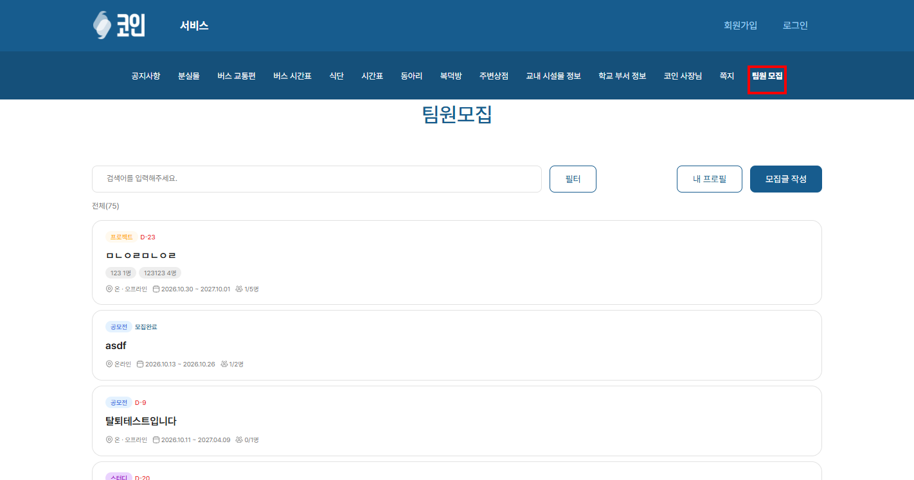

# 12. 헤더_팀원 모집 진입 (클릭) - 추가된 로깅

[← 팀원 모집 로깅 목록](README.md)

플랫폼: WEB  
원문 상태: 로깅 필요

과거 로깅·새 로깅과 각 참고사진은 원문의 구간별 연결을 유지합니다.

<!-- logging-section:past:start -->
## 과거 로깅

- 없음 (새로 추가한 로깅)

<!-- logging-section:past:end -->

<!-- logging-section:new:start -->
## 새 로깅

- 설명: 웹 상단 헤더의 서비스 메뉴에서 팀원 모집을 클릭해 팀원 모집 목록 화면으로 들어가는 경우
- screen\_view: <code>header</code>
- event\_name: <code>DA1</code>
- event\_label: <code>team_recruit__header__team_recruit_entry__header_entry__click</code>
- value: 팀원 모집
- event\_category: <code>click</code>

### 참고사진 (헤더 진입)

#### 웹

웹 — 헤더 팀원 모집 진입 (출처: stage 실제 캡처, 빨간 네모 = 클릭 위치)

모바일 — 해당 없음 (웹 전용)

<!-- logging-section:new:end -->

---

원문 정보

원본 ID: `de40221954bc8223a66e812c97bb4a45`  
[보존 원문](../../_archive/original/notion/pages/de40221954bc8223a66e812c97bb4a45.md)

