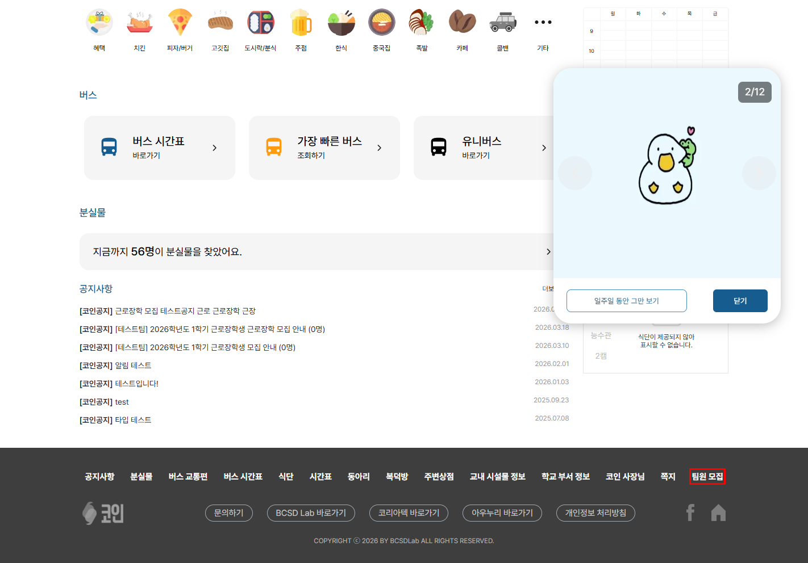

# 13. 푸터_팀원 모집 진입 (클릭) - 추가된 로깅

[← 팀원 모집 목록](README.md)

플랫폼: WEB  
원문 상태: 로깅 필요  
[Notion 기준 명세](https://app.notion.com/p/7c20221954bc82039a478153dc1ede22)  
원본 ID: `7c20221954bc82039a478153dc1ede22`

<!-- notion-body:start -->
## 과거 로깅

- 없음 (새로 추가한 로깅)

## 새 로깅

- 설명: 웹 하단 푸터의 메뉴에서 팀원 모집을 클릭해 팀원 모집 목록 화면으로 들어가는 경우
- screen\_view: <code>footer</code>
- event\_name: <code>DA1</code>
- event\_label: <code>team_recruit__footer__team_recruit_entry__footer_entry__click</code>
- value: 팀원 모집
- event\_category: <code>click</code>

### 참고사진 (푸터 진입)

<b>웹</b>

<b>참고사진 · 웹</b>

웹 — 푸터 팀원 모집 진입 (출처: stage 실제 캡처, 빨간 네모 = 클릭 위치)



<b>모바일</b>

<b>참고사진 · 모바일</b>

모바일 — 해당 없음 (웹 전용)
<!-- notion-body:end -->

<details>
<summary>Notion 원문 속성 전체</summary>

```json
{
  "platform": [
    "WEB"
  ],
  "url": "https://app.notion.com/p/7c20221954bc82039a478153dc1ede22",
  "구분": "네비게이션 바",
  "상태": "로깅 필요",
  "생성일": "2026-11-23T13:39:01.909Z",
  "이벤트 이름": "13. 푸터\\_팀원 모집 진입 (클릭) - 추가된 로깅"
}
```

</details>
