# 2-1. 필터 내부

[← 팀원 모집 로깅 목록](README.md)

플랫폼: WEB · ANDROID · IOS  
원문 상태: 로깅 필요

과거 로깅·새 로깅과 각 참고사진은 원문의 구간별 연결을 유지합니다.

<!-- logging-section:past:start -->
## 과거 로깅

① 모집 상태

- event\_label : team\_recruitment\_filter\_status
- value : \{전체 / 모집 중 / 모집 완료\} → 사용자가 선택한 값
- event\_category : “click”

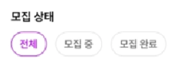

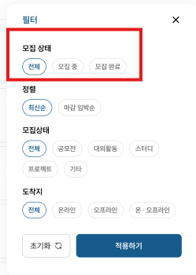

② 정렬

- event\_label : team\_recruitment\_filter\_sort
- value : \{최신순 / 마감 임박순\} → 사용자가 선택한 값
- event\_category : “click”

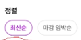

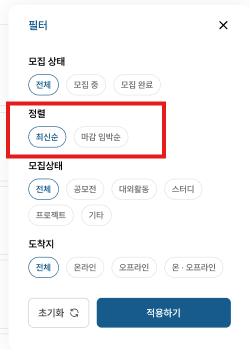

③ 카테고리

- event\_label : team\_recruitment\_filter\_category
- value : \{전체 / 공모전 / 대외활동 / 스터디 / 프로젝트 / 기타\} → 사용자가 선택한 값
- event\_category : “click”

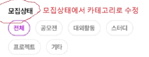

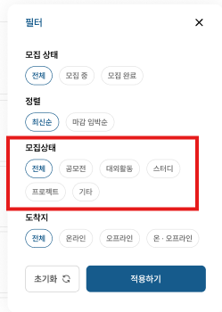

④ 진행 방식

- event\_label : team\_recruitment\_filter\_method
- value : \{전체 / 온라인 / 오프라인 / 온·오프라인\} → 사용자가 선택한 값
- event\_category : “click”

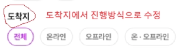

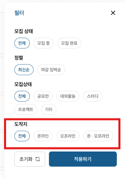

⑤ 필터 초기화

- event\_label : team\_recruitment\_filter\_reset
- value :  초기화
- event\_category : “click”

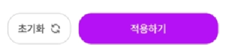

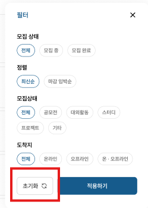

⑥ 필터 적용하기

- event\_label : team\_recruitment\_filter\_apply
- value : 적용하기
- event\_category : “click”

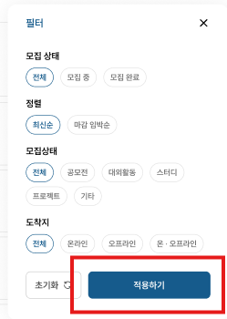

<!-- logging-section:past:end -->

<!-- logging-section:new:start -->
## 새 로깅

① 모집 상태

- 설명: 팀원 모집 목록 화면의 필터 팝업에서 모집 상태(전체 / 모집 중 / 모집 완료) 중 하나를 고르는 경우
- screen\_view: <code>team_list</code>
- event\_name: <code>DA1</code>
- event\_label: <code>team_recruit__team_list__filter__status__select</code>
- value: \{전체 / 모집 중 / 모집 완료\} (예: 모집 중)
- event\_category: <code>select</code>

② 정렬

- 설명: 필터 팝업에서 정렬(최신순 / 마감 임박순) 중 하나를 고르는 경우
- screen\_view: <code>team_list</code>
- event\_name: <code>DA1</code>
- event\_label: <code>team_recruit__team_list__filter__sort__select</code>
- value: \{최신순 / 마감 임박순\} (예: 마감 임박순)
- event\_category: <code>select</code>

③ 카테고리

- 설명: 필터 팝업에서 카테고리(전체 / 공모전 / 대외활동 / 스터디 / 프로젝트 / 기타) 중 하나를 고르는 경우
- screen\_view: <code>team_list</code>
- event\_name: <code>DA1</code>
- event\_label: <code>team_recruit__team_list__filter__category__select</code>
- value: \{전체 / 공모전 / 대외활동 / 스터디 / 프로젝트 / 기타\} (예: 공모전)
- event\_category: <code>select</code>

④ 진행 방식

- 설명: 필터 팝업에서 진행 방식(전체 / 온라인 / 오프라인 / 온·오프라인) 중 하나를 고르는 경우
- screen\_view: <code>team_list</code>
- event\_name: <code>DA1</code>
- event\_label: <code>team_recruit__team_list__filter__method__select</code>
- value: \{전체 / 온라인 / 오프라인 / 온·오프라인\} (예: 오프라인)
- event\_category: <code>select</code>

⑤ 필터 초기화

- 설명: 필터 팝업 하단의 초기화 버튼을 클릭해 선택한 필터를 모두 기본값으로 되돌리는 경우
- screen\_view: <code>team_list</code>
- event\_name: <code>DA1</code>
- event\_label: <code>team_recruit__team_list__filter__reset__click</code>
- value: 초기화
- event\_category: <code>click</code>

⑥ 필터 적용하기

- 설명: 필터 팝업 하단의 적용하기 버튼을 클릭해 고른 조건으로 모집글 목록을 다시 보여주는 경우
- screen\_view: <code>team_list</code>
- event\_name: <code>DA1</code>
- event\_label: <code>team_recruit__team_list__filter__apply__click</code>
- value: 적용하기
- event\_category: <code>click</code>

### 참고사진 (필터 내부)

① 모집 상태

웹 — 사진 없음 (추가 필요)

#### 모바일

모바일 — 모집 상태 (출처: stage 실제 캡처, 빨간 네모 = 클릭 위치)

② 정렬

웹 — 사진 없음 (추가 필요)

#### 모바일

모바일 — 정렬 (출처: stage 실제 캡처, 빨간 네모 = 클릭 위치)

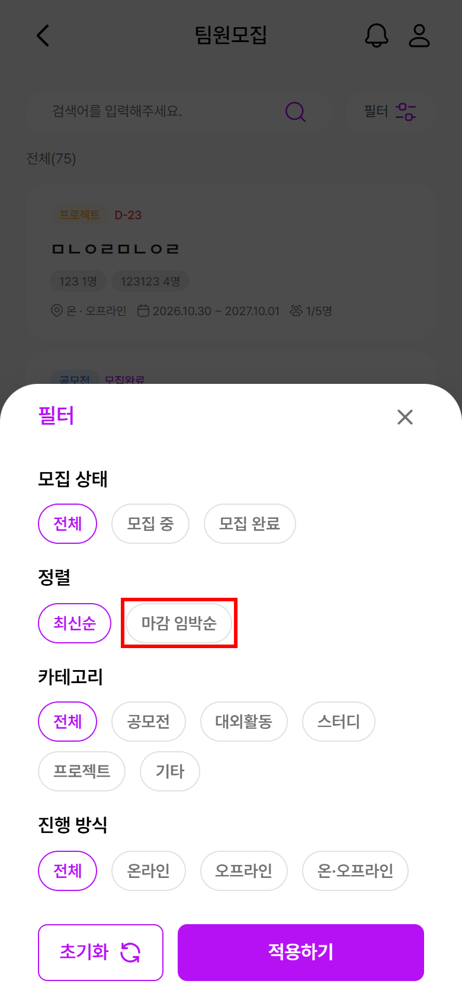

③ 카테고리

웹 — 사진 없음 (추가 필요)

#### 모바일

모바일 — 카테고리 (출처: stage 실제 캡처, 빨간 네모 = 클릭 위치)

④ 진행 방식

웹 — 사진 없음 (추가 필요)

#### 모바일

모바일 — 진행 방식 (출처: stage 실제 캡처, 빨간 네모 = 클릭 위치)

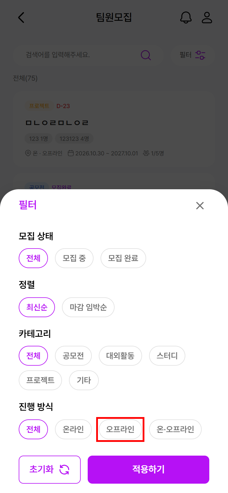

⑤ 필터 초기화

웹 — 사진 없음 (추가 필요)

#### 모바일

모바일 — 필터 초기화 (출처: stage 실제 캡처, 빨간 네모 = 클릭 위치)

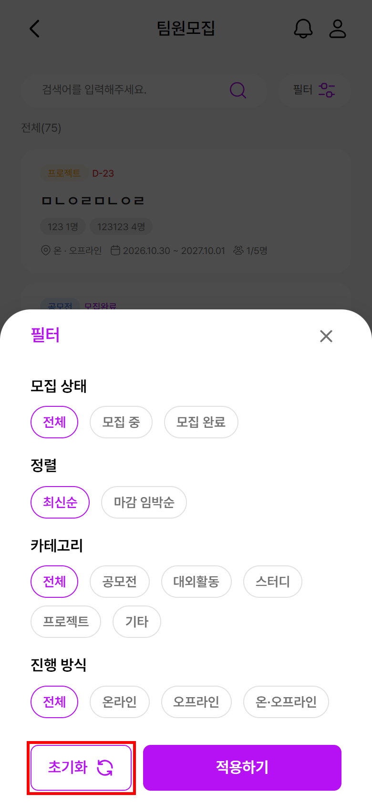

⑥ 필터 적용하기

웹 — 사진 없음 (추가 필요)

#### 모바일

모바일 — 필터 적용하기 (출처: stage 실제 캡처, 빨간 네모 = 클릭 위치)

<!-- logging-section:new:end -->

---

원문 정보

원본 ID: `c3e0221954bc82daaec581653168c8b2`  
[보존 원문](../../_archive/original/notion/pages/c3e0221954bc82daaec581653168c8b2.md)

