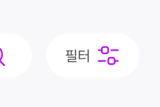
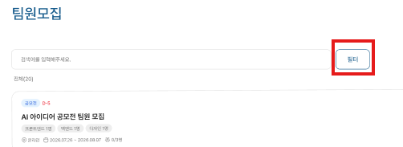

# 2. 필터 클릭

[← 팀원 모집 목록](README.md)

플랫폼: WEB, ANDROID, IOS  
원문 상태: 로깅 필요  
[Notion 기준 명세](https://app.notion.com/p/4560221954bc82e987e9014eb7180660)  
원본 ID: `4560221954bc82e987e9014eb7180660`

<!-- notion-body:start -->
## 과거 로깅

- event\_label : team\_recruitment\_filter
- value : 필터
- event\_category : “click”



## 새 로깅

- 설명: 팀원 모집 목록 화면에서 필터 버튼을 클릭해 필터 팝업(모집 상태 / 정렬 / 카테고리 / 진행 방식)을 여는 경우
- screen\_view: <code>team_list</code>
- event\_name: <code>DA1</code>
- event\_label: <code>team_recruit__team_list__filter__open__click</code>
- value: 필터
- event\_category: <code>click</code>

### 참고사진 (필터 클릭)

<b>웹</b>

<b>참고사진 · 웹</b>



<b>모바일</b>

<b>참고사진 · 모바일</b>

모바일 — 필터 클릭 (출처: stage 실제 캡처, 빨간 네모 = 클릭 위치)


<!-- notion-body:end -->

<details>
<summary>Notion 원문 속성 전체</summary>

```json
{
  "platform": [
    "WEB",
    "ANDROID",
    "IOS"
  ],
  "url": "https://app.notion.com/p/4560221954bc82e987e9014eb7180660",
  "구분": "모집글 검색 및 필터",
  "상태": "로깅 필요",
  "생성일": "2026-11-23T13:38:57.099Z",
  "이벤트 이름": "2. 필터 클릭"
}
```

</details>
