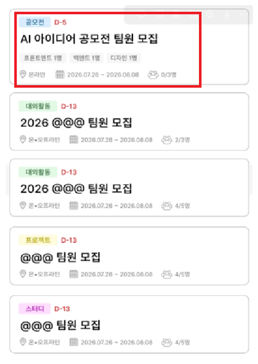
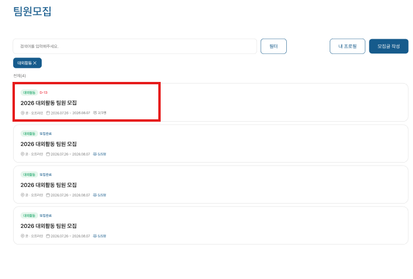
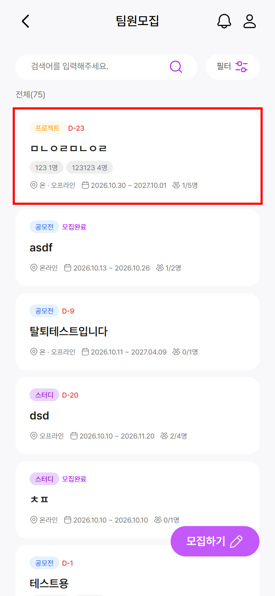

# 3. 게시글 클릭

[← 팀원 모집 목록](README.md)

플랫폼: WEB, ANDROID, IOS  
원문 상태: 로깅 필요  
[Notion 기준 명세](https://app.notion.com/p/2370221954bc82a1b076011989b2f7bb)  
원본 ID: `2370221954bc82a1b076011989b2f7bb`

<!-- notion-body:start -->
## 과거 로깅

- event\_label : team\_recruitment\_post\_select
- value : 사용자가 선택한 게시글 이름으로 나오게 해주세요
- event\_category : “click”





## 새 로깅

- 설명: 팀원 모집 목록 화면에서 모집글 카드를 클릭해 모집글 상세 화면(/team/recruitment/\{id\})으로 들어가는 경우
- screen\_view: <code>team_list</code>
- event\_name: <code>DA1</code>
- event\_label: <code>team_recruit__team_list__team_detail__entry__click</code>
- value: \{카테고리\}\_\{모집글 id\} (예: 프로젝트\_103)
- event\_category: <code>click</code>

### 참고사진 (게시글 클릭)

<b>웹</b>

<b>참고사진 · 웹</b>

웹 — 사진 없음 (추가 필요)

<b>모바일</b>

<b>참고사진 · 모바일</b>

모바일 — 게시글 클릭 (출처: stage 실제 캡처, 빨간 네모 = 클릭 위치)


<!-- notion-body:end -->

<details>
<summary>Notion 원문 속성 전체</summary>

```json
{
  "platform": [
    "WEB",
    "ANDROID",
    "IOS"
  ],
  "url": "https://app.notion.com/p/2370221954bc82a1b076011989b2f7bb",
  "구분": "모집글 검색 및 필터",
  "상태": "로깅 필요",
  "생성일": "2026-11-23T13:38:58.495Z",
  "이벤트 이름": "3. 게시글 클릭"
}
```

</details>
