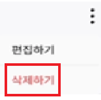
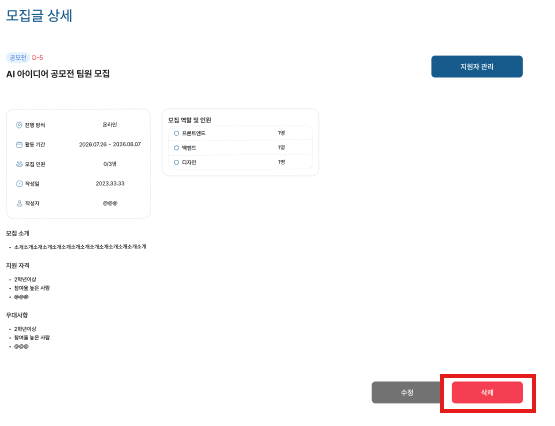
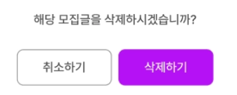
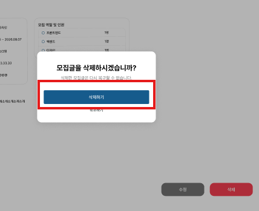
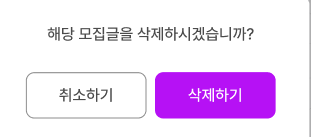
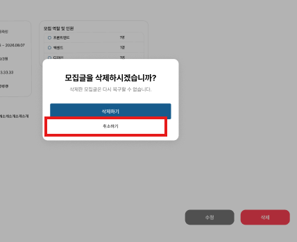
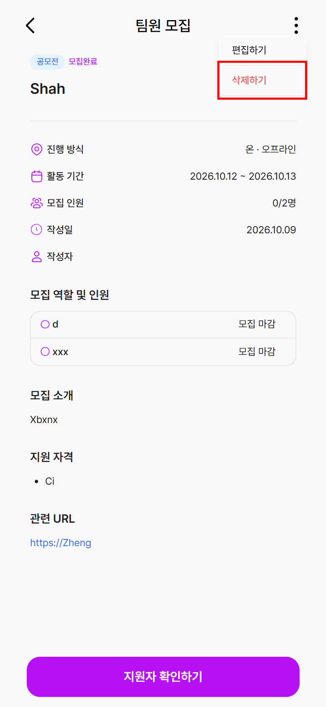

# 4-1. 모집글 상세 및 삭제

[← 팀원 모집 로깅 목록](README.md)

플랫폼: WEB · ANDROID · IOS  
원문 상태: 로깅 필요

과거 로깅·새 로깅과 각 참고사진은 원문의 구간별 연결을 유지합니다.

<!-- logging-section:past:start -->
## 이전 로깅

① 게시글 삭제 버튼 클릭

- event\_label : team\_recruitment\_post\_delete
- value : 삭제하기
- event\_category : click

② 게시글 삭제하기

- event\_label : team\_recruitment\_post\_delete\_confirm
- value : 삭제하기
- event\_category : click

③ 게시글 삭제 취소하기

- event\_label : team\_recruitment\_post\_delete\_cancel
- value : 취소하기
- event\_category : click

<!-- logging-section:past:end -->

<!-- logging-section:new:start -->
## 새 로깅 (26.10.17)

① 게시글 삭제 버튼 클릭

- 설명: 내가 작성한 모집글의 상세 화면에서 삭제 버튼을 클릭해 삭제 확인 팝업을 여는 경우
- screen\_view: <code>team_detail</code>
- event\_name: <code>DA1</code>
- event\_label: <code>team_recruit__team_detail__team_delete__open__click</code>
- value: 삭제하기
- event\_category: <code>click</code>

② 게시글 삭제하기

- 설명: 삭제 확인 팝업에서 삭제하기를 클릭해 모집글을 최종 삭제하는 경우
- screen\_view: <code>team_detail</code>
- event\_name: <code>DA1</code>
- event\_label: <code>team_recruit__team_detail__team_delete__confirm__click</code>
- value: 삭제하기
- event\_category: <code>click</code>

③ 게시글 삭제 취소하기

- 설명: 삭제 확인 팝업에서 취소하기를 클릭해 삭제하지 않고 팝업을 닫는 경우
- screen\_view: <code>team_detail</code>
- event\_name: <code>DA1</code>
- event\_label: <code>team_recruit__team_detail__team_delete__cancel__click</code>
- value: 취소하기
- event\_category: <code>click</code>

검토사항

- 통합 가이드·후속: 원문 (원문 ID: 4129ae650b598060bb4bdf347b7d4c7a)
- ② ③ 참고사진: 삭제 확인 팝업은 삭제하기를 눌러야 열려서, stage 데이터 보호를 위해 캡처하지 않음
- label DA2 기준 정렬 (2026-10-27): <code>team_recruit__team_detail__delete__click</code> → <code>team_recruit__team_detail__team_delete__open__click</code>
- label DA2 기준 정렬 (2026-10-27): <code>team_recruit__team_detail__delete__confirm__click</code> → <code>team_recruit__team_detail__team_delete__confirm__click</code>
- label DA2 기준 정렬 (2026-10-27): <code>team_recruit__team_detail__delete__cancel__click</code> → <code>team_recruit__team_detail__team_delete__cancel__click</code>
- ① 사진은 stage 로그인 상태, 우측 상단 ⋮ 메뉴를 연 상태. 사진 플랫폼 확인 완료 (이미지 비율 기준: 모바일, 780x1688). 웹 사진 추가 필요

① 게시글 삭제 버튼 클릭

참고사진 · 웹

웹 — 사진 없음 (추가 필요)

참고사진 · 모바일

모바일 — 삭제 버튼 (출처: stage 실제 캡처, 빨간 네모 = 클릭 위치)

② 게시글 삭제하기

참고사진 · 웹

웹 — 사진 없음 (추가 필요)

참고사진 · 모바일

모바일 — 사진 없음 (추가 필요)

③ 게시글 삭제 취소하기

참고사진 · 웹

웹 — 사진 없음 (추가 필요)

참고사진 · 모바일

모바일 — 사진 없음 (추가 필요)

<!-- logging-section:new:end -->

---

원문 정보

원본 ID: `8750221954bc82cab445818f102644d0`  
[보존 원문](../../_archive/original/notion/pages/8750221954bc82cab445818f102644d0.md)

