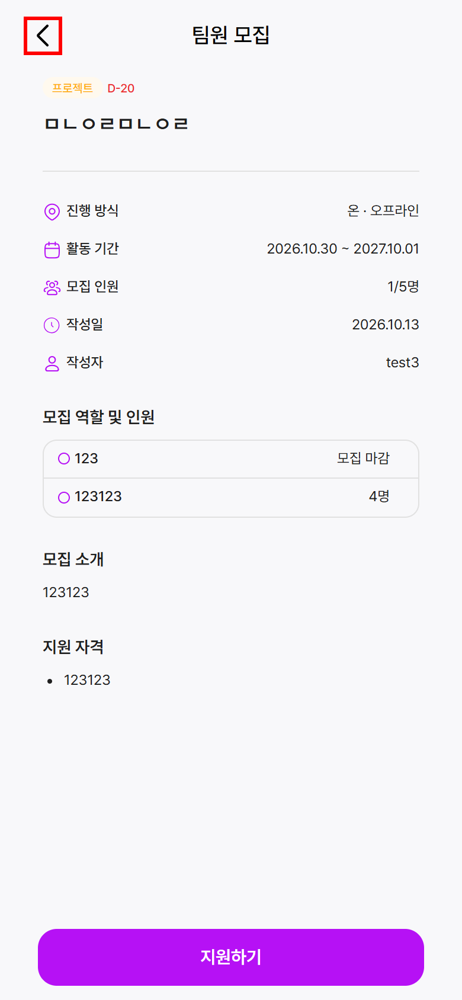

# 4-3. 모집글 상세_뒤로가기 (클릭) - 추가된 로깅

[← 팀원 모집 로깅 목록](README.md)

플랫폼: ANDROID · IOS  
원문 상태: 로깅 필요

과거 로깅·새 로깅과 각 참고사진은 원문의 구간별 연결을 유지합니다.

생성일: 2026년 11월 12일 오후 2:08
구분: 모집글 상세 지원자
상태: 로깅 필요
platform: ANDROID, IOS

<!-- logging-section:past:start -->
## 과거 로깅

- 없음 (새로 추가한 로깅)

<!-- logging-section:past:end -->

<!-- logging-section:new:start -->
## 새 로깅

- 설명: 모집글 상세 화면 왼쪽 위 뒤로가기(\<) 버튼을 클릭해 이전 화면(팀원 모집 목록 등)으로 돌아가는 경우
- screen\_view: `team_detail`
- event\_name: `DA1`
- event\_label: `team_recruit__team_detail__navigation__back__click`
- value: 뒤로가기
- event\_category: `click`

### 참고사진 (뒤로가기)

웹 — 해당 없음 (웹 상세 화면에 뒤로가기 버튼 없음)

#### 모바일

모바일 — 모집글 상세 뒤로가기 (출처: stage 실제 캡처, 빨간 네모 = 클릭 위치)

<!-- logging-section:new:end -->

---

원문 정보

원본 ID: `c8e0221954bc83c9b38881d86e381fb5`  
[보존 원문](../../_archive/original/notion/pages/c8e0221954bc83c9b38881d86e381fb5.md)

