# 5-1. 모집글 작성

[← 팀원 모집 로깅 목록](README.md)

플랫폼: WEB · ANDROID · IOS  
원문 상태: 로깅 필요

과거 로깅·새 로깅과 각 참고사진은 원문의 구간별 연결을 유지합니다.

<!-- logging-section:past:start -->
## 과거 로깅

① 카테고리 선택

- event\_label : team\_recruitment\_recruit\_category

- value : \{공모전 / 대외활동 / 스터디 / 프로젝트 / 기타\} 

- event\_category : “click”

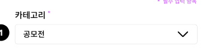

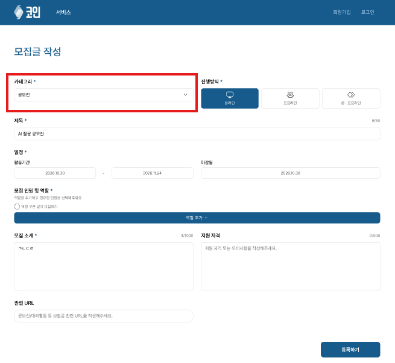

② 진행 방식 선택

- event\_label : team\_recruitment\_recruit\_method
- value : \{온라인 / 오프라인 / 온·오프라인\}
- event\_category : click

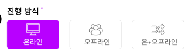

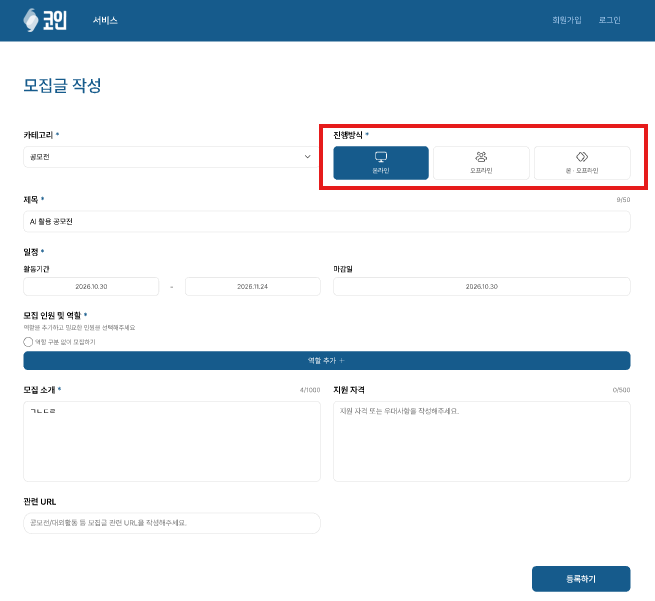

③ 역할 추가 / 역할 구분 없이 모집하기 버튼 클릭

- event\_label : team\_recruitment\_recruit\_role
- value : \{역할 구분 없이 모집하기 / 역할 추가\}
- event\_category : click

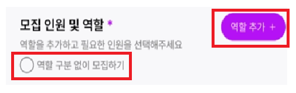

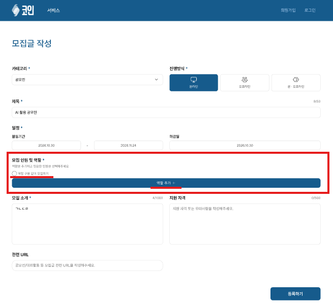

④ 등록하기

- event\_label : team\_recruitment\_recruit\_submit
- value : 등록하기
- event\_category : click

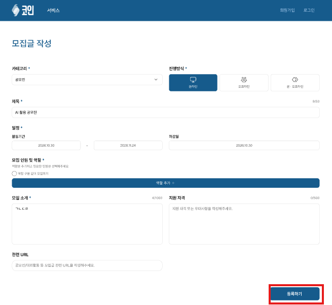

⑤ 등록 취소하기

- event\_label : team\_recruitment\_recruit\_submit\_cancel
- value : 취소하기
- event\_category : click

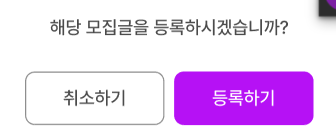

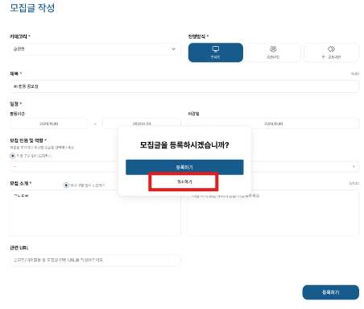

⑥ 등록하기

- event\_label : team\_recruitment\_recruit\_submit\_confirm
- value : 등록하기
- event\_category : click

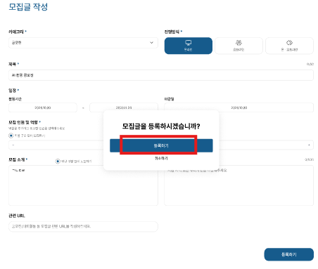

<!-- logging-section:past:end -->

<!-- logging-section:new:start -->
## 새 로깅

① 카테고리 선택

- 설명: 모집글 작성 화면에서 카테고리(공모전 / 대외활동 / 스터디 / 프로젝트 / 기타) 중 하나를 고르는 경우
- screen\_view: <code>team_write</code>
- event\_name: <code>DA1</code>
- event\_label: <code>team_recruit__team_write__team_write__category__select</code>
- value: \{공모전 / 대외활동 / 스터디 / 프로젝트 / 기타\} (예: 공모전)
- event\_category: <code>select</code>

② 진행 방식 선택

- 설명: 모집글 작성 화면에서 진행 방식(온라인 / 오프라인 / 온·오프라인) 중 하나를 고르는 경우
- screen\_view: <code>team_write</code>
- event\_name: <code>DA1</code>
- event\_label: <code>team_recruit__team_write__team_write__method__select</code>
- value: \{온라인 / 오프라인 / 온·오프라인\} (예: 오프라인)
- event\_category: <code>select</code>

③ 역할 추가 / 역할 구분 없이 모집하기 버튼 클릭

- 설명: 모집글 작성 화면의 모집 역할 영역에서 역할 추가 또는 역할 구분 없이 모집하기 버튼을 클릭하는 경우
- screen\_view: <code>team_write</code>
- event\_name: <code>DA1</code>
- event\_label: <code>team_recruit__team_write__team_write__role__click</code>
- value: \{역할 구분 없이 모집하기 / 역할 추가\} (예: 역할 추가)
- event\_category: <code>click</code>

④ 등록하기

- 설명: 모집글 작성 화면 하단의 등록하기 버튼을 클릭해 등록 확인 팝업을 여는 경우
- screen\_view: <code>team_write</code>
- event\_name: <code>DA1</code>
- event\_label: <code>team_recruit__team_write__team_write__open__click</code>
- value: 등록하기
- event\_category: <code>click</code>

⑤ 등록 취소하기

- 설명: 등록 확인 팝업에서 취소하기를 클릭해 팝업을 닫는 경우
- screen\_view: <code>team_write</code>
- event\_name: <code>DA1</code>
- event\_label: <code>team_recruit__team_write__team_write__cancel__click</code>
- value: 취소하기
- event\_category: <code>click</code>

⑥ 등록하기

- 설명: 등록 확인 팝업에서 등록하기를 클릭해 모집글을 최종 등록하는 경우
- screen\_view: <code>team_write</code>
- event\_name: <code>DA1</code>
- event\_label: <code>team_recruit__team_write__team_write__confirm__click</code>
- value: 등록하기
- event\_category: <code>click</code>

### 참고사진 (모집글 작성)

① 카테고리 선택

<b>웹</b>

<b>참고사진 · 웹</b>

웹 — 사진 없음 (추가 필요)

<b>모바일</b>

<b>참고사진 · 모바일</b>

모바일 — 카테고리 선택 (출처: stage 실제 캡처, 빨간 네모 = 클릭 위치)

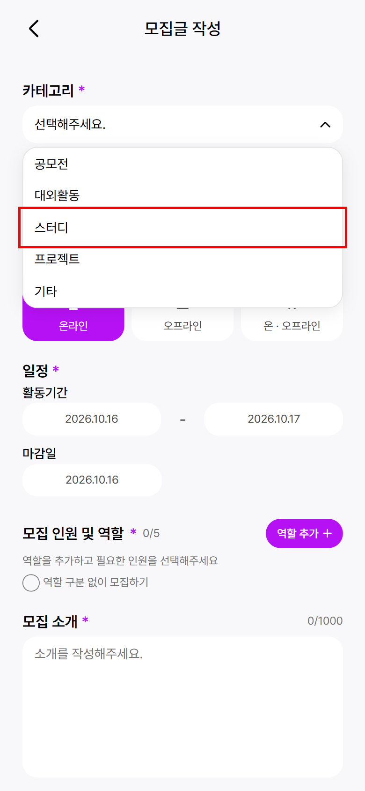

② 진행 방식 선택

<b>웹</b>

<b>참고사진 · 웹</b>

웹 — 사진 없음 (추가 필요)

<b>모바일</b>

<b>참고사진 · 모바일</b>

모바일 — 진행 방식 선택 (출처: stage 실제 캡처, 빨간 네모 = 클릭 위치)

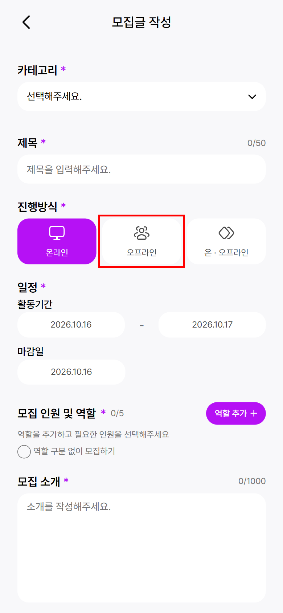

③ 역할 추가 / 역할 구분 없이 모집하기 버튼 클릭

<b>웹</b>

<b>참고사진 · 웹</b>

웹 — 사진 없음 (추가 필요)

<b>모바일</b>

<b>참고사진 · 모바일</b>

모바일 — 역할 (출처: stage 실제 캡처, 빨간 네모 = 클릭 위치)

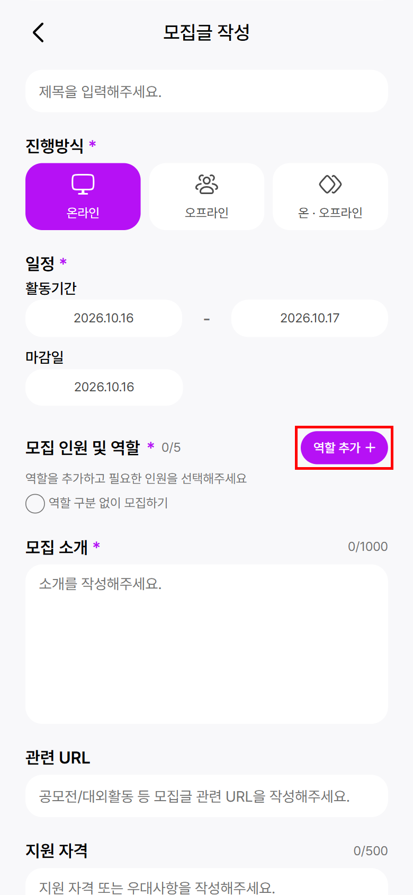

④ 등록하기

<b>웹</b>

<b>참고사진 · 웹</b>

웹 — 사진 없음 (추가 필요)

<b>모바일</b>

<b>참고사진 · 모바일</b>

모바일 — 등록하기 (출처: stage 실제 캡처, 빨간 네모 = 클릭 위치)

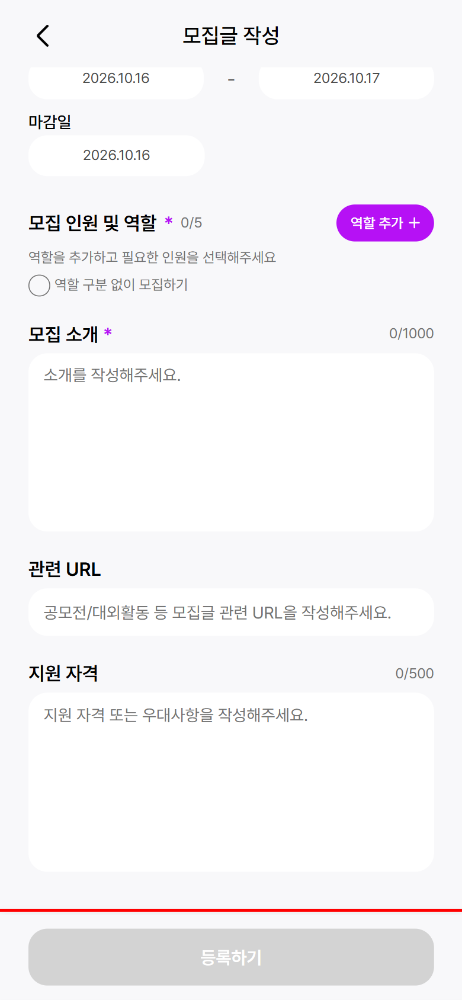

⑤ 등록 취소하기

<b>웹</b>

<b>참고사진 · 웹</b>

웹 — 사진 없음 (추가 필요)

<b>모바일</b>

<b>참고사진 · 모바일</b>

모바일 — 사진 없음 (추가 필요)

⑥ 등록하기

<b>웹</b>

<b>참고사진 · 웹</b>

웹 — 사진 없음 (추가 필요)

<b>모바일</b>

<b>참고사진 · 모바일</b>

모바일 — 사진 없음 (추가 필요)

<!-- logging-section:new:end -->

---

원문 정보

원본 ID: `6640221954bc83aba31b81721c46ebd7`  
[보존 원문](../../_archive/original/notion/pages/6640221954bc83aba31b81721c46ebd7.md)

