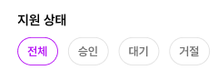
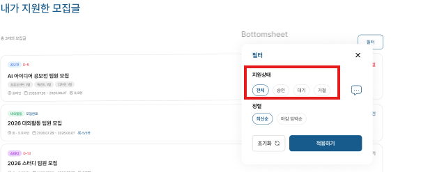
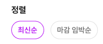
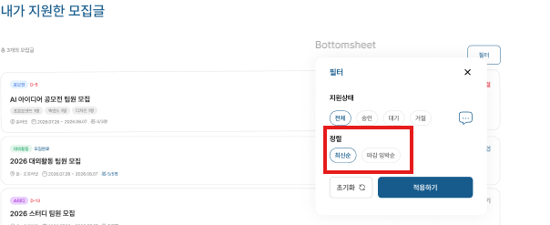
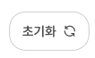
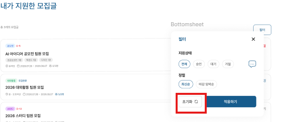
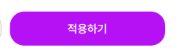
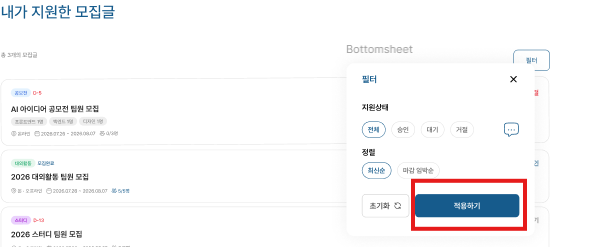
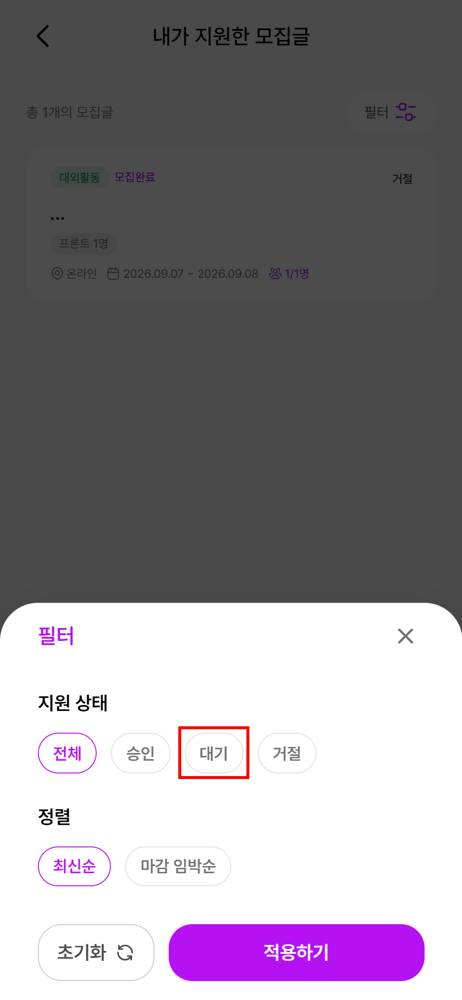
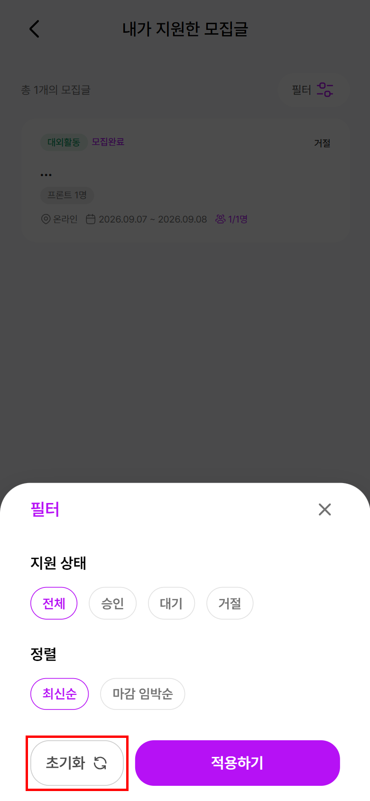

# 8-1. 필터 내부

[← 팀원 모집 로깅 목록](README.md)

플랫폼: WEB · ANDROID · IOS  
원문 상태: 로깅 필요

과거 로깅·새 로깅과 각 참고사진은 원문의 구간별 연결을 유지합니다.

<!-- logging-section:past:start -->
## 과거 로깅

① 지원 상태 선택

- event\_label : team\_recruitment\_applied\_post\_filter\_status
- value : \{전체 / 승인 / 대기 / 거절\}
- event\_category : click

② 정렬 방식 선택

- event\_label : team\_recruitment\_applied\_post\_filter\_sort
- value : \{최신순 / 마감 임박순\}
- event\_category : click

③ 필터 초기화

- event\_label : team\_recruitment\_applied\_post\_filter\_reset
- value : 초기화
- event\_category : click

④ 필터 적용

- event\_label : team\_recruitment\_applied\_post\_filter\_apply
- value : 적용하기
- event\_category : click

<!-- logging-section:past:end -->

<!-- logging-section:new:start -->
## 새 로깅

① 지원 상태 선택

- 설명: 내가 지원한 모집글 화면의 필터 팝업에서 지원 상태(전체 / 승인 / 대기 / 거절) 중 하나를 고르는 경우
- screen\_view: <code>team_applied</code>
- event\_name: <code>DA1</code>
- event\_label: <code>team_recruit__team_applied__filter__status__select</code>
- value: \{전체 / 승인 / 대기 / 거절\} (예: 대기)
- event\_category: <code>select</code>

② 정렬 방식 선택

- 설명: 내가 지원한 모집글 화면의 필터 팝업에서 정렬(최신순 / 마감 임박순) 중 하나를 고르는 경우
- screen\_view: <code>team_applied</code>
- event\_name: <code>DA1</code>
- event\_label: <code>team_recruit__team_applied__filter__sort__select</code>
- value: \{최신순 / 마감 임박순\} (예: 최신순)
- event\_category: <code>select</code>

③ 필터 초기화

- 설명: 내가 지원한 모집글 화면의 필터 팝업에서 초기화 버튼을 클릭하는 경우
- screen\_view: <code>team_applied</code>
- event\_name: <code>DA1</code>
- event\_label: <code>team_recruit__team_applied__filter__reset__click</code>
- value: 초기화
- event\_category: <code>click</code>

④ 필터 적용

- 설명: 내가 지원한 모집글 화면의 필터 팝업에서 적용하기를 클릭해 목록을 다시 보여주는 경우
- screen\_view: <code>team_applied</code>
- event\_name: <code>DA1</code>
- event\_label: <code>team_recruit__team_applied__filter__apply__click</code>
- value: 적용하기
- event\_category: <code>click</code>

### 참고사진 (내가 지원한 모집글 필터 내부)

웹 사진은 전 이벤트 없음 (추가 필요).

① 지원 상태 선택

웹 — 사진 없음 (추가 필요)

#### 모바일

모바일 — 지원 상태 선택 (출처: stage 실제 캡처, 빨간 네모 = 클릭 위치)

② 정렬 방식 선택

웹 — 사진 없음 (추가 필요)

#### 모바일

모바일 — 정렬 방식 선택 (출처: stage 실제 캡처, 빨간 네모 = 클릭 위치)

③ 필터 초기화

웹 — 사진 없음 (추가 필요)

#### 모바일

모바일 — 필터 초기화 (출처: stage 실제 캡처, 빨간 네모 = 클릭 위치)

④ 필터 적용

웹 — 사진 없음 (추가 필요)

#### 모바일

모바일 — 필터 적용 (출처: stage 실제 캡처, 빨간 네모 = 클릭 위치)

<!-- logging-section:new:end -->

---

원문 정보

원본 ID: `ec10221954bc83f2b19a010b66c7868c`  
[보존 원문](../../_archive/original/notion/pages/ec10221954bc83f2b19a010b66c7868c.md)

