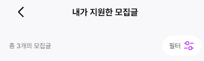
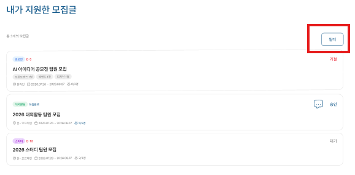
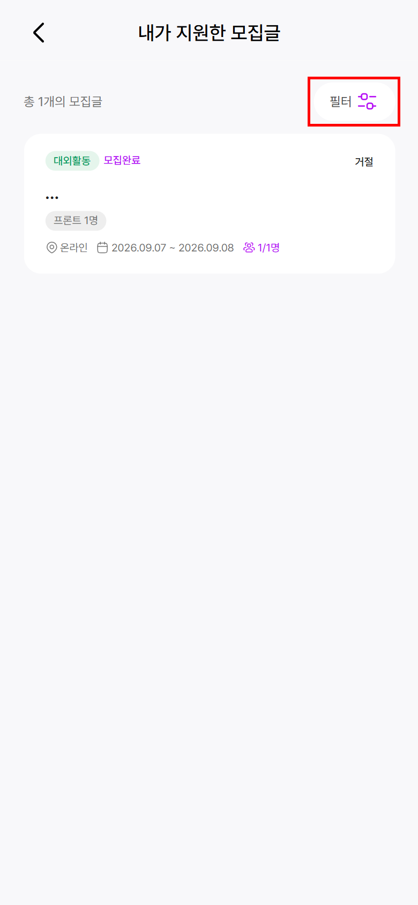

# 8. 필터 클릭

[← 팀원 모집 로깅 목록](README.md)

플랫폼: WEB · ANDROID · IOS  
원문 상태: 로깅 필요

과거 로깅·새 로깅과 각 참고사진은 원문의 구간별 연결을 유지합니다.

<!-- logging-section:past:start -->
## 과거 로깅

- event\_label : team\_recruitment\_applied\_post\_filter
- value : 필터
- event\_category : click

<!-- logging-section:past:end -->

<!-- logging-section:new:start -->
## 새 로깅

- 설명: 내가 지원한 모집글 화면에서 필터 버튼을 클릭해 필터 팝업(지원 상태 / 정렬)을 여는 경우
- screen\_view: <code>team_applied</code>
- event\_name: <code>DA1</code>
- event\_label: <code>team_recruit__team_applied__filter__open__click</code>
- value: 필터
- event\_category: <code>click</code>

### 참고사진 (필터 클릭)

<b>웹</b>

<b>참고사진 · 웹</b>

웹 — 사진 없음 (추가 필요)

<b>모바일</b>

<b>참고사진 · 모바일</b>

모바일 — 내가 지원한 모집글 필터 클릭 (출처: stage 실제 캡처, 빨간 네모 = 클릭 위치)

<!-- logging-section:new:end -->

---

원문 정보

원본 ID: `03b0221954bc8223943c01a21779d79b`  
[보존 원문](../../_archive/original/notion/pages/03b0221954bc8223943c01a21779d79b.md)

