# 9-1. 필터 클릭 및 내부

[← 팀원 모집 로깅 목록](README.md)

플랫폼: WEB · ANDROID · IOS  
원문 상태: 로깅 필요

과거 로깅·새 로깅과 각 참고사진은 원문의 구간별 연결을 유지합니다.

<!-- logging-section:past:start -->
## 과거 로깅

① 필터 버튼 클릭

- event\_label : team\_recruitment\_created\_post\_filter
- value : 필터
- event\_category : click

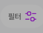

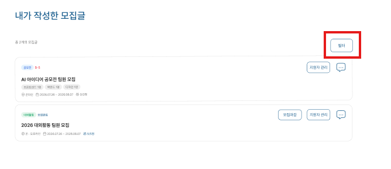

② 모집 상태 선택

- event\_label : team\_recruitment\_created\_post\_filter\_status
- value : \{전체 / 모집 중 / 모집 마감\}
- event\_category : click

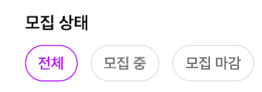

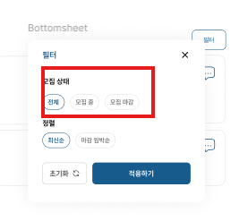

③ 정렬 방식 선택

- event\_label : team\_recruitment\_created\_post\_filter\_sort
- value : \{최신순 / 마감 임박순\}
- event\_category : click

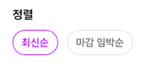

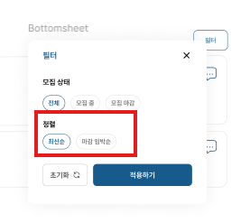

④ 필터 초기화

- event\_label : team\_recruitment\_created\_post\_filter\_reset
- value : 초기화
- event\_category : click

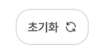

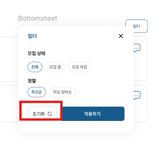

⑤ 필터 적용

- event\_label : team\_recruitment\_created\_post\_filter\_apply
- value : 적용하기
- event\_category : click

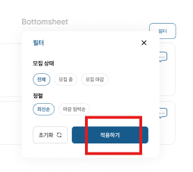

<!-- logging-section:past:end -->

<!-- logging-section:new:start -->
## 새 로깅

① 필터 버튼 클릭

- 설명: 내가 작성한 모집글 화면에서 필터 버튼을 클릭해 필터 팝업(모집 상태 / 정렬)을 여는 경우
- screen\_view: <code>team_created</code>
- event\_name: <code>DA1</code>
- event\_label: <code>team_recruit__team_created__filter__open__click</code>
- value: 필터
- event\_category: <code>click</code>

② 모집 상태 선택

- 설명: 내가 작성한 모집글 화면의 필터 팝업에서 모집 상태(전체 / 모집 중 / 모집 마감) 중 하나를 고르는 경우
- screen\_view: <code>team_created</code>
- event\_name: <code>DA1</code>
- event\_label: <code>team_recruit__team_created__filter__status__select</code>
- value: \{전체 / 모집 중 / 모집 마감\} (예: 모집 중)
- event\_category: <code>select</code>

③ 정렬 방식 선택

- 설명: 내가 작성한 모집글 화면의 필터 팝업에서 정렬(최신순 / 마감 임박순) 중 하나를 고르는 경우
- screen\_view: <code>team_created</code>
- event\_name: <code>DA1</code>
- event\_label: <code>team_recruit__team_created__filter__sort__select</code>
- value: \{최신순 / 마감 임박순\} (예: 마감 임박순)
- event\_category: <code>select</code>

④ 필터 초기화

- 설명: 내가 작성한 모집글 화면의 필터 팝업에서 초기화 버튼을 클릭하는 경우
- screen\_view: <code>team_created</code>
- event\_name: <code>DA1</code>
- event\_label: <code>team_recruit__team_created__filter__reset__click</code>
- value: 초기화
- event\_category: <code>click</code>

⑤ 필터 적용

- 설명: 내가 작성한 모집글 화면의 필터 팝업에서 적용하기를 클릭해 목록을 다시 보여주는 경우
- screen\_view: <code>team_created</code>
- event\_name: <code>DA1</code>
- event\_label: <code>team_recruit__team_created__filter__apply__click</code>
- value: 적용하기
- event\_category: <code>click</code>

### 참고사진 (내가 작성한 모집글 필터)

웹 사진은 전 이벤트 없음 (추가 필요).

① 필터 버튼 클릭

<b>웹</b>

<b>참고사진 · 웹</b>

웹 — 사진 없음 (추가 필요)

<b>모바일</b>

<b>참고사진 · 모바일</b>

모바일 — 필터 버튼 (출처: stage 실제 캡처, 빨간 네모 = 클릭 위치)

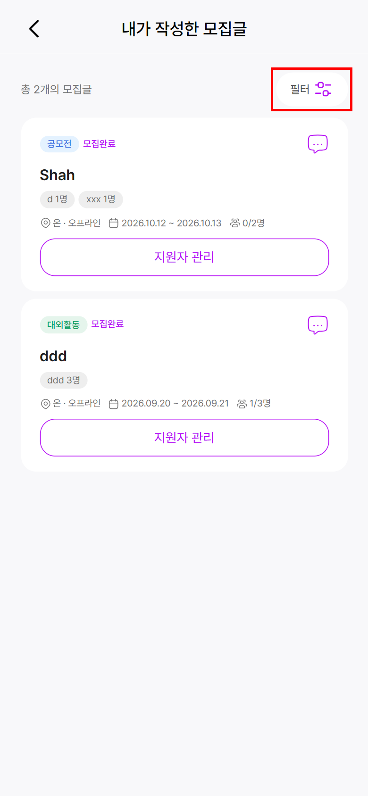

② 모집 상태 선택

<b>웹</b>

<b>참고사진 · 웹</b>

웹 — 사진 없음 (추가 필요)

<b>모바일</b>

<b>참고사진 · 모바일</b>

모바일 — 모집 상태 선택 (출처: stage 실제 캡처, 빨간 네모 = 클릭 위치)

③ 정렬 방식 선택

<b>웹</b>

<b>참고사진 · 웹</b>

웹 — 사진 없음 (추가 필요)

<b>모바일</b>

<b>참고사진 · 모바일</b>

모바일 — 정렬 방식 선택 (출처: stage 실제 캡처, 빨간 네모 = 클릭 위치)

④ 필터 초기화

<b>웹</b>

<b>참고사진 · 웹</b>

웹 — 사진 없음 (추가 필요)

<b>모바일</b>

<b>참고사진 · 모바일</b>

모바일 — 필터 초기화 (출처: stage 실제 캡처, 빨간 네모 = 클릭 위치)

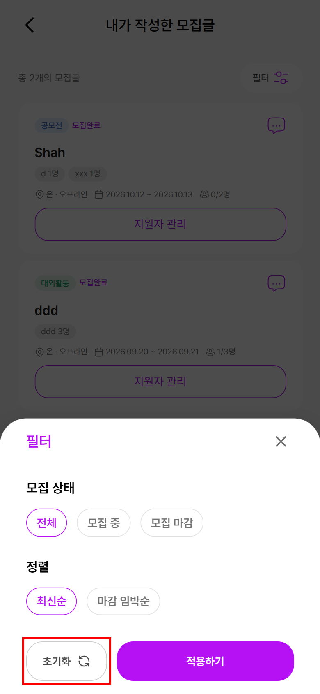

⑤ 필터 적용

<b>웹</b>

<b>참고사진 · 웹</b>

웹 — 사진 없음 (추가 필요)

<b>모바일</b>

<b>참고사진 · 모바일</b>

모바일 — 필터 적용 (출처: stage 실제 캡처, 빨간 네모 = 클릭 위치)

<!-- logging-section:new:end -->

---

원문 정보

원본 ID: `7170221954bc83eb96ac011d9e6a6b7c`  
[보존 원문](../../_archive/original/notion/pages/7170221954bc83eb96ac011d9e6a6b7c.md)

