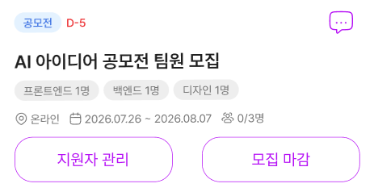
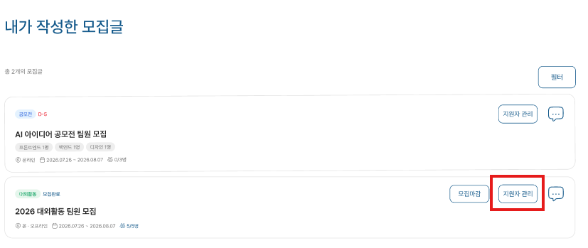
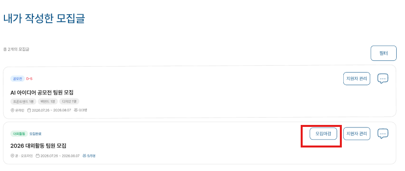
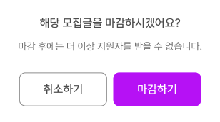
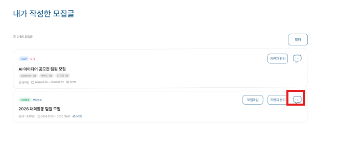
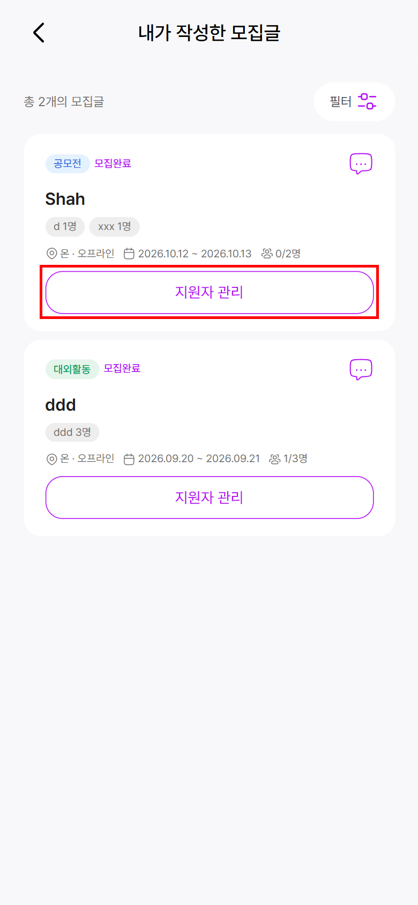
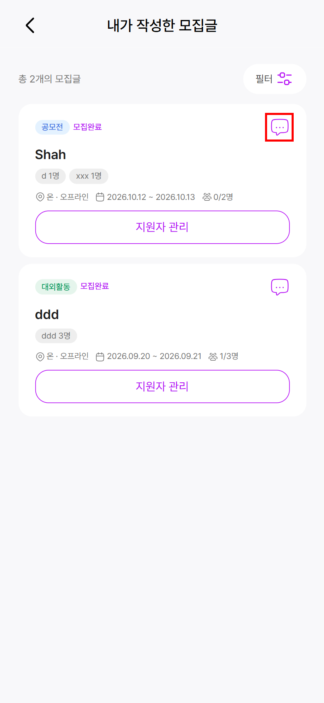

# 9. 내가 작성한 모집글

[← 팀원 모집 목록](README.md)

플랫폼: WEB, ANDROID, IOS  
원문 상태: 로깅 필요  
[Notion 기준 명세](https://app.notion.com/p/e940221954bc8341a1eb818608f79a6d)  
원본 ID: `e940221954bc8341a1eb818608f79a6d`

<!-- notion-body:start -->
## 과거 로깅

① 지원자 관리 클릭

- event\_label : team\_recruitment\_created\_post\_applicant
- value : 사용자가 선택한 모집글 이름
- event\_category : click





② 모집 마감 버튼 클릭

- event\_label : team\_recruitment\_created\_post\_close
- value : 사용자가 마감하려는 모집글 이름
- event\_category : click




③ 모집 마감 취소

- <b> web 로깅 X </b>
  - → 디자인이 없어서 사진 첨부를 못했습니다 기능을 구현하게 된다면 로깅 심어주시면 감사하겠습니다!
- event\_label : team\_recruitment\_created\_post\_close\_cancel
- value : 취소하기
- event\_category : click



④ 모집 마감 확인 

- <b>web 로깅 X </b>
  - → 디자인이 없어서 사진 첨부를 못했습니다 기능을 구현하게 된다면 로깅 심어주시면 감사하겠습니다!
- event\_label : team\_recruitment\_created\_post\_close\_confirm
- value : 마감하기
- event\_category : click


⑤ 채팅 클릭

- event\_label : team\_recruitment\_created\_post\_chat
- value : 사용자가 채팅을 선택한 모집글 이름
- event\_category : click




## 새 로깅

① 지원자 관리 클릭

- 설명: 내가 작성한 모집글 화면에서 모집글 카드의 지원자 관리 버튼을 클릭해 지원자 관리 화면으로 들어가는 경우
- screen\_view: <code>team_created</code>
- event\_name: <code>DA1</code>
- event\_label: <code>team_recruit__team_created__team_applicant__entry__click</code>
- value: \{카테고리\}\_\{모집글 id\} (예: 프로젝트\_103)
- event\_category: <code>click</code>

② 모집 마감 버튼 클릭

- 설명: 내가 작성한 모집글 화면에서 모집 마감 버튼을 클릭하는 경우 (mobile은 마감 확인 팝업이 뜸)
- screen\_view: <code>team_created</code>
- event\_name: <code>DA1</code>
- event\_label: <code>team_recruit__team_created__team_deadline__open__click</code>
- value: \{카테고리\}\_\{모집글 id\} (예: 프로젝트\_103)
- event\_category: <code>click</code>

③ 모집 마감 취소

- 설명: 모집 마감 확인 팝업에서 취소하기를 클릭해 마감하지 않고 닫는 경우
- screen\_view: <code>team_created</code>
- event\_name: <code>DA1</code>
- event\_label: <code>team_recruit__team_created__team_deadline__cancel__click</code>
- value: 취소하기
- event\_category: <code>click</code>

④ 모집 마감 확인

- 설명: 모집 마감 확인 팝업에서 마감하기를 클릭해 모집글을 최종 마감하는 경우
- screen\_view: <code>team_created</code>
- event\_name: <code>DA1</code>
- event\_label: <code>team_recruit__team_created__team_deadline__confirm__click</code>
- value: 마감하기
- event\_category: <code>click</code>

⑤ 채팅 클릭

- 설명: 내가 작성한 모집글 화면에서 모집글 카드의 채팅 버튼을 클릭해 채팅방으로 들어가는 경우
- screen\_view: <code>team_created</code>
- event\_name: <code>DA1</code>
- event\_label: <code>team_recruit__team_created__chat_entry__entry__click</code>
- value: \{카테고리\}\_\{모집글 id\} (예: 프로젝트\_103)
- event\_category: <code>click</code>

### 참고사진 (내가 작성한 모집글)

① 지원자 관리 클릭

<b>웹</b>

<b>참고사진 · 웹</b>

웹 — 사진 없음 (추가 필요)

<b>모바일</b>

<b>참고사진 · 모바일</b>

모바일 — 지원자 관리 (출처: stage 실제 캡처, 빨간 네모 = 클릭 위치)



② 모집 마감 버튼 클릭

<b>웹</b>

<b>참고사진 · 웹</b>

웹 — 사진 없음 (추가 필요)

<b>모바일</b>

<b>참고사진 · 모바일</b>

모바일 — 사진 없음 (추가 필요)

③ 모집 마감 취소

<b>웹</b>

<b>참고사진 · 웹</b>

웹 — 해당 없음 (디자인 없음)

<b>모바일</b>

<b>참고사진 · 모바일</b>

모바일 — 사진 없음 (추가 필요)

④ 모집 마감 확인

<b>웹</b>

<b>참고사진 · 웹</b>

웹 — 해당 없음 (디자인 없음)

<b>모바일</b>

<b>참고사진 · 모바일</b>

모바일 — 사진 없음 (추가 필요)

⑤ 채팅 클릭

<b>웹</b>

<b>참고사진 · 웹</b>

웹 — 사진 없음 (추가 필요)

<b>모바일</b>

<b>참고사진 · 모바일</b>

모바일 — 채팅 클릭 (출처: stage 실제 캡처, 빨간 네모 = 클릭 위치)


<!-- notion-body:end -->

<details>
<summary>Notion 원문 속성 전체</summary>

```json
{
  "platform": [
    "WEB",
    "ANDROID",
    "IOS"
  ],
  "url": "https://app.notion.com/p/e940221954bc8341a1eb818608f79a6d",
  "구분": "내가 작성한 모집글",
  "상태": "로깅 필요",
  "생성일": "2026-11-23T13:38:57.594Z",
  "이벤트 이름": "9. 내가 작성한 모집글"
}
```

</details>
