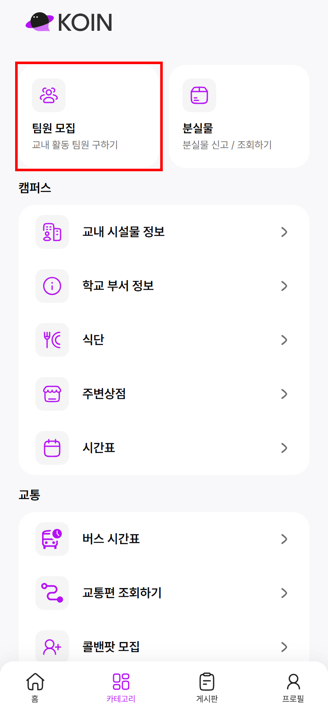

# [레거시·중복 원문] 14. 카테고리_팀원 모집 진입 (클릭) - 추가된 로깅

[← 팀원 모집 로깅 목록](README.md)

플랫폼: ANDROID · IOS  
원문 상태: 로깅 필요

과거 로깅·새 로깅과 각 참고사진은 원문의 구간별 연결을 유지합니다.

<!-- logging-section:past:start -->
## 과거 로깅

- 없음 (새로 추가한 로깅)
- 설명: 하단 네비게이션바 카테고리 화면에서 팀원 모집을 클릭해 팀원 모집 목록 화면으로 들어가는 경우
- screen\_view: <code>main_category</code>
- event\_name: <code>DA2</code>
- event\_label: <code>team_recruit__main_category__category_navigation__team_recruit_entry__click</code>
- value: 팀원 모집
- event\_category: <code>click</code>

### 참고사진 (카테고리 진입)

<b>웹</b>

<b>참고사진 · 웹</b>

웹 — 해당 없음 (모바일 웹은 /category 화면에서 동일)

<b>모바일</b>

<b>참고사진 · 모바일</b>

모바일 — 카테고리 팀원 모집 진입 (출처: stage 실제 캡처, 빨간 네모 = 클릭 위치)

<!-- logging-section:past:end -->

<!-- logging-section:new:start -->
## 새 로깅

레거시. [3-6 카테고리 내부 클릭 (현재 로깅) 2026.08.30 이후 찍히는 로깅](../10-%ED%99%88%ED%99%94%EB%A9%B4-%EB%A6%AC%EB%94%94%EC%9E%90%EC%9D%B8/3-6-%EC%B9%B4%ED%85%8C%EA%B3%A0%EB%A6%AC-%EB%82%B4%EB%B6%80-%ED%81%B4%EB%A6%AD-%28%ED%98%84%EC%9E%AC-%EB%A1%9C%EA%B9%85%29-2026.08.30-%EC%9D%B4%ED%9B%84-%EC%B0%8D%ED%9E%88%EB%8A%94-%EB%A1%9C%EA%B9%85.md)를 따른다.

<!-- logging-section:new:end -->

---

원문 정보

원본 ID: `2ff0221954bc82aebf2301a1efaabcdf`  
[보존 원문](../../_archive/original/notion/pages/2ff0221954bc82aebf2301a1efaabcdf.md)

