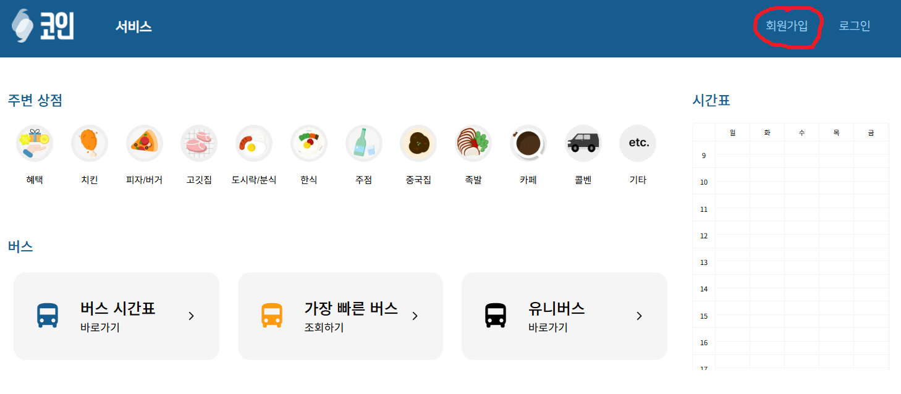

# 1-1 회원가입 진입(클릭)

[← 로그인/회원가입/정보수정 - 레거시 목록](README.md)

플랫폼: WEB  
원문 상태: 완료  
[Notion 기준 명세](https://app.notion.com/p/73a0221954bc82cda2a7812ab5d6a959)  
원본 ID: `73a0221954bc82cda2a7812ab5d6a959`

<!-- notion-body:start -->
## 과거 로깅

- event\_label : “header”
- value : “회원가입 시작<b>”</b>
- event\_category : “click”



## 새 로깅

- 레거시: V1 명세. 새 로깅은 V2 페이지로 대체한다.
- 대체 로깅: [1-1 헤더_회원가입진입(클릭)](https://app.notion.com/p/9ea0221954bc833b95ea01aebe168ff5) (<code>account__header__sign_up__header_entry__click</code>)
<!-- notion-body:end -->

<details>
<summary>Notion 원문 속성 전체</summary>

```json
{
  "platform": [
    "WEB"
  ],
  "url": "https://app.notion.com/p/73a0221954bc82cda2a7812ab5d6a959",
  "상태": "완료",
  "생성일": "2026-11-23T13:39:14.689Z",
  "이벤트 이름": "1-1 회원가입 진입(클릭)",
  "태그": [
    "로그아웃"
  ]
}
```

</details>
