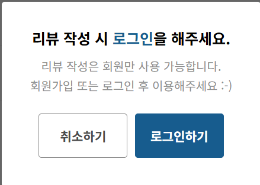
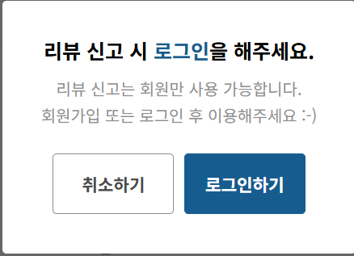
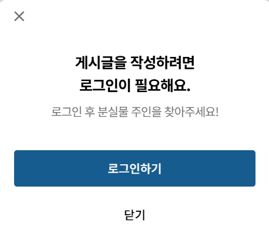
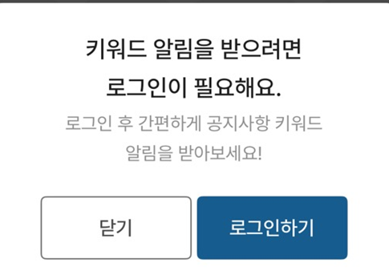
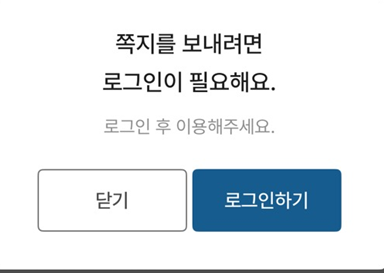
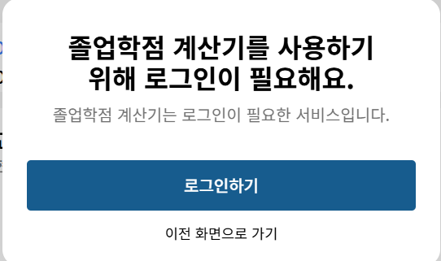
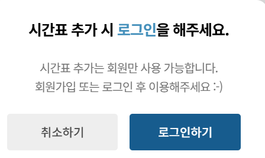
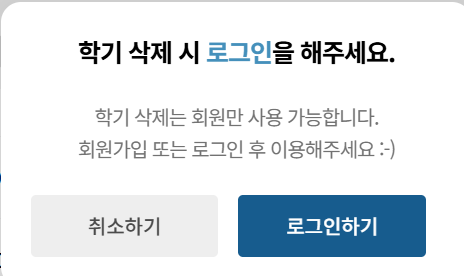

# [레거시] 2-1. (웹, 모바일) 로그인 유입

> **레거시 문서** · 과거 구현과 로깅을 확인하기 위한 보존 자료입니다.

[← 로그인/회원가입/정보수정 - 레거시 로깅 목록](README.md)

원문 상태: 완료

원문에 과거·새 로깅 구분이 없어 아래 정의와 참고사진을 원문 순서로 표시합니다.

원문 미기재 항목: `event_name`, `screen_view`. 값을 추정하지 않았습니다.

## 📌 로깅 이유

- 어떤 기능을 이용하다가 로그인의 필요성을 느꼈는지 확인하며 로그인 유도를 분석하는데 사용됩니다

## 📌 로그인 유도 (기능별)

✅ 리뷰 작성 팝업 (웹, 모바일) (비즈니스)

사진

✅ 리뷰 신고 팝업 (웹, 모바일) (비즈니스)

사진

✅ 게시글 작성 팝업 (웹, 모바일) (캠퍼스)

사진

✅ 키워드 알림 팝업 (모바일) (캠퍼스)

사진

✅ 쪽지 보내기 팝업 (웹, 모바일) (캠퍼스)

사진

✅ 졸업학점계산기 팝업 (웹) (유저)

사진

✅ 시간표 관리 팝업 (웹, 모바일) (유저)

사진

## 📌 팀 별 로깅 요청

<table>
<colgroup>
<col />
<col width="415" />
</colgroup>
<tr>
<td>
팀
</td>
<td>
기능명
</td>
</tr>
<tr>
<td>
유저
</td>
<td>
졸업학점계산기 팝업, 시간표 관리 팝업
</td>
</tr>
<tr>
<td>
비즈니스
</td>
<td>
리뷰 작성 팝업, 리뷰 신고 팝업
</td>
</tr>
<tr>
<td>
캠퍼스
</td>
<td>
게시글 작성 팝업, 키워드 알림 팝업, 쪽지 보내기 팝업 
</td>
</tr>
</table>

## 📌 해당하는 화면의 팝업에서 로그인하기를 클릭할 시 로깅.

- event\_label : “login\_prompt”
- value : “\{기능명\}<b>”</b>
- event\_category : “click”

---

원문 정보

원본 ID: `5bf0221954bc8339996381b49bfe9142`  
[보존 원문](../../_archive/original/notion/pages/5bf0221954bc8339996381b49bfe9142.md)

