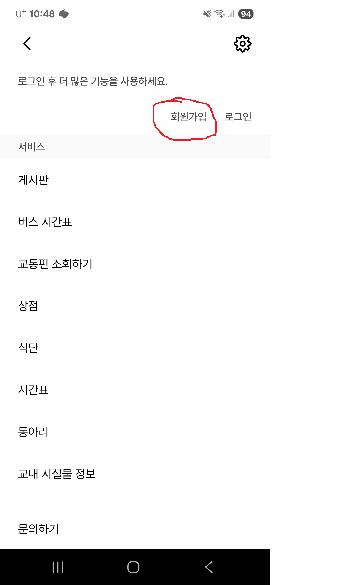

# [레거시] 1-2 회원가입진입(클릭) - 레거시

> **레거시 문서** · 과거 구현과 로깅을 확인하기 위한 보존 자료입니다.

[← 로그인/회원가입/정보수정 V2 로깅 목록](README.md)

플랫폼: ANDROID · IOS · WEB  
원문 상태: 로깅 필요

과거 로깅·새 로깅과 각 참고사진은 원문의 구간별 연결을 유지합니다.

원문 미기재 항목: `event_name`, `screen_view`. 값을 추정하지 않았습니다.

<!-- logging-section:past:start -->
## 과거 로깅

- event\_label : “hamburger”
- value : “회원가입 시작<b>”</b>
- event\_category : “click”
- custom\_session\_id : \{sign\_up\}\_\{0\}\_\{플랫폼\}\_\{세션시작시간\}\_\{랜덤값\}

<!-- logging-section:past:end -->

---

원문 정보

원본 ID: `e010221954bc8352bea4010b08266e6e`  
[보존 원문](../../_archive/original/notion/pages/e010221954bc8352bea4010b08266e6e.md)

