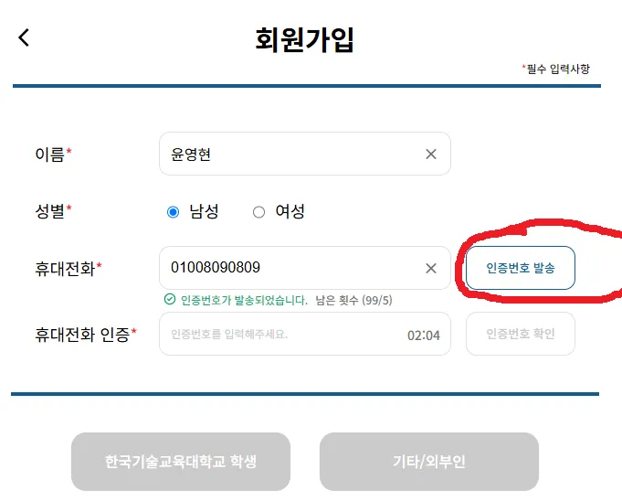
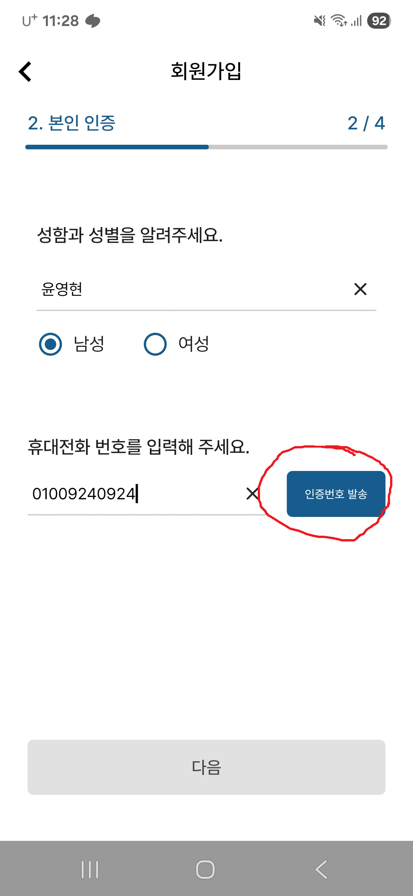
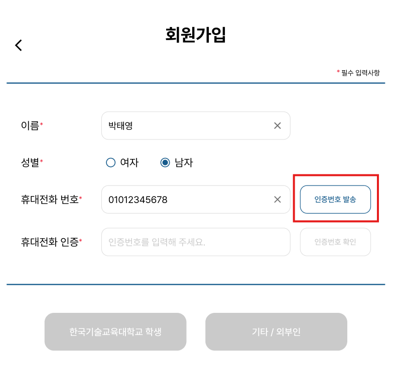
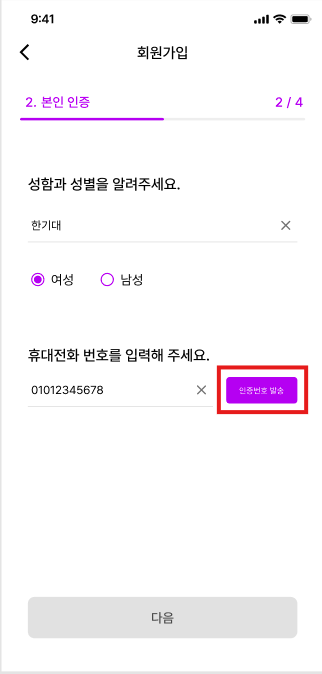

# 1-5 본인인증_인증번호_발송(클릭)

[← 로그인/회원가입/정보수정 V2 로깅 목록](README.md)

플랫폼: ANDROID · IOS · WEB  
원문 상태: 로깅 필요

과거 로깅·새 로깅과 각 참고사진은 원문의 구간별 연결을 유지합니다.

<!-- logging-section:past:start -->
## 과거 로깅

- event\_label : “identity\_verification”
- value : “인증번호 발송<b>”</b>
- event\_category : “click”
- custom\_session\_id : \{sign\_up\}\_\{0\}\_\{플랫폼\}\_\{세션시작시간\}\_\{랜덤값\}

<b>웹</b>

<b>모바일</b>

<!-- logging-section:past:end -->

<!-- logging-section:new:start -->
## 새 로깅

- 설명: 회원가입 본인인증 화면에서 기존 인증번호 발송 동작을 기록한다. 기존 요청·결과 전송 시점과 value는 변경하지 않는다.
- event\_name: <code>DA2</code>
- screen\_view: <code>identity_verification</code>
- event\_label: <code>account__identity_verification__sign_up__send_code__click</code>
- value: 인증번호 발송
- event\_category: <code>click</code>
- custom\_session\_id : \{sign\_up\}\_\{0\}\_\{플랫폼\}\_\{세션시작시간\}\_\{랜덤값\}

<b>참고사진 (기능 표시)</b>

<b>웹</b>

<b>모바일</b>

<!-- logging-section:new:end -->

---

원문 정보

원본 ID: `3b60221954bc83b4987601e0c9041109`  
[보존 원문](../../_archive/original/notion/pages/3b60221954bc83b4987601e0c9041109.md)

