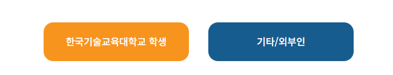
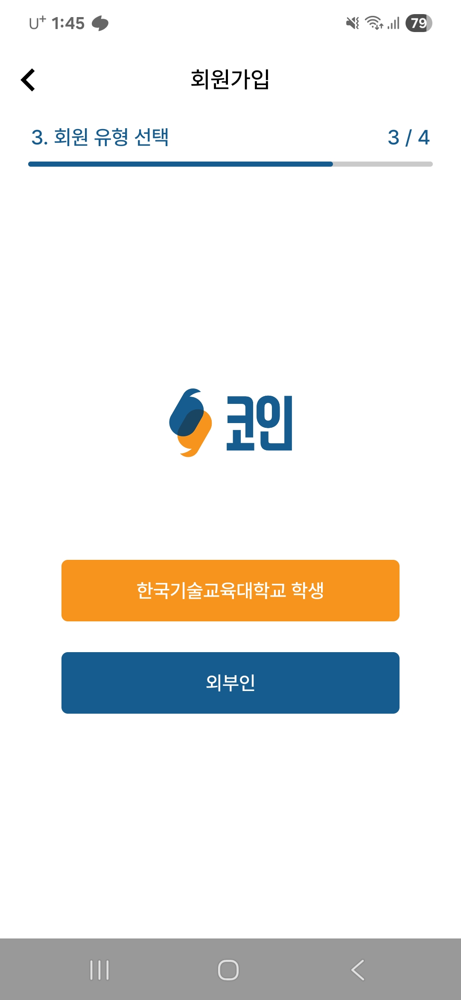
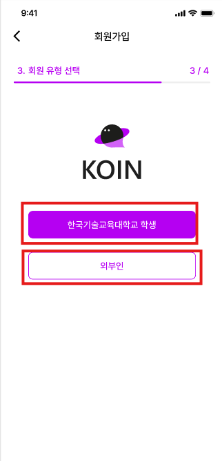

# 1-7 정보입력_학생_외부인_구분(클릭)

[← 로그인/회원가입/정보수정 V2 로깅 목록](README.md)

플랫폼: ANDROID · IOS  
원문 상태: 로깅 필요

과거 로깅·새 로깅과 각 참고사진은 원문의 구간별 연결을 유지합니다.

<!-- logging-section:past:start -->
## 과거 로깅

- event\_label : “create\_account”
- value : “학생” or “외부인”
- event\_category : “click”
- custom\_session\_id : \{sign\_up\}\_\{0\}\_\{플랫폼\}\_\{세션시작시간\}\_\{랜덤값\}

학생을 클릭하면 학생, 외부인을 클릭하면 외부인으로 로깅해주시면 됩니다.

<b>웹</b>

<b>모바일</b>

<!-- logging-section:past:end -->

<!-- logging-section:new:start -->
## 새 로깅

- 설명: 회원가입에서 학생·외부인 구분을 클릭할 때 기록한다. WEB 본인인증 경로와 모바일 선택 화면 모두 같은 논리 화면 user\_type\_selection을 사용한다.
- event\_name: <code>DA2</code>
- screen\_view: <code>user_type_selection</code>
- event\_label: <code>account__user_type_selection__sign_up__user_type__click</code>
- value: 학생 또는 외부인
- event\_category: <code>click</code>
- custom\_session\_id : \{sign\_up\}\_\{0\}\_\{플랫폼\}\_\{세션시작시간\}\_\{랜덤값\}

학생을 클릭하면 학생, 외부인을 클릭하면 외부인으로 로깅해주시면 됩니다.

<b>참고사진 (기능 표시)</b>

모바

<!-- logging-section:new:end -->

---

원문 정보

원본 ID: `b600221954bc82919bf001f67d3f1c13`  
[보존 원문](../../_archive/original/notion/pages/b600221954bc82919bf001f67d3f1c13.md)

