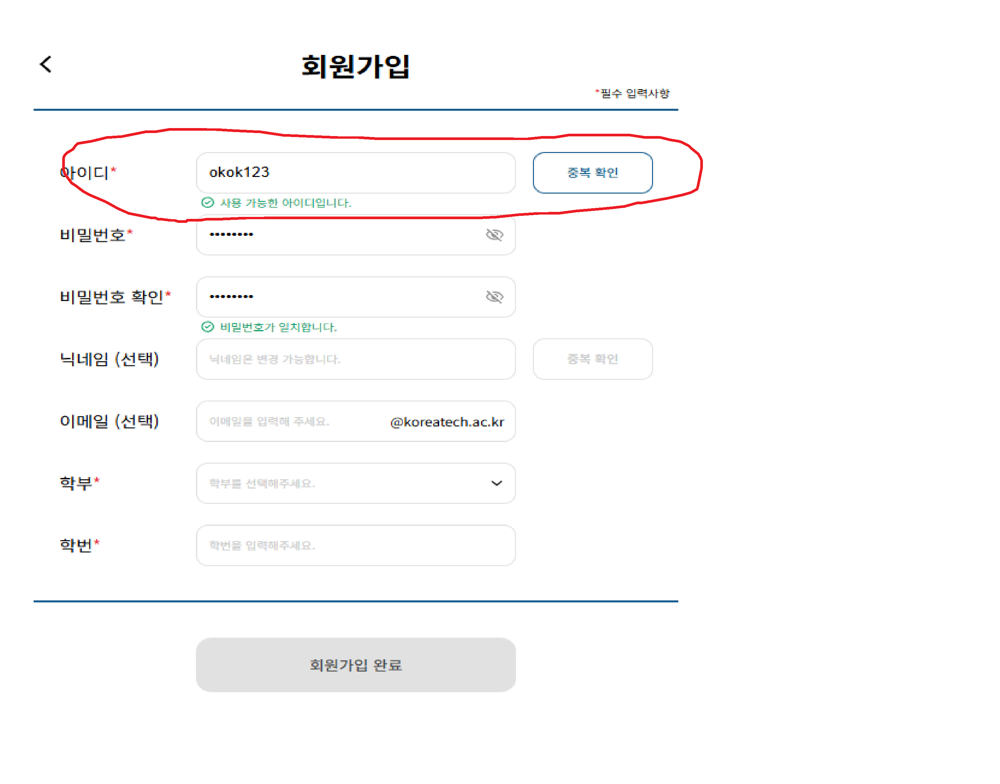
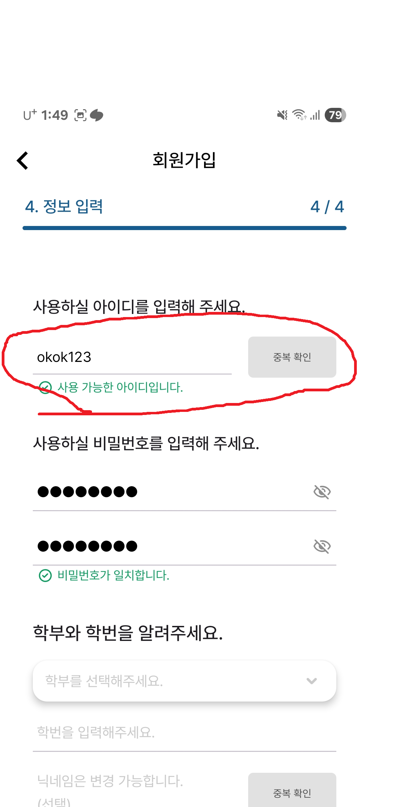
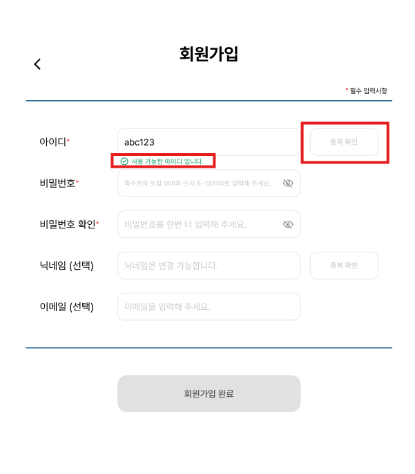
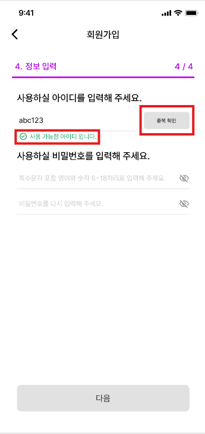

# 1-8 학생_외부인_아이디_중복확인

[← 로그인/회원가입/정보수정 V2 로깅 목록](README.md)

플랫폼: ANDROID · IOS · WEB  
원문 상태: 로깅 필요

과거 로깅·새 로깅과 각 참고사진은 원문의 구간별 연결을 유지합니다.

<!-- logging-section:past:start -->
## 과거 로깅

- event\_label : “create\_account”
- value : “아이디생성<b>”</b>
- event\_category : “click”
- custom\_session\_id : \{sign\_up\}\_\{0\}\_\{플랫폼\}\_\{세션시작시간\}\_\{랜덤값\}

모든 중복 확인 클릭이 아닌 사용 가능한 아이디를 찾은 순간에만 로깅 해주시면 됩니다.

<b>웹</b>

<b>모바일</b>

<!-- logging-section:past:end -->

<!-- logging-section:new:start -->
## 새 로깅

- 설명: 회원가입 정보입력에서 사용 가능한 아이디를 찾은 순간에만 기록한다. 모든 중복확인 버튼 클릭을 기록하는 조건으로 확대하지 않는다.
- event\_name: <code>DA2</code>
- screen\_view: <code>input_user_info</code>
- event\_label: <code>account__input_user_info__sign_up__id_available__click</code>
- value: 아이디생성
- event\_category: <code>click</code>
- custom\_session\_id : \{sign\_up\}\_\{0\}\_\{플랫폼\}\_\{세션시작시간\}\_\{랜덤값\}

모든 중복 확인 클릭이 아닌 사용 가능한 아이디를 찾은 순간에만 로깅 해주시면 됩니다.

<b>참고사진 (기능 표시)</b>

<b>웹</b>

<b>모바일</b>

<!-- logging-section:new:end -->

---

원문 정보

원본 ID: `ae70221954bc8236bbba8149765016d7`  
[보존 원문](../../_archive/original/notion/pages/ae70221954bc8236bbba8149765016d7.md)

