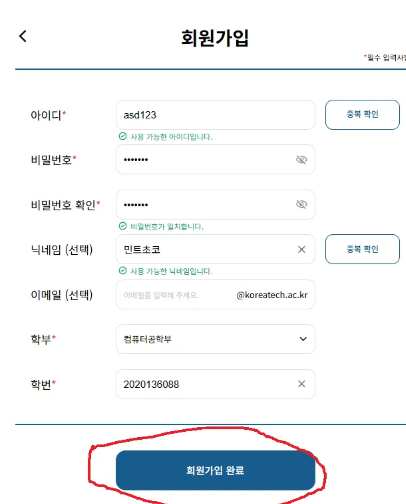
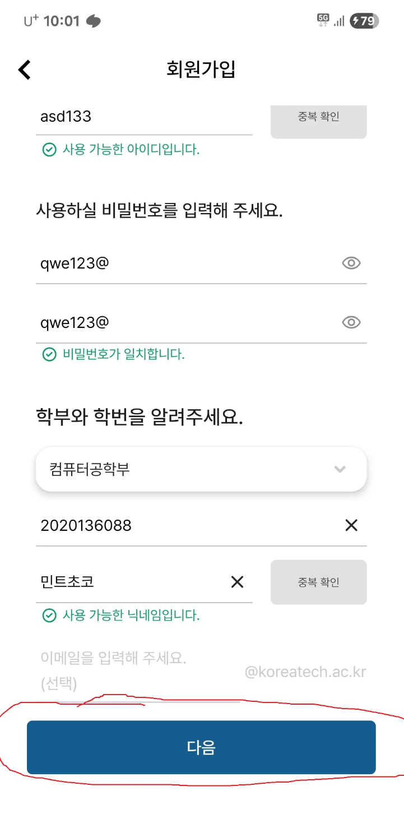
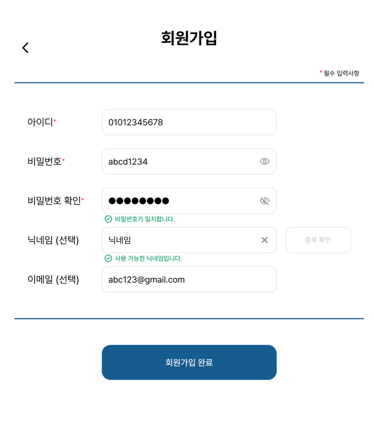
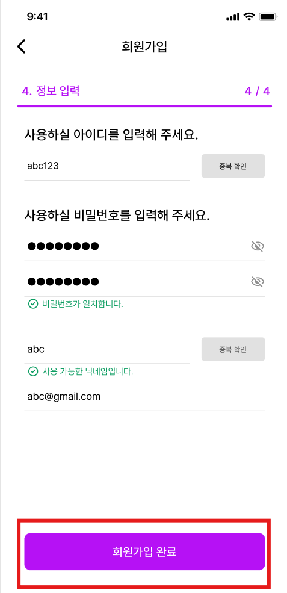

# 1-9 학생_외부인_회원가입완료(클릭)

[← 로그인/회원가입/정보수정 V2 목록](README.md)

플랫폼: ANDROID, IOS, WEB  
원문 상태: 로깅 필요  
[Notion 기준 명세](https://app.notion.com/p/4d00221954bc833d8007011f8d4764c1)  
원본 ID: `4d00221954bc833d8007011f8d4764c1`

<!-- notion-body:start -->
## 과거 로깅

- event\_label : “sign\_up\_completed”
- value : “회원가입완료<b>”</b>
- event\_category : “click”
- custom\_session\_id : \{sign\_up\}\_\{0\}\_\{플랫폼\}\_\{세션시작시간\}\_\{랜덤값\}

<b>웹</b>



<b>모바일</b>



## 새 로깅

- 설명: 회원가입 정보입력의 기존 회원가입완료 동작과 전송 조건에 따라 기록한다. 기존 회원가입완료 value를 유지하며 별도 성공 이벤트나 실패 value를 추가하지 않는다.
- event\_name: <code>DA2</code>
- screen\_view: <code>input_user_info</code>
- event\_label: <code>account__input_user_info__sign_up__confirm__click</code>
- value: 회원가입완료
- event\_category: <code>click</code>
- custom\_session\_id : \{sign\_up\}\_\{0\}\_\{플랫폼\}\_\{세션시작시간\}\_\{랜덤값\}

<b>참고사진 (기능 표시)</b>

<b>웹</b>



<b>모바일</b>


<!-- notion-body:end -->

<details>
<summary>Notion 원문 속성 전체</summary>

```json
{
  "platform": [
    "ANDROID",
    "IOS",
    "WEB"
  ],
  "url": "https://app.notion.com/p/4d00221954bc833d8007011f8d4764c1",
  "구분": "회원가입완료",
  "상태": "로깅 필요",
  "생성일": "2026-11-23T13:38:33.752Z",
  "이벤트 이름": "1-9 학생\\_외부인\\_회원가입완료(클릭)",
  "태그": [
    "회원가입"
  ]
}
```

</details>
