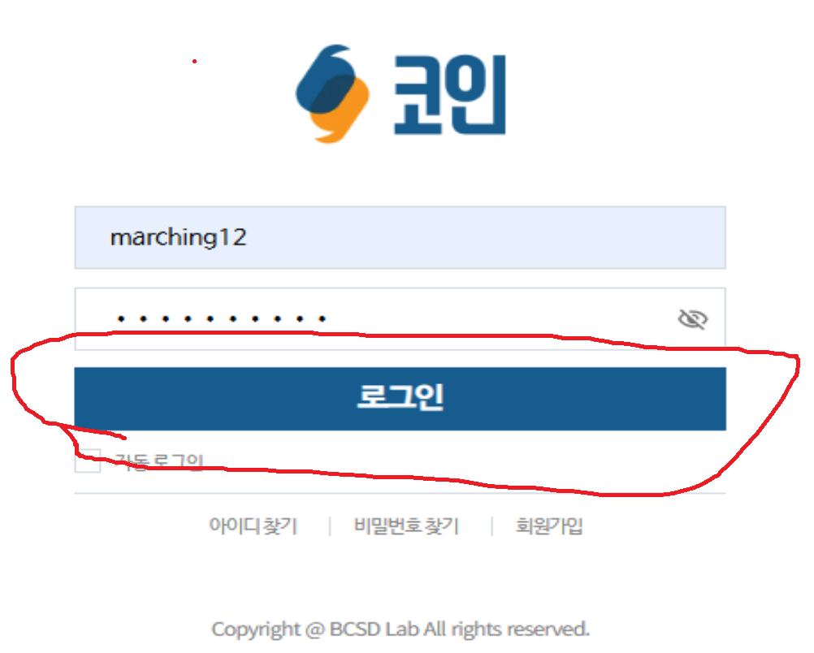
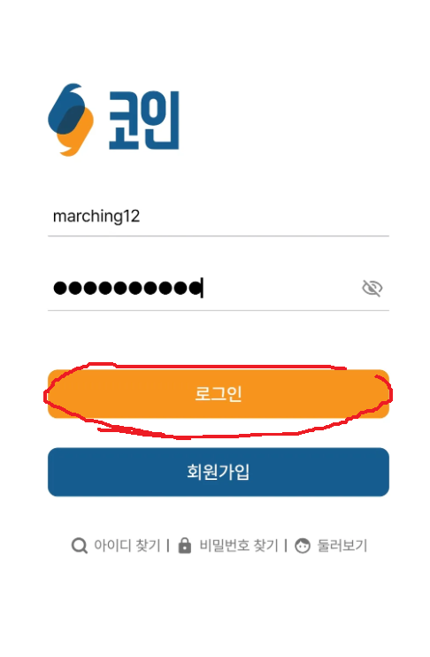
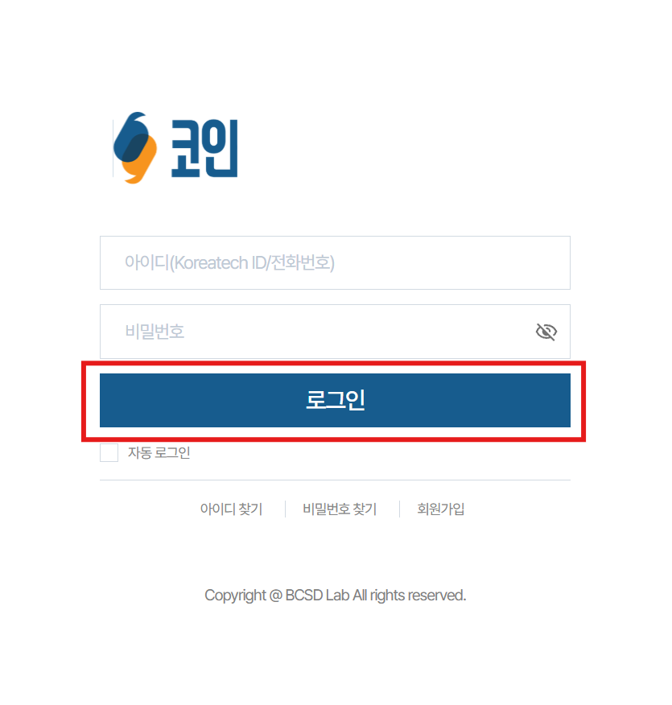
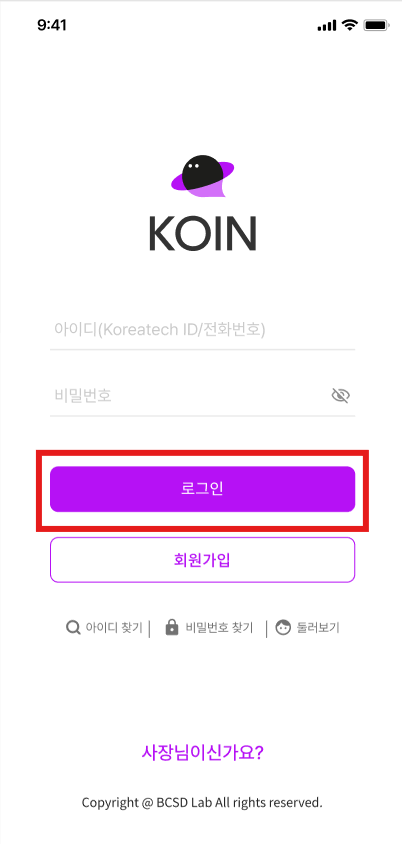

# 2-3 로그인 시도(클릭)

[← 로그인/회원가입/정보수정 V2 목록](README.md)

플랫폼: ANDROID, IOS, WEB  
원문 상태: 로깅 필요  
[Notion 기준 명세](https://app.notion.com/p/1ab0221954bc8247aee801c8f994a0e1)  
원본 ID: `1ab0221954bc8247aee801c8f994a0e1`

<!-- notion-body:start -->
## 과거 로깅

- event\_label : “login”
- value : “로그인 완료 or 로그인 실패<b>”</b>
- event\_category : “click”

로그인에 성공하면 로그인 완료, 실패하면 로그인 실패로 로깅 해주시면 됩니다.

<b>웹</b>



<b>모바일</b>



## 새 로깅

- 설명: 로그인 화면에서 기존 로그인 결과 조건에 따라 기록한다. 성공하면 로그인 완료, 실패하면 로그인 실패 value를 사용하며 기존 전송 시점을 유지한다.
- event\_name: <code>DA2</code>
- screen\_view: <code>login</code>
- event\_label: <code>account__login__login__confirm__click</code>
- value: 로그인 완료 또는 로그인 실패
- event\_category: <code>click</code>

로그인에 성공하면 로그인 완료, 실패하면 로그인 실패로 로깅 해주시면 됩니다.

<b>참고사진 (기능 표시)</b>

<b>웹</b>



<b>모바일</b>


<!-- notion-body:end -->

<details>
<summary>Notion 원문 속성 전체</summary>

```json
{
  "platform": [
    "ANDROID",
    "IOS",
    "WEB"
  ],
  "url": "https://app.notion.com/p/1ab0221954bc8247aee801c8f994a0e1",
  "구분": "로그인",
  "상태": "로깅 필요",
  "생성일": "2026-11-23T13:38:56.922Z",
  "이벤트 이름": "2-3 로그인 시도(클릭)",
  "태그": [
    "로그인"
  ]
}
```

</details>
