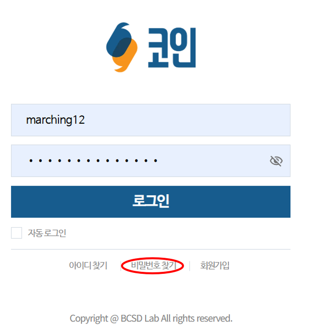
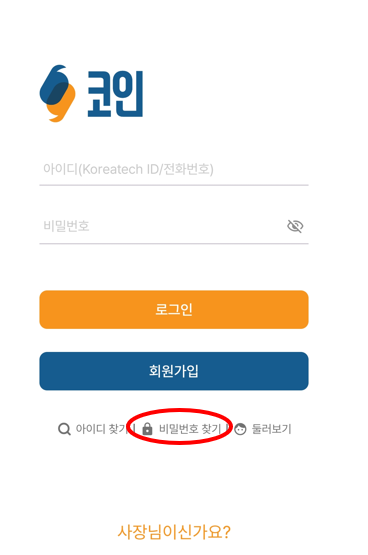
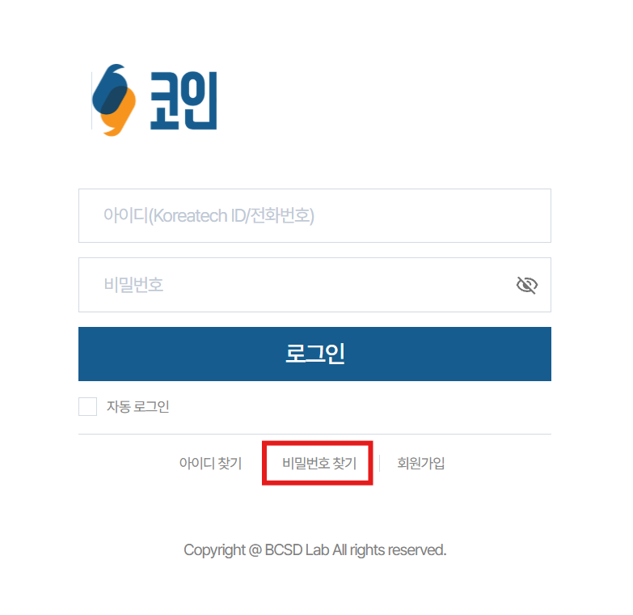
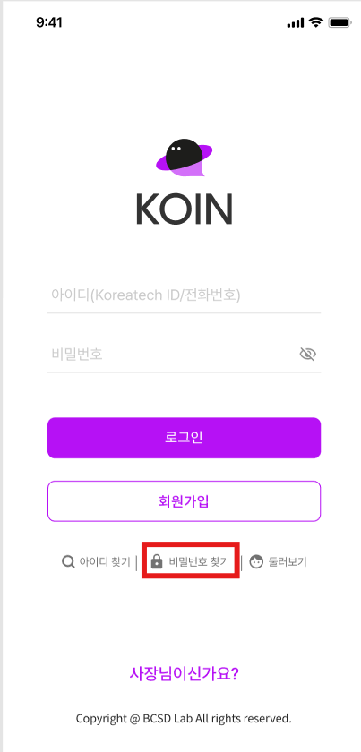

# 2-5 비밀번호찾기(클릭)

[← 로그인/회원가입/정보수정 V2 로깅 목록](README.md)

플랫폼: ANDROID · IOS · WEB  
원문 상태: 로깅 필요

과거 로깅·새 로깅과 각 참고사진은 원문의 구간별 연결을 유지합니다.

<!-- logging-section:past:start -->
## 과거 로깅

- event\_label : “login”
- value : “비밀번호 찾기<b>”</b>
- event\_category : “click”

<b>웹</b>

<b>모바일</b>

<!-- logging-section:past:end -->

<!-- logging-section:new:start -->
## 새 로깅

- 설명: 로그인 화면에서 비밀번호찾기 버튼을 클릭해 해당 경로로 진입할 때 기록한다.
- event\_name: <code>DA2</code>
- screen\_view: <code>login</code>
- event\_label: <code>account__login__account_recovery__password_entry__click</code>
- value: 비밀번호 찾기
- event\_category: <code>click</code>

<b>참고사진 (기능 표시)</b>

<b>웹</b>

<b>모바일</b>

<!-- logging-section:new:end -->

---

원문 정보

원본 ID: `6510221954bc82538277818d7d2f729a`  
[보존 원문](../../_archive/original/notion/pages/6510221954bc82538277818d7d2f729a.md)

