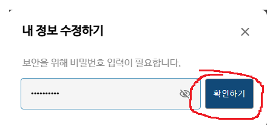

# 3-1  헤더_정보수정하기(클릭)

[← 로그인/회원가입/정보수정 V2 목록](README.md)

플랫폼: WEB  
원문 상태: 로깅 필요  
[Notion 기준 명세](https://app.notion.com/p/c4b0221954bc8395ad4f013a2bab63a3)  
원본 ID: `c4b0221954bc8395ad4f013a2bab63a3`

<!-- notion-body:start -->
## 과거 로깅

- event\_label : “header”
- value : “정보수정 시도<b>”</b>
- event\_category : “click”

<b>웹</b>



## 새 로깅

- 설명: 웹 헤더의 정보수정 버튼을 클릭해 정보수정 화면으로 진입할 때 기록한다.
- event\_name: <code>DA2</code>
- screen\_view: <code>header</code>
- event\_label: <code>account__header__profile_edit__header_entry__click</code>
- value: 정보수정 시도
- event\_category: <code>click</code>

### 참고사진 (WEB 리디자인 · 헤더 정보수정)

<b>웹</b>

<b>참고사진 · 웹</b>

[Figma 원본](https://www.figma.com/design/DPlcYuiFxhyT5ULbqec59i/KOIN-Web?node-id=17614-36124) · 2026-11-04. 원본 캡처에 빨간 네모만 추가했다. 빨간 네모는 기존 명세의 정보수정 클릭 위치다. 실제 SDK 적용·배포·전송은 미확인이다.


<!-- notion-body:end -->

<details>
<summary>Notion 원문 속성 전체</summary>

```json
{
  "platform": [
    "WEB"
  ],
  "url": "https://app.notion.com/p/c4b0221954bc8395ad4f013a2bab63a3",
  "구분": "정보수정",
  "상태": "로깅 필요",
  "생성일": "2026-11-23T13:38:57.179Z",
  "이벤트 이름": "3-1  헤더\\_정보수정하기(클릭)",
  "태그": [
    "정보수정"
  ]
}
```

</details>
