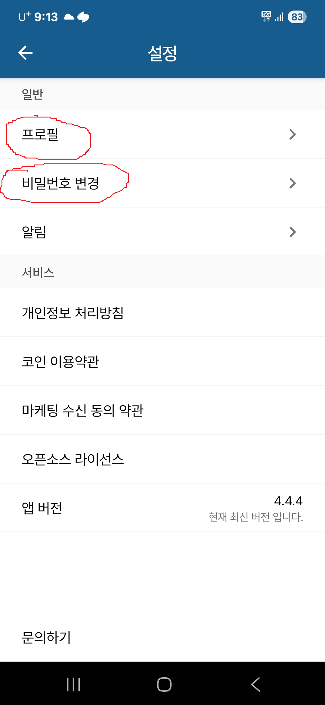
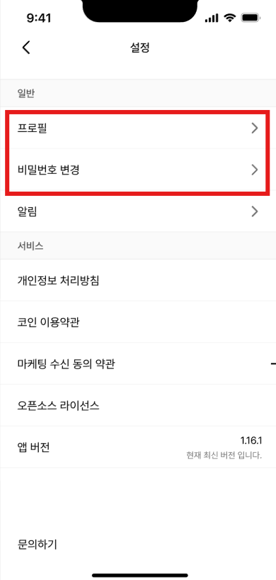

# 3-2 정보수정하기(클릭)

[← 로그인/회원가입/정보수정 V2 목록](README.md)

플랫폼: ANDROID, IOS  
원문 상태: 로깅 필요  
[Notion 기준 명세](https://app.notion.com/p/69a0221954bc8373b7638117ffb87eec)  
원본 ID: `69a0221954bc8373b7638117ffb87eec`

<!-- notion-body:start -->
## 과거 로깅

- event\_label : “hamburger”
- value : “정보수정 시도<b>”</b>
- event\_category : “click”

모바일



## 새 로깅

- 설명: 계정 설정 화면에서 정보수정하기를 클릭해 정보수정 화면으로 진입할 때 기록한다.
- event\_name: <code>DA2</code>
- screen\_view: <code>account_config</code>
- event\_label: <code>account__account_config__profile_edit__entry__click</code>
- value: 정보수정 시도
- event\_category: <code>click</code>

<b>참고사진 · 모바일</b>

<b>모바일</b>


<!-- notion-body:end -->

<details>
<summary>Notion 원문 속성 전체</summary>

```json
{
  "platform": [
    "ANDROID",
    "IOS"
  ],
  "url": "https://app.notion.com/p/69a0221954bc8373b7638117ffb87eec",
  "구분": "정보수정",
  "상태": "로깅 필요",
  "생성일": "2026-11-23T13:38:58.347Z",
  "이벤트 이름": "3-2 정보수정하기(클릭)",
  "태그": [
    "정보수정"
  ]
}
```

</details>
