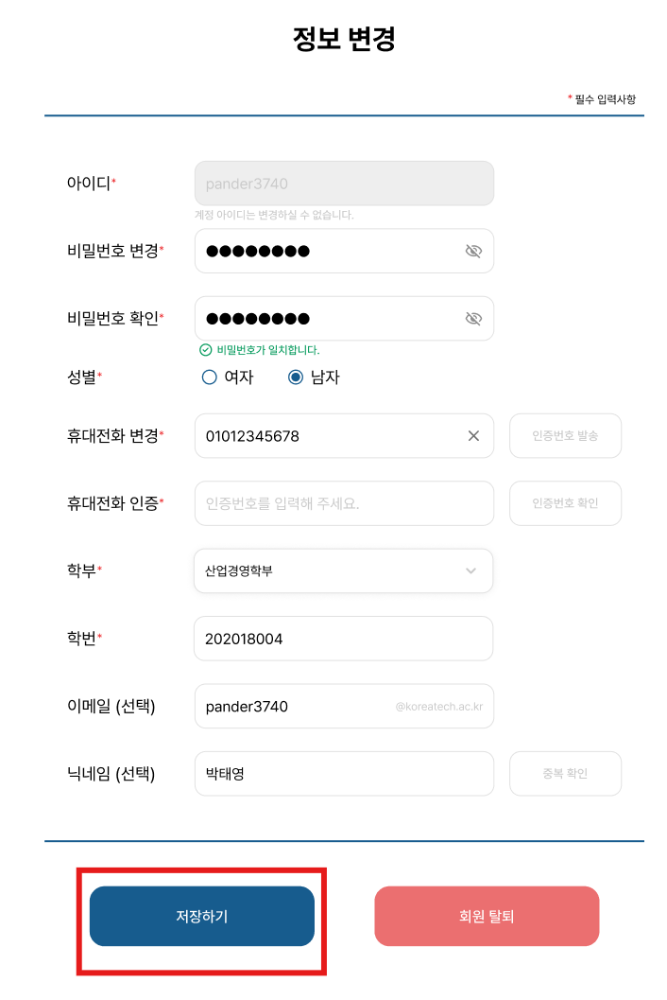
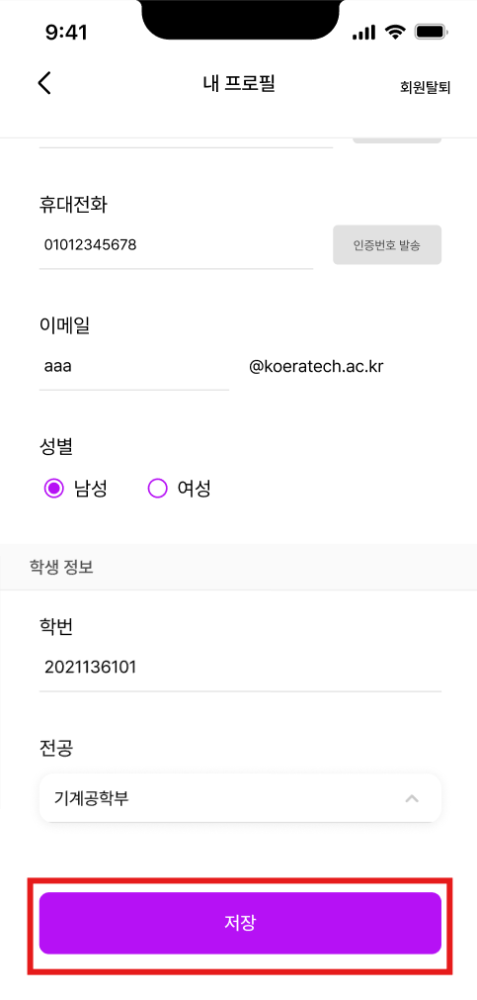

# 3-3 정보수정완료(클릭)

[← 로그인/회원가입/정보수정 V2 로깅 목록](README.md)

플랫폼: ANDROID · IOS · WEB  
원문 상태: 로깅 필요

과거 로깅·새 로깅과 각 참고사진은 원문의 구간별 연결을 유지합니다.

<!-- logging-section:past:start -->
## 과거 로깅

- event\_label : “user\_info”
- value : “정보수정 완료 or 정보수정 실패<b>”</b>
- event\_category : “click”

웹

모바일

비밀번호 변경에도 심어주세요 ㅎㅎ

<!-- logging-section:past:end -->

<!-- logging-section:new:start -->
## 새 로깅

- 설명: 정보수정 화면에서 기존 수정 완료·실패 처리 조건에 따라 기록한다. 기존 전송 시점과 성공·실패 value를 유지한다.
- event\_name: <code>DA2</code>
- screen\_view: <code>edit_profile</code>
- event\_label: <code>account__edit_profile__profile_edit__confirm__click</code>
- value: 정보수정 완료 또는 정보수정 실패
- event\_category: <code>click</code>

<b>웹</b>

<b>모바일</b>

<!-- logging-section:new:end -->

---

원문 정보

원본 ID: `7e80221954bc82fe99480164f6927673`  
[보존 원문](../../_archive/original/notion/pages/7e80221954bc82fe99480164f6927673.md)

