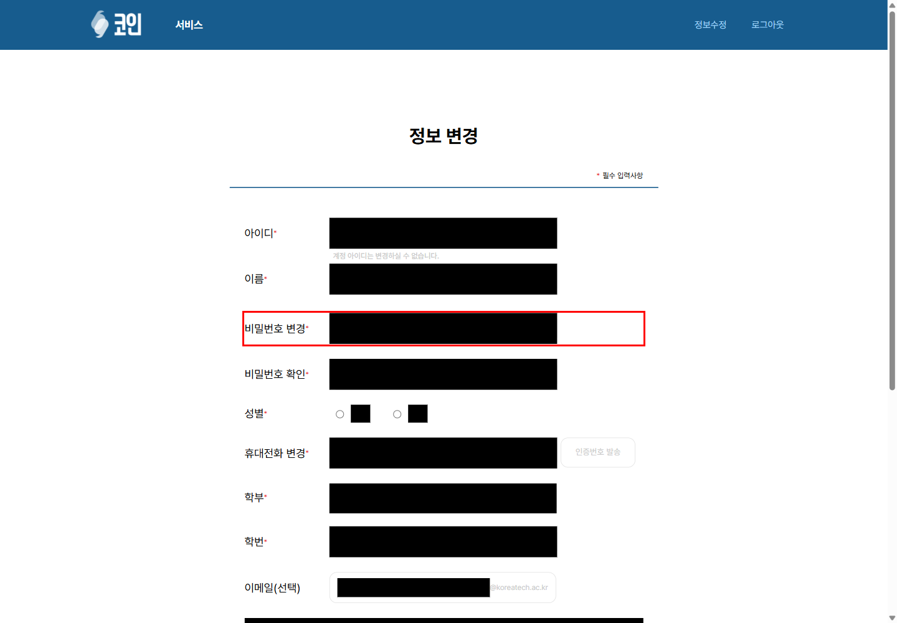

# 3-4 비밀번호수정완료(클릭)
<!-- representative-note:start -->
> 이 페이지는 중복 목록에서 제외한 보존 원본입니다. [대표 명세](3-4-%EB%B9%84%EB%B0%80%EB%B2%88%ED%98%B8%EC%88%98%EC%A0%95%EC%99%84%EB%A3%8C%28%ED%81%B4%EB%A6%AD%29.md)에서 시작하세요. 아래 원문·과거/새 정의·이미지는 그대로 보존합니다.
<!-- representative-note:end -->

[← 로그인/회원가입/정보수정 V2 로깅 목록](README.md)

플랫폼: WEB  
원문 상태: 로깅 필요

과거 로깅·새 로깅과 각 참고사진은 원문의 구간별 연결을 유지합니다.

<!-- logging-section:past:start -->
## 과거 로깅

- event\_label : “user\_info”
- value : “정보수정 완료 or 정보수정 실패<b>”</b>
- event\_category : “click”

웹

모바일

비밀번호 변경에도 심어주세요 ㅎㅎ

<!-- logging-section:past:end -->

<!-- logging-section:new:start -->
## 새 로깅

- 설명: 정보수정을 통한 비밀번호 변경의 기존 완료·실패 처리 조건에 따라 기록한다. WEB·모바일 모두 논리 화면 password\_change를 사용하며 비밀번호 찾기 경로와 구분한다. 기존 전송 시점과 성공·실패 value는 유지한다.
- event\_name: <code>DA2</code>
- screen\_view: <code>password_change</code>
- event\_label: <code>account__password_change__password_change__confirm__click</code>
- value: 비밀번호 수정 완료 또는 비밀번호 수정 실패
- event\_category: <code>click</code>

#### 웹

WEB · stage 정보수정 경로의 실제 비밀번호 변경 입력 화면. 개인정보·입력값 검은색 마스킹. 제출하지 않았으므로 변경 결과/SDK 발화 증거는 아님. 2026-10-30.

<!-- logging-section:new:end -->

---

원문 정보

원본 ID: `6ec0221954bc83e08706811705f676ac`  
[보존 원문](../../_archive/original/notion/pages/6ec0221954bc83e08706811705f676ac.md)

