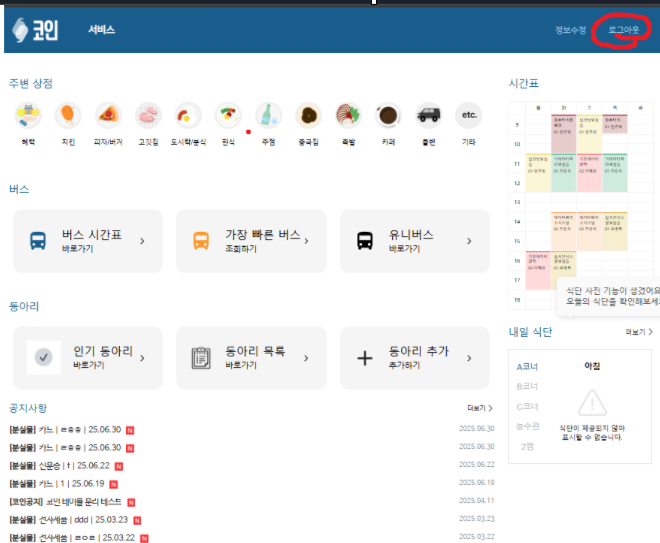
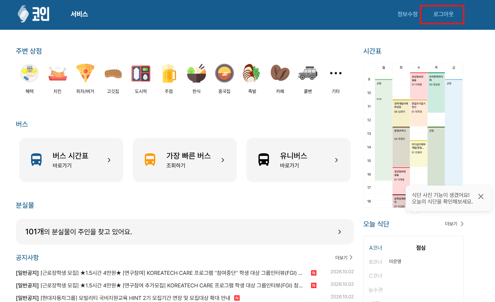

# 4-1 로그아웃(클릭)

[← 로그인/회원가입/정보수정 V2 로깅 목록](README.md)

플랫폼: WEB  
원문 상태: 로깅 필요

과거 로깅·새 로깅과 각 참고사진은 원문의 구간별 연결을 유지합니다.

<!-- logging-section:past:start -->
## 과거 로깅

- event\_label : “header”
- value : “로그아웃<b>”</b>
- event\_category : “click”

웹

<b>이전 WEB 참고사진 · 리디자인 전</b>

<b>웹</b>

<!-- logging-section:past:end -->

<!-- logging-section:new:start -->
## 새 로깅

- 설명: 로그인한 WEB 공통 헤더의 로그아웃 버튼을 클릭할 때 기록한다. 로그아웃 처리 성공 이벤트와 구분한다.
- event\_name: <code>DA2</code>
- screen\_view: <code>header</code>
- event\_label: <code>account__header__logout__click</code>
- value: 로그아웃
- event\_category: <code>click</code>

### 참고사진 (로그아웃 버튼 클릭)

#### 웹

WEB 리디자인 · [Figma 시안](https://www.figma.com/design/DPlcYuiFxhyT5ULbqec59i/KOIN-Web?node-id=17614-36124) · 2026-11-04. 빨간 네모 = 로그아웃 버튼 클릭 위치. 원본 캡처에 코드로 테두리만 표시했으며 실제 서비스 캡처·SDK 검증을 뜻하지 않는다.

<b>로그인 후 헤더 영역 · Figma 벡터 4배 캡처</b>

정보수정·로그아웃의 별도 상태 프레임을 그대로 캡처했다. 전체 홈 화면에 버튼을 합성하지 않았다.

해당 없음 — 이 페이지는 WEB 헤더 전용 명세다. 앱 프로필 버튼은 기존 모바일 명세를 따른다.

<!-- logging-section:new:end -->

---

원문 정보

원본 ID: `4390221954bc83899e8281c2d3bd9ed1`  
[보존 원문](../../_archive/original/notion/pages/4390221954bc83899e8281c2d3bd9ed1.md)

