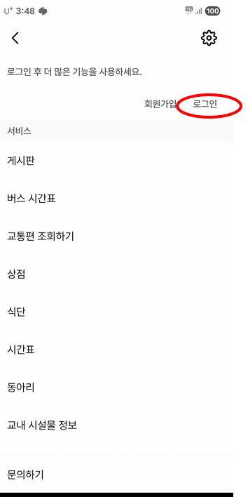

# [레거시] 2-2 로그인 진입(클릭)

[← 로그인/회원가입/정보수정 V2 목록](README.md)

플랫폼: ANDROID, IOS  
원문 상태: 레거시  
[Notion 기준 명세](https://app.notion.com/p/d440221954bc83bb909281a0cb60314d)  
원본 ID: `d440221954bc83bb909281a0cb60314d`

<!-- notion-body:start -->
<b>레거시 보존 · 현행 기준은 홈화면 리디자인</b>

- 2026-11-05 사용자 지시: 홈화면 리디자인의 로깅은 모두 유지하고, 겹치는 다른 서비스 명세를 레거시로 보존한다.
- 프로필 로그인의 현행 기준: [4-2 로그인 클릭](https://app.notion.com/p/eeb0221954bc8211937181c4678c723b).
- 이 페이지는 별도 신규 구현·추가 전송 대상이 아니다. 아래 라벨·value·category·event\_name·screen\_view·사진·플랫폼과 이전 로깅은 이력으로 보존한다.
- 이전의 ‘이 페이지가 대표’·‘두 문서 별개 유지’·‘같은 라벨 문서 계약’ 설명은 이 최신 결정으로 대체한다. 홈 명세의 라벨·값·필드는 이번 작업에서 변경하지 않는다.
- 실제 SDK의 옛 라벨 중단·전환·단일 전송은 미확인이다. 이 문서 정리는 운영 코드나 데이터의 삭제·변경을 뜻하지 않는다.

## 이전 로깅

- event\_label : “hamburger”
- value : “로그인 시도<b>”</b>
- event\_category : “click”


<!-- notion-body:end -->

<details>
<summary>Notion 원문 속성 전체</summary>

```json
{
  "platform": [
    "ANDROID",
    "IOS"
  ],
  "url": "https://app.notion.com/p/d440221954bc83bb909281a0cb60314d",
  "구분": "로그인",
  "상태": "레거시",
  "생성일": "2026-11-23T13:38:34.134Z",
  "이벤트 이름": "\\[레거시\\] 2-2 로그인 진입(클릭)",
  "태그": [
    "로그인"
  ]
}
```

</details>
