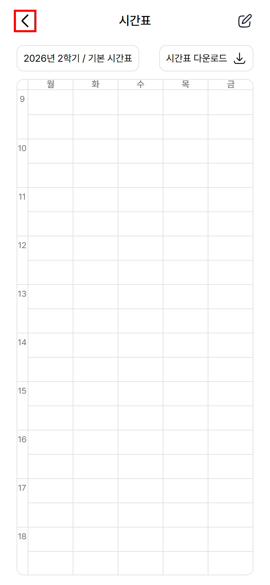

# 2-10. 시간표 탈출_뒤로가기버튼

[← 시간표 로깅 목록](README.md)

플랫폼: ANDROID · IOS  
원문 상태: 완료

과거 로깅·새 로깅과 각 참고사진은 원문의 구간별 연결을 유지합니다.

생성일: 2026년 11월 12일 오후 2:08
태그: 시간표
platform: ANDROID, IOS
상태: 완료

<!-- logging-section:past:start -->
## 과거 로깅

- event\_label : “timetable\_back”
- value : “뒤로가기버튼”
- event\_category : “click”

<!-- logging-section:past:end -->

<!-- logging-section:new:start -->
## 새 로깅

- 설명: 모바일 시간표 화면 왼쪽 위 뒤로가기(\<) 버튼을 눌러 시간표에서 나가는 경우
- screen\_view: `timetable`
- event\_name: `DA1`
- event\_label: `timetable__timetable__navigation__back__click`
- value: 뒤로가기
- event\_category: `click`

### 참고사진 (기능 표시)

<b>웹</b>

<b>참고사진 · 웹</b>

해당 없음 (모바일 전용)

<b>모바일</b>

<b>참고사진 · 모바일</b>

모바일 — 뒤로가기 버튼 (출처: stage 실제 캡처, 빨간 네모 = 클릭 위치)

<!-- logging-section:new:end -->

---

원문 정보

원본 ID: `daa0221954bc83fd9ea98165d8b666db`  
[보존 원문](../../_archive/original/notion/pages/daa0221954bc83fd9ea98165d8b666db.md)

