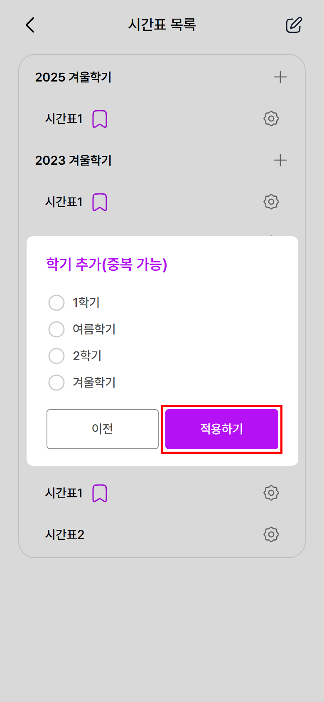

# 2-13. (웹, 반응형 앱) 시간표_학기 추가 (클릭)

[← 시간표 로깅 목록](README.md)

플랫폼: ANDROID · IOS · WEB · WEB (모바일)  
원문 상태: 로깅 필요

과거 로깅·새 로깅과 각 참고사진은 원문의 구간별 연결을 유지합니다.

<!-- logging-section:past:start -->
## 과거 로깅

- event\_label : “timetable”
- value : “semester\_add”
- event\_category : “click”
- 참고 이미지

<b>웹</b>

<b>앱</b>

<!-- logging-section:past:end -->

<!-- logging-section:new:start -->
## 새 로깅

- 설명: 시간표 화면 학기 드롭다운 맨 아래 '학기 추가하기' → 학기 추가 팝업에서 연도·학기를 고르고 추가하기를 누르는 경우

- screen\_view: <code>timetable</code>

- event\_name: <code>DA1</code>

- event\_label: <code>timetable__timetable__semester_manage__edit_apply__click</code>

- value: 

- 웹 : \{연도\}\_\{학기\} (예: 2026\_겨울학기)

- 모바일 : \{연도\}\_\{학기\} (예: 2026\_겨울학기) 

- event\_category: <code>click</code>

### 참고사진 (기능 표시)

<b>웹</b>

<b>참고사진 · 웹</b>

웹 — 학기 추가 팝업의 추가하기 (출처: stage 실제 캡처, 로그인 상태, 빨간 네모 = 클릭 위치)

<b>모바일</b>

<b>참고사진 · 모바일</b>

모바일 — 학기 편집 → 연도 선택 → 다음 → 학기 추가(중복 가능)에서 학기를 고르고 적용하기 (출처: stage 실제 캡처, 로그인 상태, 빨간 네모 = 클릭 위치)

<!-- logging-section:new:end -->

---

원문 정보

원본 ID: `a4e0221954bc8319ac0b01c9f0631a34`  
[보존 원문](../../_archive/original/notion/pages/a4e0221954bc8319ac0b01c9f0631a34.md)

