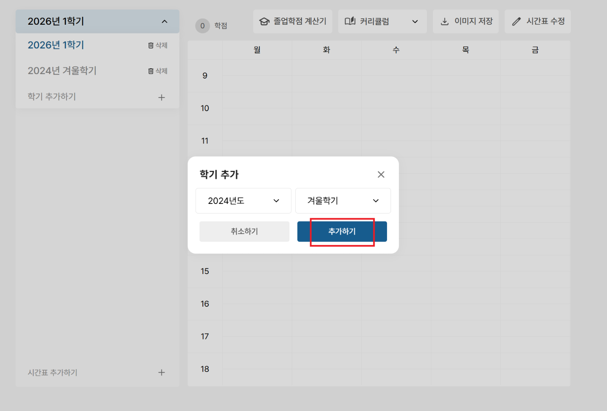
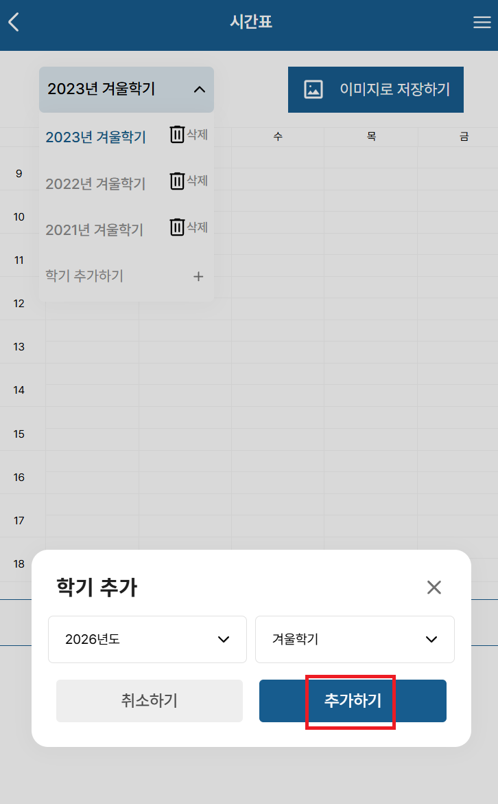
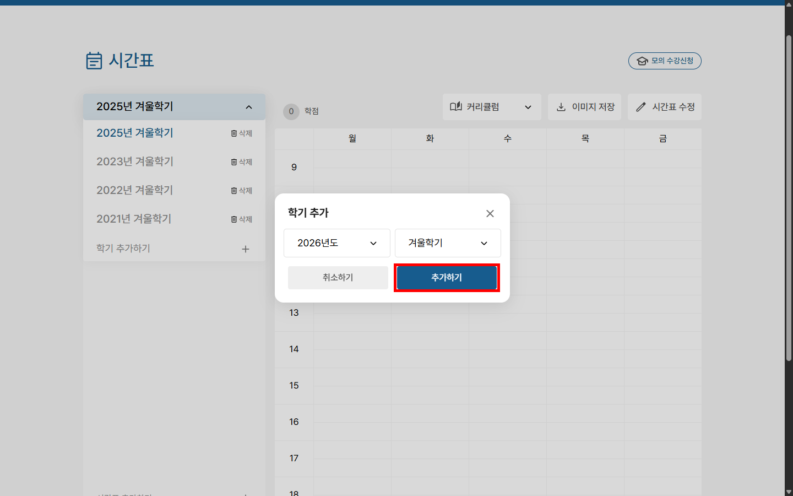

# 2-13. (웹, 반응형 앱) 시간표_학기 추가 (클릭)

[← 로깅 목록](README.md)

생성일: 2026년 11월 8일 오후 8:00
태그: 시간표
platform: ANDROID, IOS, WEB, WEB (모바일)
상태: 로깅 필요

- 과거 로깅
    - event_label : “timetable”
    - value : “semester_add”
    - event_category : “click”
    - 참고 이미지
    
    **웹**
    
    
    
    **앱**
    
    
    
- 새 로깅
    - 설명: 시간표 화면 학기 드롭다운 맨 아래 '학기 추가하기' → 학기 추가 팝업에서 연도·학기를 고르고 추가하기를 누르는 경우
    - screen_view: `timetable`
    - event_name: `DA1`
    - event_label: `timetable__timetable__semester_manage__edit_apply__click`
    - value:
        - 웹 : {연도}_{학기} (예: 2026_겨울학기)
        - 모바일 : {연도}_{학기} (예: 2026_겨울학기)
    - event_category: `click`
    
    ### 참고사진 (기능 표시)
    
    **웹**
    
    **참고사진 · 웹**
    
    웹 — 학기 추가 팝업의 추가하기 (출처: stage 실제 캡처, 로그인 상태, 빨간 네모 = 클릭 위치)
    
    
    
    **모바일**
    
    **참고사진 · 모바일**
    
    모바일 — 학기 편집 → 연도 선택 → 다음 → 학기 추가(중복 가능)에서 학기를 고르고 적용하기 (출처: stage 실제 캡처, 로그인 상태, 빨간 네모 = 클릭 위치)
    
    
> 이전 GitHub의 모바일 추가·삭제 접두어 및 묶음 전송 규칙은 보존 이력에 남겼습니다. 이 페이지는 제공된 Notion ZIP의 value를 기준으로 하며 SDK 변경·배포를 뜻하지 않습니다.
