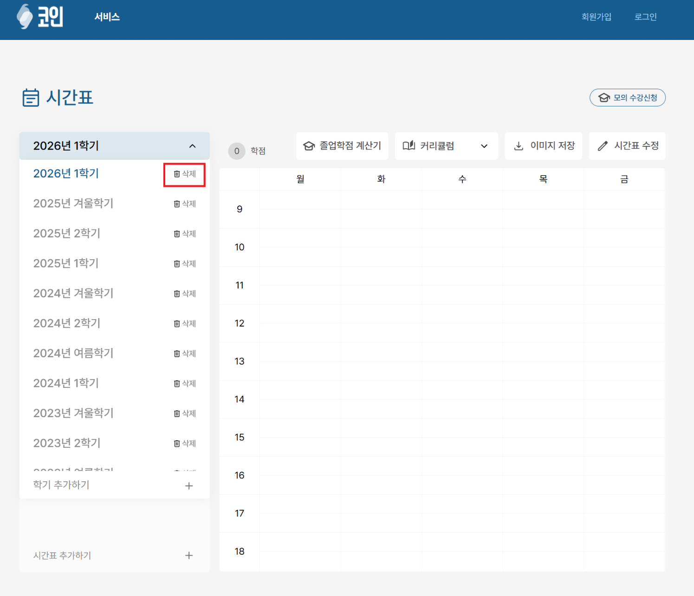
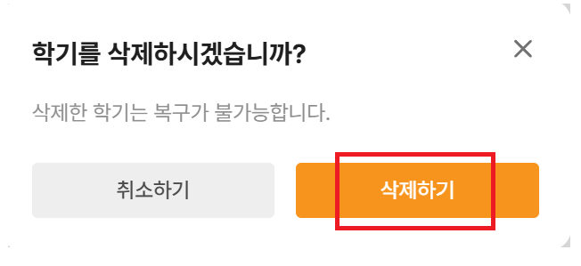
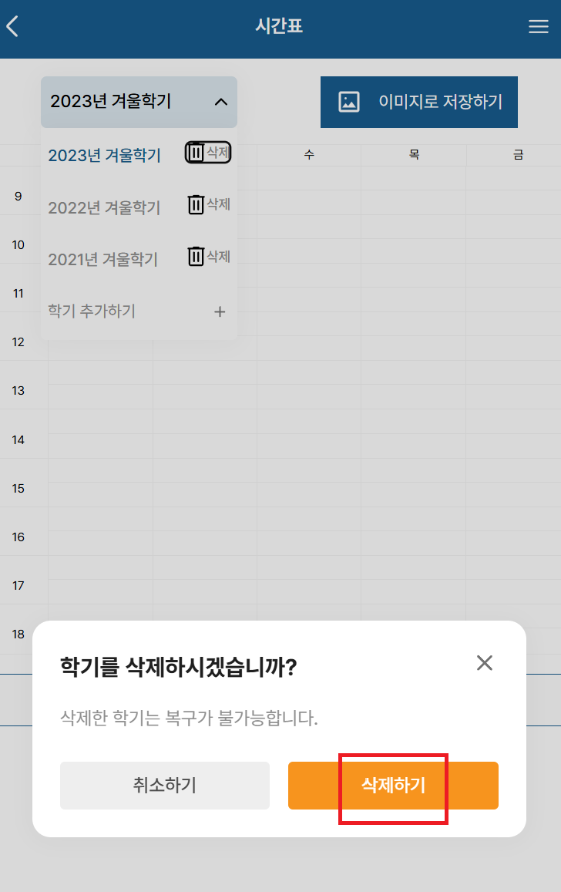
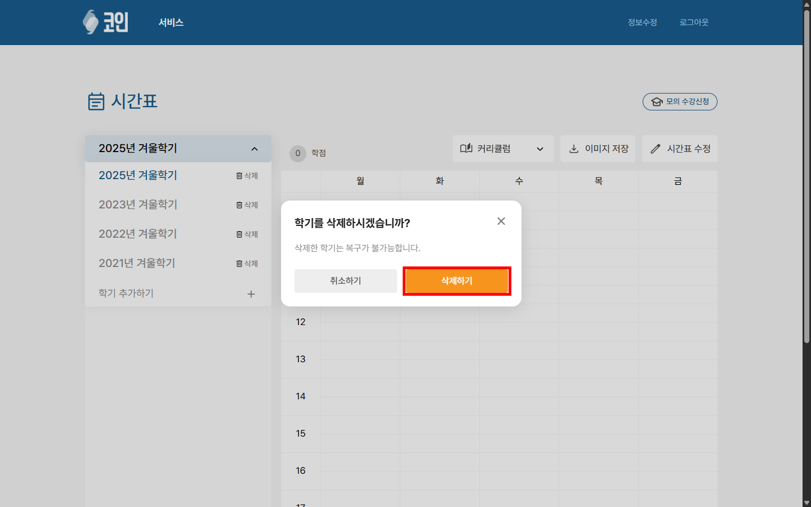
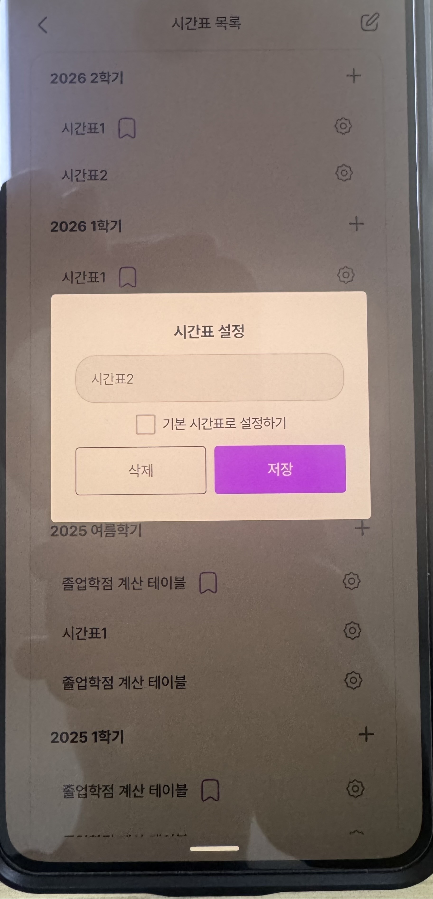

# 2-14. (웹, 반응형 앱) 시간표_학기 삭제_확정 (클릭)

[← 로깅 목록](README.md)

생성일: 2026년 11월 8일 오후 8:00
태그: 시간표
platform: ANDROID, IOS, WEB, WEB (모바일)
상태: 로깅 필요

- 이전 로깅
    - event_label : “timetable”
    - value : “semester_delete_confirm”
    - event_category : “click”
    - 참고 이미지
    - 웹
        
        
        
        
        
    - 앱
        
        
        
- 새 로깅 (26.10.17)
    - screen_view: `timetable`
    - event_name: `DA1`
    - event_label: `timetable__timetable__semester_manage__edit_apply__click`
    - value:
        - 웹 : {연도}_{학기} (예: 2026_2학기)
        - 모바일 : {연도}_{학기} (예: 2026_2학기)
    - event_category: `click`
    
    - 검토사항
        - 변경 없는 편집 제외 (2026년 11월 8일 프론트 요청 반영): 현재 학기 집합과 사용자가 적용하려는 최종 집합을 비교해 추가·삭제 변경분이 모두 0이면 이벤트를 보내지 않는다. 이미 있는 학기를 다시 고르는 중복 추가와 선택을 되돌려 원래 상태가 된 경우도 미전송한다.
        - 유효한 변경분이 있는 상태에서 사용자가 추가하기·삭제 확정·적용하기를 실행할 때 기존 공통 edit_apply 계약을 한 번 전송한다. 단순 선택·팝업 열기·취소는 포함하지 않는다. 모바일에서 추가와 삭제를 함께 적용해도 문서 2-13·2-14별로 나눠 전송하지 않는다.
        - 이 이벤트는 유효한 변경의 사용자 적용 행동이며 서버 저장 성공을 증명하지 않는다. 빈 변경분·입력 검증 실패를 제외하되 성공 콜백 이벤트로 임의 전환하지 않는다. 자동 API 재시도에 로그를 추가하지 않으며 사용자의 별도 유효한 재시도는 새로운 적용 행동이다.
        - WEB value의 기존 연도_학기와 모바일의 기존 추가/삭제_연도_학기 표현, DA1·click·screen_view·event_label은 유지한다. 과거 로그를 성공 이벤트로 재해석하거나 소급 변경하지 않는다. SDK 반영·실제 변경 집합·한 번 전송 검수는 별도다.
        - 웹·모바일 공통 계약 (2026년 11월 5일 사용자 승인): 같은 기능의 screen_view와 event_label은 플랫폼과 관계없이 아래 공통값을 사용한다. 기존 플랫폼별 화면명 유지 지시는 이 결정으로 대체한다. 플랫폼은 기존 DB 속성으로 구분하며 value·event_name·event_category·기존 전송 시점·이전 로깅·사진은 유지한다. 실제 SDK 적용·배포·단일 전송은 미확인이다. 공통값: `timetable` / `timetable__timetable__semester_manage__edit_apply__click`. 학기 편집의 추가·삭제 확정/적용을 공통 계약으로 묶는다. 대표 명세는 2-13. (웹, 반응형 앱) 시간표_학기 추가 (클릭)는 삭제 경로 설명이다. 모바일에서 추가·삭제를 한 번에 적용하면 1개 이벤트만 전송한다. WEB의 기존 value는 연도·학기만 포함하므로 이 공통 라벨과 value만으로 추가/삭제를 구별할 수 없고, value 변경은 이번 범위에 포함하지 않는다.
        - 통합 가이드·후속: 로깅 통합 가이드
        - 모바일: stage 모바일 웹은 학기 편집의 학기 체크 해제 → 적용하기 방식으로 보임, 확인 필요. 별도 삭제 팝업 없이 이미 있는 학기(체크됨)를 해제하고 적용하기를 누르는 방식으로 보이며, 해제 시 삭제되는지는 누르지 않아 미확인.
        - label DA2 기준 정렬 (2026-10-27): `timetable__timetable__semester_delete__confirm__click` → `timetable__timetable__semester_manage__delete_confirm__click`
        - label DA2 기준 정렬 (2026-10-27): `timetable__timetable_list__semester_edit__apply__click` → `timetable__timetable_list__semester_manage__edit_apply__click`
        - 이전 플랫폼 분리안 (2026-11-05 공통 계약으로 대체됨) (2026-10-27): `timetable__timetable_list__semester_manage__edit_apply__click`의 기준 명세는 2-13. (웹, 반응형 앱) 시간표_학기 추가 (클릭). 모바일 학기 편집 적용 한 번에 추가·삭제를 함께 처리한다. 웹의 추가·삭제 라벨은 각각 유지한다. 같은 사용자 동작은 한 번만 전송하며, 문서가 여러 개라는 이유로 추가 이벤트를 보내지 않는다. 기존 value·플랫폼·발생 시점은 유지한다.
    
    ### 참고사진 (기능 표시)
    
    **웹**
    
    - 참고사진 · 웹
        
        웹 — '학기를 삭제하시겠습니까?' 팝업의 삭제하기 (출처: stage 실제 캡처, 로그인 상태, 빨간 네모 = 클릭 위치)
        
        
        
    
    **모바일**
    
    - 참고사진 · 모바일
        
        모바일 — 학기 편집에서 학기 해제 후 적용하기 (출처: stage 실제 캡처, 로그인 상태, 빨간 네모 = 클릭 위치)
        
        
> 이전 GitHub의 모바일 추가·삭제 접두어 및 묶음 전송 규칙은 보존 이력에 남겼습니다. 이 페이지는 제공된 Notion ZIP의 value를 기준으로 하며 SDK 변경·배포를 뜻하지 않습니다.
