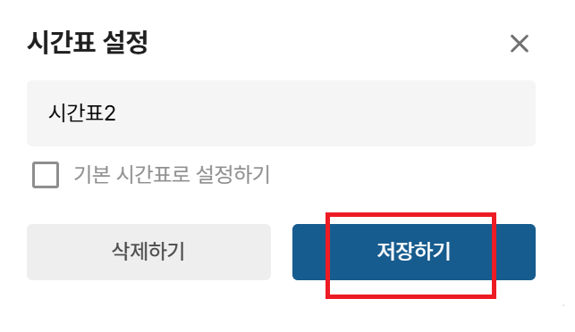
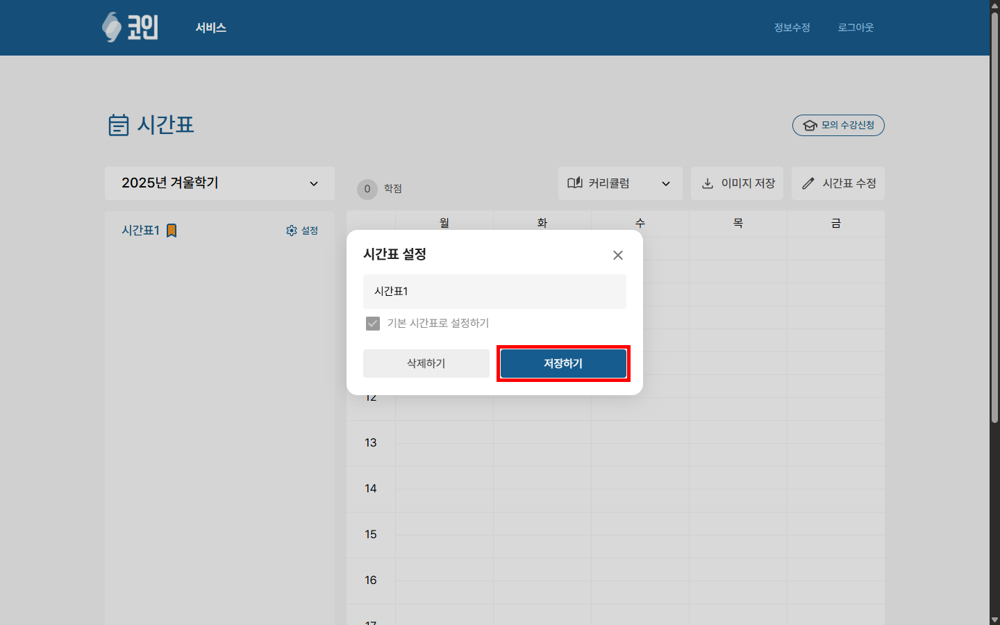
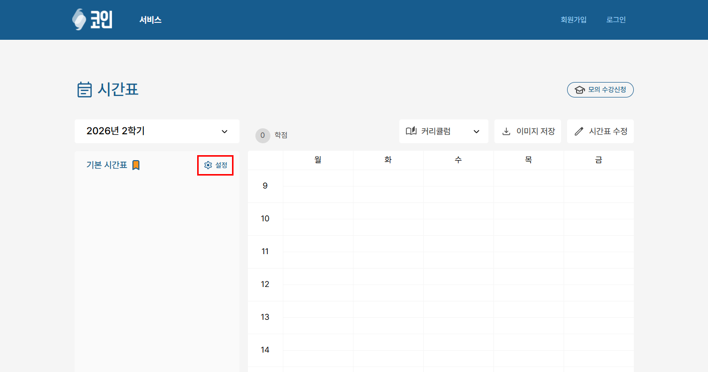

# 2-15. (웹) 시간표_저장 (클릭)

[← 시간표 목록](README.md)

플랫폼: WEB  
원문 상태: 로깅 필요  
[Notion 기준 명세](https://app.notion.com/p/afd0221954bc82259bc7014eee6721ea)  
원본 ID: `afd0221954bc82259bc7014eee6721ea`

<!-- notion-body:start -->
## 과거 로깅

- event\_label : “timetable”
- value : “저장하기”
- event\_category : “click”
- 참고 이미지



## 새 로깅

- 설명: 웹 시간표 화면 시간표 목록의 설정 → 시간표 설정 팝업(이름 변경·기본 시간표로 설정)에서 저장하기를 누르는 경우
- screen\_view: <code>timetable</code>
- event\_name: <code>DA1</code>
- event\_label: <code>timetable__timetable__timetable_config__save__click</code>
- value: 저장하기
- event\_category: <code>click</code>

### 참고사진 (기능 표시)

<b>웹</b>

<b>참고사진 · 웹</b>

웹 — 시간표 설정 팝업의 저장하기 (출처: stage 실제 캡처, 로그인 상태, 빨간 네모 = 클릭 위치 / 시간표 설정 팝업)



웹 — 시간표 설정 버튼 (출처: stage 실제 캡처, 빨간 네모 = 시간표 설정 팝업을 여는 설정 버튼)



<b>모바일</b>

<b>참고사진 · 모바일</b>

해당 없음 (웹 전용)
<!-- notion-body:end -->

<details>
<summary>Notion 원문 속성 전체</summary>

```json
{
  "platform": [
    "WEB"
  ],
  "url": "https://app.notion.com/p/afd0221954bc82259bc7014eee6721ea",
  "상태": "로깅 필요",
  "생성일": "2026-11-23T13:38:59.620Z",
  "이벤트 이름": "2-15. (웹) 시간표\\_저장 (클릭)",
  "태그": [
    "시간표"
  ]
}
```

</details>
