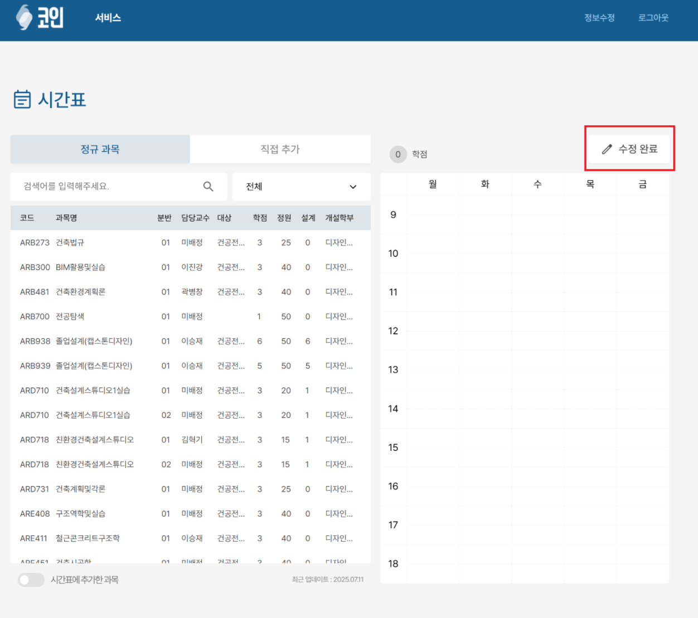
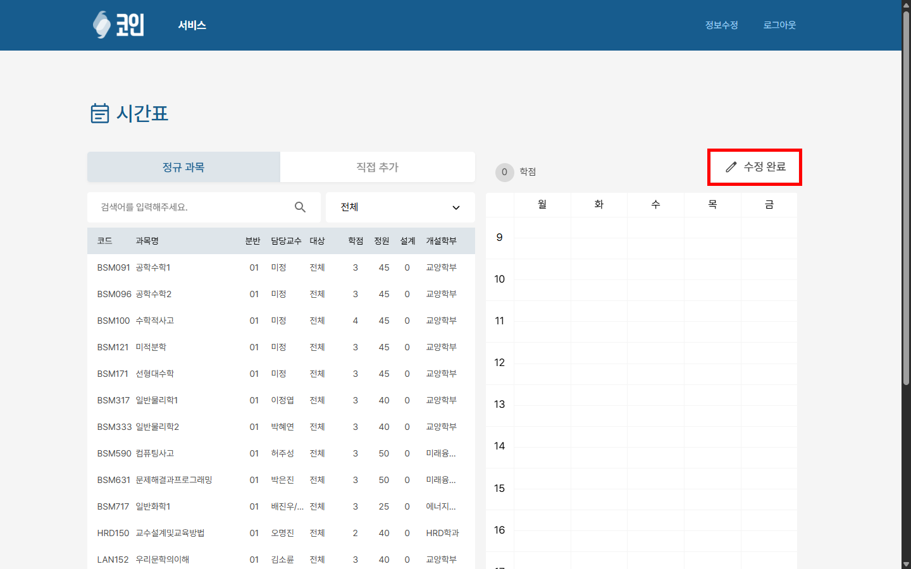

# 2-17. (웹) 시간표_수정 완료 (클릭)

[← 시간표 목록](README.md)

플랫폼: WEB  
원문 상태: 로깅 필요  
[Notion 기준 명세](https://app.notion.com/p/3e40221954bc839c8b588186f5899cde)  
원본 ID: `3e40221954bc839c8b588186f5899cde`

<!-- notion-body:start -->
## 과거 로깅

- event\_label : “timetable”
- value : “수정 완료”
- event\_category : “click”
- 참고 이미지



## 새 로깅

- 설명: 웹 시간표 수정 화면 오른쪽 위 수정 완료 버튼을 눌러 수정을 끝내고 시간표 화면으로 돌아가는 경우
- screen\_view: <code>timetable_edit</code>
- event\_name: <code>DA1</code>
- event\_label: <code>timetable__timetable_edit__timetable_edit__confirm__click</code>
- value: 수정 완료
- event\_category: <code>click</code>

### 참고사진 (기능 표시)

<b>웹</b>

<b>참고사진 · 웹</b>

웹 — 수정 완료 (출처: stage 실제 캡처, 로그인 상태, 빨간 네모 = 클릭 위치)



<b>모바일</b>

<b>참고사진 · 모바일</b>

해당 없음 (웹 전용)
<!-- notion-body:end -->

<details>
<summary>Notion 원문 속성 전체</summary>

```json
{
  "platform": [
    "WEB"
  ],
  "url": "https://app.notion.com/p/3e40221954bc839c8b588186f5899cde",
  "상태": "로깅 필요",
  "생성일": "2026-11-23T13:38:59.839Z",
  "이벤트 이름": "2-17. (웹) 시간표\\_수정 완료 (클릭)",
  "태그": [
    "시간표"
  ]
}
```

</details>
