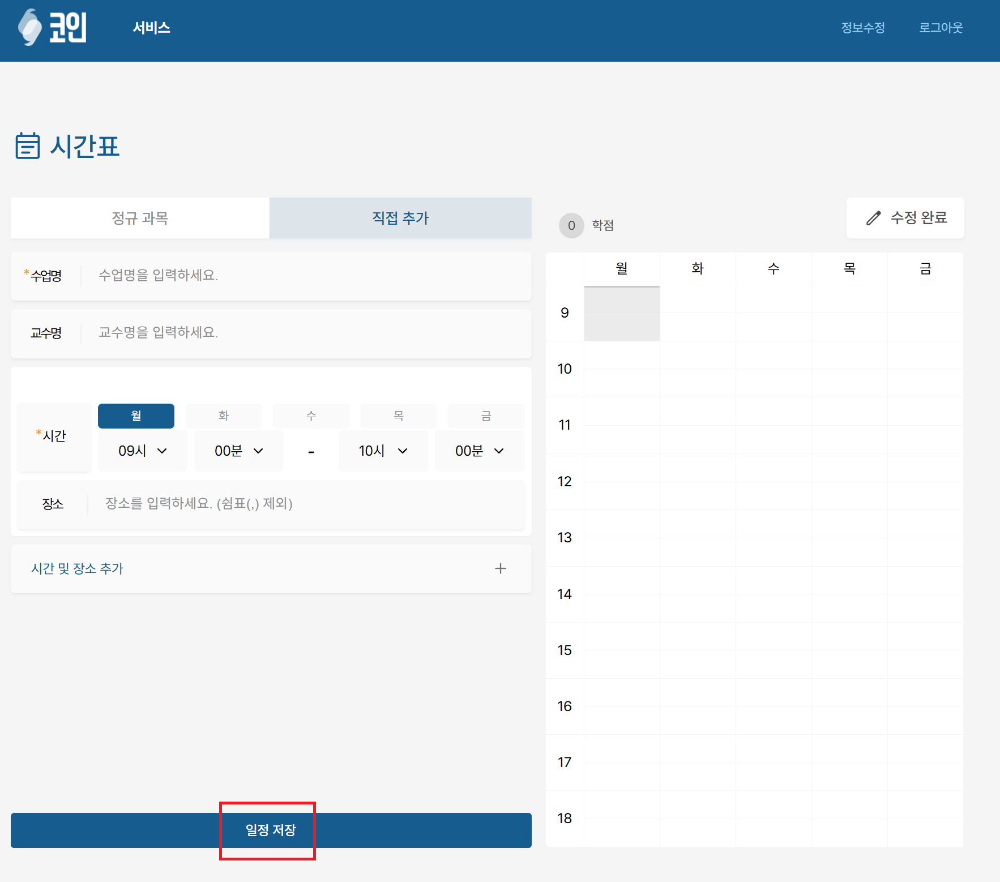

# 2-19. (웹) 시간표_수정_일정 저장 (클릭)

[← 시간표 목록](README.md)

플랫폼: WEB  
원문 상태: 로깅 필요  
[Notion 기준 명세](https://app.notion.com/p/1af0221954bc82029b9101a650dee45d)  
원본 ID: `1af0221954bc82029b9101a650dee45d`

<!-- notion-body:start -->
## 과거 로깅

- event\_label : “timetable”
- value : “일정 저장”
- event\_category : “click”
- 참고 이미지



## 새 로깅

- 설명: 웹 시간표 수정 화면의 직접 추가 탭에서 수업명·시간·장소를 입력하고 일정 저장 버튼을 눌러 시간표에 넣는 경우
- screen\_view: <code>timetable_edit</code>
- event\_name: <code>DA1</code>
- event\_label: <code>timetable__timetable_edit__timetable_edit__custom_save__click</code>
- value: 일정 저장
- event\_category: <code>click</code>

### 참고사진 (기능 표시)

<b>웹</b>

<b>참고사진 · 웹</b>

웹 — 직접 추가 탭 일정 저장 (출처: stage 실제 캡처, 로그인 상태, 빨간 네모 = 클릭 위치 / 직접 추가 탭)


<b>모바일</b>

<b>참고사진 · 모바일</b>

해당 없음 (웹 전용)
<!-- notion-body:end -->

<details>
<summary>Notion 원문 속성 전체</summary>

```json
{
  "platform": [
    "WEB"
  ],
  "url": "https://app.notion.com/p/1af0221954bc82029b9101a650dee45d",
  "상태": "로깅 필요",
  "생성일": "2026-11-23T13:39:00.072Z",
  "이벤트 이름": "2-19. (웹) 시간표\\_수정\\_일정 저장 (클릭)",
  "태그": [
    "시간표"
  ]
}
```

</details>
