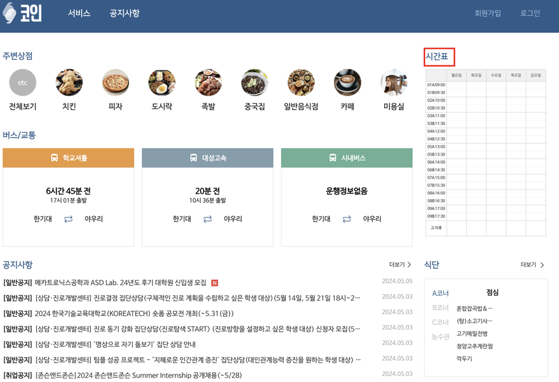
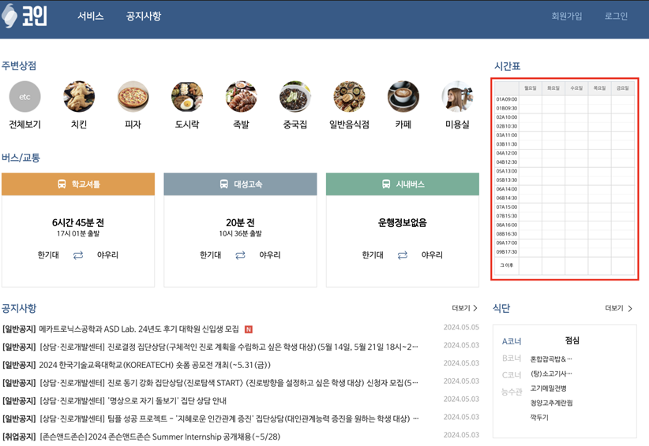

# 2-1~2. (웹) 메인_시간표

[← 시간표 로깅 목록](README.md)

플랫폼: WEB  
원문 상태: 완료

과거 로깅·새 로깅과 각 참고사진은 원문의 구간별 연결을 유지합니다.

원문 미기재 항목: `event_name`, `screen_view`. 값을 추정하지 않았습니다.

<!-- logging-section:past:start -->
## 과거 로깅

- event\_label : “main\_timetable”
- value : “text<b>”, “table”</b>
- event\_category : “click”

<!-- logging-section:past:end -->

<!-- logging-section:new:start -->
## 새 로깅

- 레거시: 지금 웹 메인 화면에는 시간표 위젯(시간표 글자·표)이 없어(stage 2026-10-14 확인) 새 로깅을 만들지 않는다.
- 대체 로깅: 2-3. (웹) 헤더\_시간표 (timetable\_\_header\_\_timetable\_entry\_\_header\_entry\_\_click), 2-4. (웹) 푸터\_시간표 (timetable\_\_footer\_\_timetable\_entry\_\_footer\_entry\_\_click)

해당 없음 (레거시)

해당 없음 (레거시)

<!-- logging-section:new:end -->

---

원문 정보

원본 ID: `dba0221954bc828ebd7d81977c013257`  
[보존 원문](../../_archive/original/notion/pages/dba0221954bc828ebd7d81977c013257.md)

