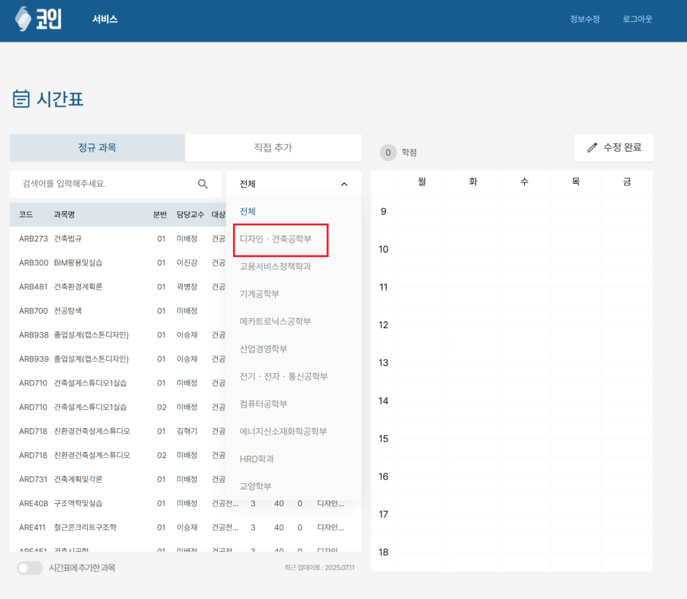
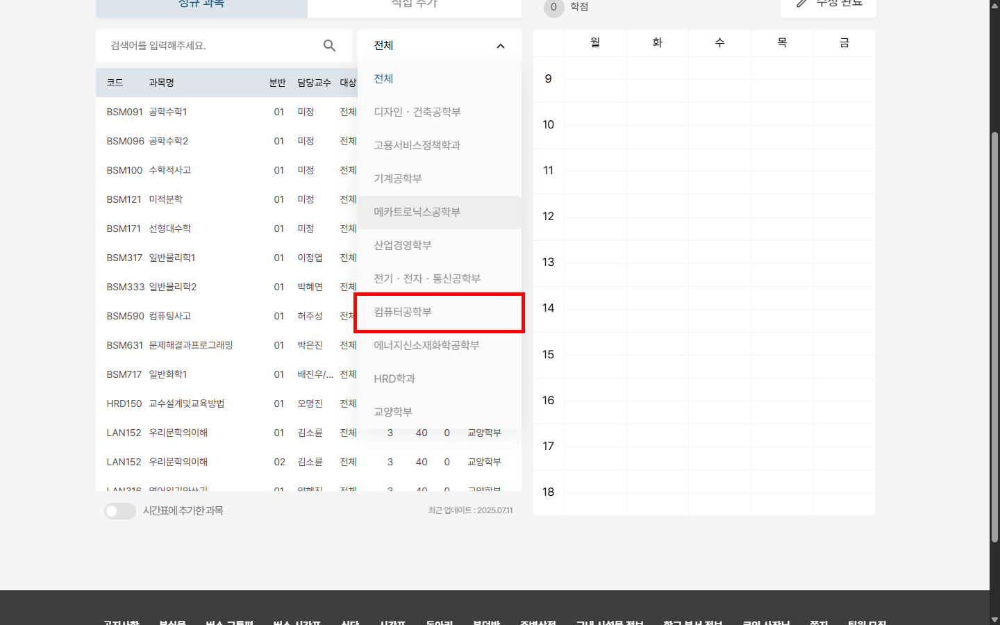

# 2-20. (웹) 시간표_수정_해당 학부 (클릭)

[← 시간표 로깅 목록](README.md)

플랫폼: WEB  
원문 상태: 로깅 필요

과거 로깅·새 로깅과 각 참고사진은 원문의 구간별 연결을 유지합니다.

<!-- logging-section:past:start -->
## 과거 로깅

- event\_label : “timetable”
- value : “filter\_select\_\{사용자가 클릭한 학부\}”
- event\_category : “click”

<!-- logging-section:past:end -->

<!-- logging-section:new:start -->
## 새 로깅

- 설명: 웹 시간표 수정 화면(정규 과목 탭)의 학부 드롭다운(기본 '전체')에서 학부를 골라 과목 목록을 거르는 경우
- screen\_view: <code>timetable_edit</code>
- event\_name: <code>DA1</code>
- event\_label: <code>timetable__timetable_edit__search__department__select</code>
- value: \{학부\} (예: 디자인ㆍ건축공학부) · 학부명은 드롭다운 표기 그대로(가운뎅점 ㆍ 포함), 전체를 고르면 전체
- event\_category: <code>select</code>

### 참고사진 (기능 표시)

#### 웹

웹 — 학부 선택 (출처: stage 실제 캡처, 로그인 상태, 빨간 네모 = 클릭 위치 / 학부 드롭다운을 연 상태)

해당 없음 (웹 전용)

<!-- logging-section:new:end -->

---

원문 정보

원본 ID: `10e0221954bc8296ade3015ad6cc451b`  
[보존 원문](../../_archive/original/notion/pages/10e0221954bc8296ade3015ad6cc451b.md)

