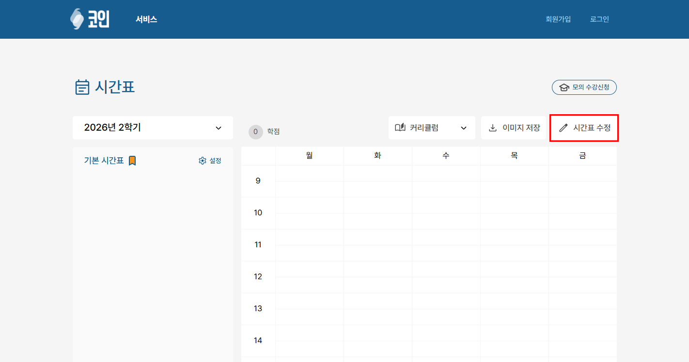
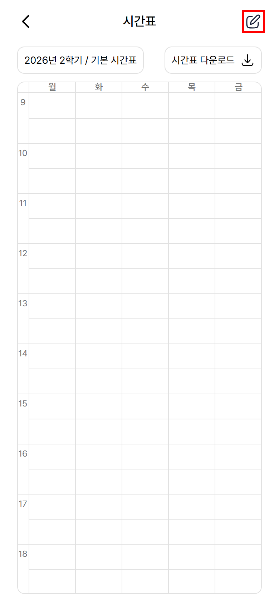

# 2-23. (웹, 반응형 앱) 시간표_시간표 수정 (클릭) - 추가된 로깅

[← 시간표 목록](README.md)

플랫폼: ANDROID, IOS, WEB  
원문 상태: 로깅 필요  
[Notion 기준 명세](https://app.notion.com/p/7560221954bc82d9a5f88156d19ee8ac)  
원본 ID: `7560221954bc82d9a5f88156d19ee8ac`

<!-- notion-body:start -->
## 과거 로깅

- 없음 (새로 추가한 로깅)

## 새 로깅

- 설명: 시간표 화면에서 시간표 수정 버튼(모바일은 오른쪽 위 연필 아이콘)을 클릭해 시간표 수정 화면으로 들어가는 경우 (모바일은 'PC환경만 지원합니다' 안내가 뜨고 들어가지 않음)
- screen\_view: <code>timetable</code>
- event\_name: <code>DA1</code>
- event\_label: <code>timetable__timetable__timetable_edit__entry__click</code>
- value: 시간표 수정
- event\_category: <code>click</code>

### 참고사진 (기능 표시)

<b>웹</b>

<b>참고사진 · 웹</b>

웹 — 시간표 수정 (출처: stage 실제 캡처, 빨간 네모 = 클릭 위치)



<b>모바일</b>

<b>참고사진 · 모바일</b>

모바일 — 시간표 수정 (출처: stage 실제 캡처, 빨간 네모 = 클릭 위치)


<!-- notion-body:end -->

<details>
<summary>Notion 원문 속성 전체</summary>

```json
{
  "platform": [
    "ANDROID",
    "IOS",
    "WEB"
  ],
  "url": "https://app.notion.com/p/7560221954bc82d9a5f88156d19ee8ac",
  "상태": "로깅 필요",
  "생성일": "2026-11-23T13:39:00.153Z",
  "이벤트 이름": "2-23. (웹, 반응형 앱) 시간표\\_시간표 수정 (클릭) - 추가된 로깅",
  "태그": [
    "시간표"
  ]
}
```

</details>
