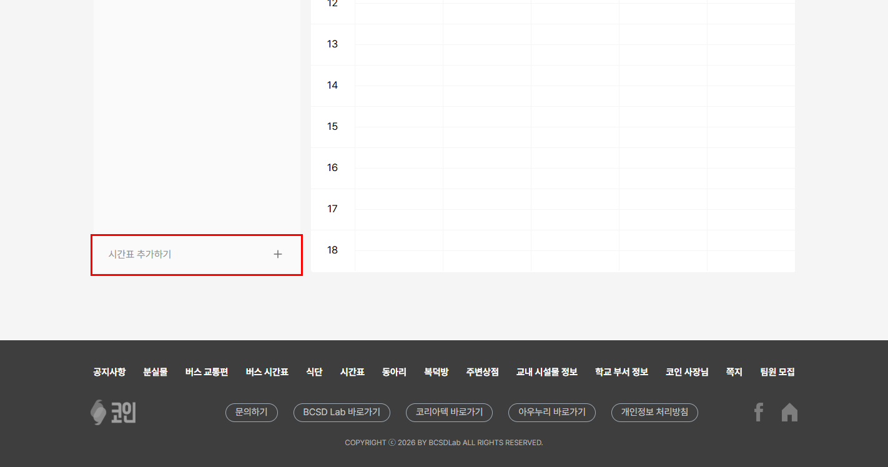

# 2-24. (웹) 시간표_시간표 추가하기 (클릭) - 추가된 로깅

[← 시간표 목록](README.md)

플랫폼: WEB  
원문 상태: 로깅 필요  
[Notion 기준 명세](https://app.notion.com/p/c010221954bc823d9c1e0169d1a71a63)  
원본 ID: `c010221954bc823d9c1e0169d1a71a63`

<!-- notion-body:start -->
## 과거 로깅

- 없음 (새로 추가한 로깅)

## 새 로깅

- 설명: 웹 시간표 화면 왼쪽 시간표 목록 아래 시간표 추가하기 버튼을 클릭해 선택한 학기에 새 시간표를 만드는 경우 (비로그인이면 로그인 안내 팝업이 뜸)
- screen\_view: <code>timetable</code>
- event\_name: <code>DA1</code>
- event\_label: <code>timetable__timetable__timetable_manage__add__click</code>
- value: 시간표 추가하기
- event\_category: <code>click</code>

### 참고사진 (기능 표시)

<b>웹</b>

<b>참고사진 · 웹</b>

웹 — 시간표 추가하기 (출처: stage 실제 캡처, 빨간 네모 = 클릭 위치)



<b>모바일</b>

<b>참고사진 · 모바일</b>

해당 없음 (웹 전용)
<!-- notion-body:end -->

<details>
<summary>Notion 원문 속성 전체</summary>

```json
{
  "platform": [
    "WEB"
  ],
  "url": "https://app.notion.com/p/c010221954bc823d9c1e0169d1a71a63",
  "상태": "로깅 필요",
  "생성일": "2026-11-23T13:39:02.400Z",
  "이벤트 이름": "2-24. (웹) 시간표\\_시간표 추가하기 (클릭) - 추가된 로깅",
  "태그": [
    "시간표"
  ]
}
```

</details>
