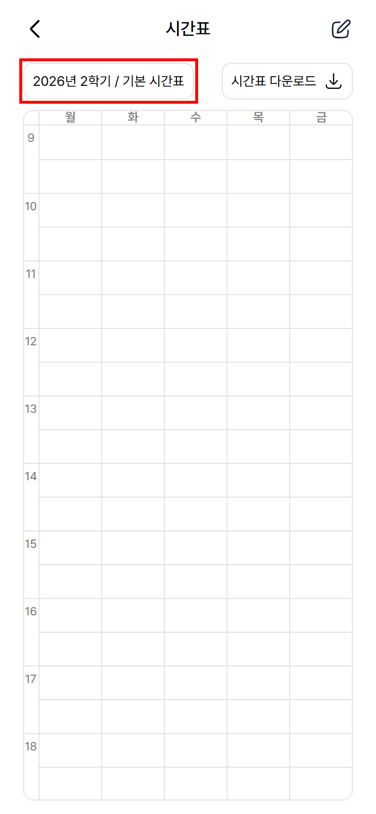

# 2-26. (앱, 반응형 웹) 시간표_학기 시간표 선택 (클릭) - 추가된 로깅

[← 시간표 로깅 목록](README.md)

플랫폼: ANDROID · IOS · WEB (모바일)  
원문 상태: 로깅 필요

과거 로깅·새 로깅과 각 참고사진은 원문의 구간별 연결을 유지합니다.

<!-- logging-section:past:start -->
## 과거 로깅

- 없음 (새로 추가한 로깅)

<!-- logging-section:past:end -->

<!-- logging-section:new:start -->
## 새 로깅

- 설명: 모바일 시간표 화면 왼쪽 위 '학기 / 시간표' 선택 버튼을 클릭해 시간표 목록 화면(/timetable/list)으로 들어가는 경우
- screen\_view: <code>timetable</code>
- event\_name: <code>DA1</code>
- event\_label: <code>timetable__timetable__timetable_list__entry__click</code>
- value: 학기 시간표 선택
- event\_category: <code>click</code>

### 참고사진 (기능 표시)

해당 없음 (모바일 전용)

#### 모바일

모바일 — 학기 시간표 선택 (출처: stage 실제 캡처, 빨간 네모 = 클릭 위치)

<!-- logging-section:new:end -->

---

원문 정보

원본 ID: `a330221954bc830688cb0181d9d51520`  
[보존 원문](../../_archive/original/notion/pages/a330221954bc830688cb0181d9d51520.md)

