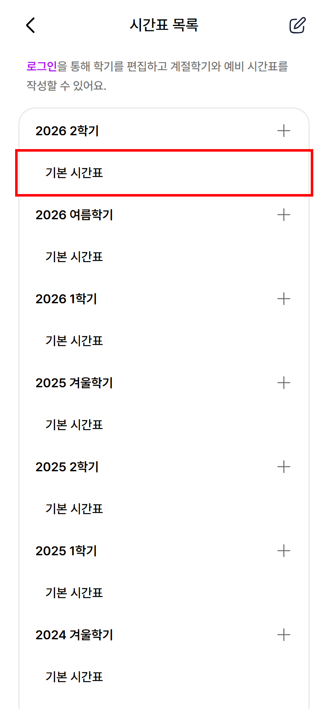

# 2-27. (앱, 반응형 웹) 시간표 목록_시간표 선택 (클릭) - 추가된 로깅

[← 시간표 목록](README.md)

플랫폼: ANDROID, IOS, WEB (모바일)  
원문 상태: 로깅 필요  
[Notion 기준 명세](https://app.notion.com/p/00c0221954bc8205b87c017295f8d83c)  
원본 ID: `00c0221954bc8205b87c017295f8d83c`

<!-- notion-body:start -->
## 과거 로깅

- 없음 (새로 추가한 로깅)

## 새 로깅

- 설명: 모바일 시간표 목록 화면에서 학기 아래 시간표 하나를 골라 그 시간표를 보는 시간표 화면으로 돌아가는 경우
- screen\_view: <code>timetable_list</code>
- event\_name: <code>DA1</code>
- event\_label: <code>timetable__timetable_list__timetable_list__select</code>
- value: \{연도\}\_\{학기\}\_\{시간표명\} (예: 2026\_2학기\_기본 시간표)
- event\_category: <code>select</code>

### 참고사진 (기능 표시)

<b>웹</b>

<b>참고사진 · 웹</b>

해당 없음 (모바일 전용)

<b>모바일</b>

<b>참고사진 · 모바일</b>

모바일 — 시간표 목록에서 시간표 선택 (출처: stage 실제 캡처, 빨간 네모 = 클릭 위치)


<!-- notion-body:end -->

<details>
<summary>Notion 원문 속성 전체</summary>

```json
{
  "platform": [
    "ANDROID",
    "IOS",
    "WEB (모바일)"
  ],
  "url": "https://app.notion.com/p/00c0221954bc8205b87c017295f8d83c",
  "상태": "로깅 필요",
  "생성일": "2026-11-23T13:39:01.976Z",
  "이벤트 이름": "2-27. (앱, 반응형 웹) 시간표 목록\\_시간표 선택 (클릭) - 추가된 로깅",
  "태그": [
    "시간표"
  ]
}
```

</details>
