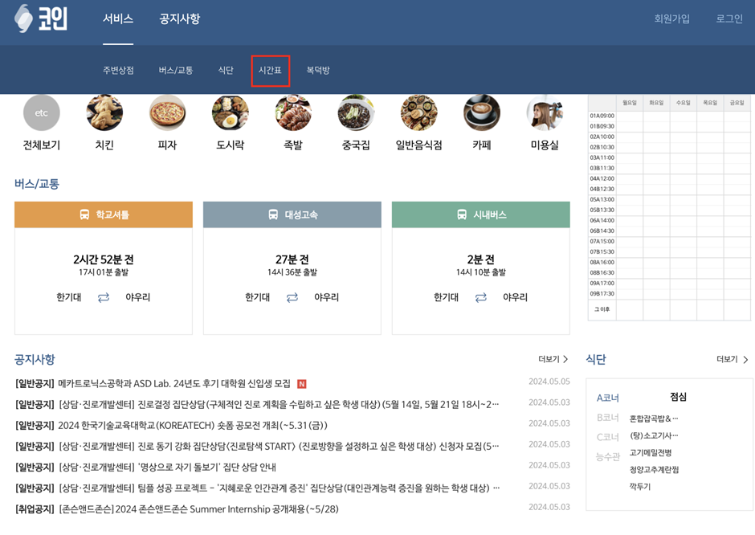
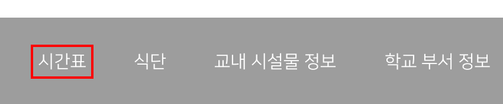

# 2-3. (웹) 헤더_시간표

[← 시간표 로깅 목록](README.md)

플랫폼: WEB  
원문 상태: 완료

과거 로깅·새 로깅과 각 참고사진은 원문의 구간별 연결을 유지합니다.

<!-- logging-section:past:start -->
## 과거 로깅

- event\_label : “header”
- value : “시간표”
- event\_category : “click”

<!-- logging-section:past:end -->

<!-- logging-section:new:start -->
## 새 로깅

- 설명: 웹 상단 헤더의 서비스 메뉴에서 시간표를 클릭해 시간표 화면으로 들어가는 경우
- screen\_view: <code>header</code>
- event\_name: <code>DA1</code>
- event\_label: <code>timetable__header__timetable_entry__header_entry__click</code>
- value: 시간표
- event\_category: <code>click</code>

### 참고사진 (학교생활 → 시간표 · WEB 리디자인)

#### 웹

학교생활 → 시간표. 출처: [Figma WEB 리디자인](https://www.figma.com/design/DPlcYuiFxhyT5ULbqec59i/KOIN-Web?node-id=11541-33352), 2026-11-04 원본 캡처에 코드로 빨간 네모만 추가. 빨간 네모는 기존 명세가 지칭하는 클릭 대상이다. 실제 클릭 가능 여부·SDK 적용·배포·수집은 미확인이다.

<!-- logging-section:new:end -->

---

원문 정보

원본 ID: `2a00221954bc834ba97c81609dc344a3`  
[보존 원문](../../_archive/original/notion/pages/2a00221954bc834ba97c81609dc344a3.md)

