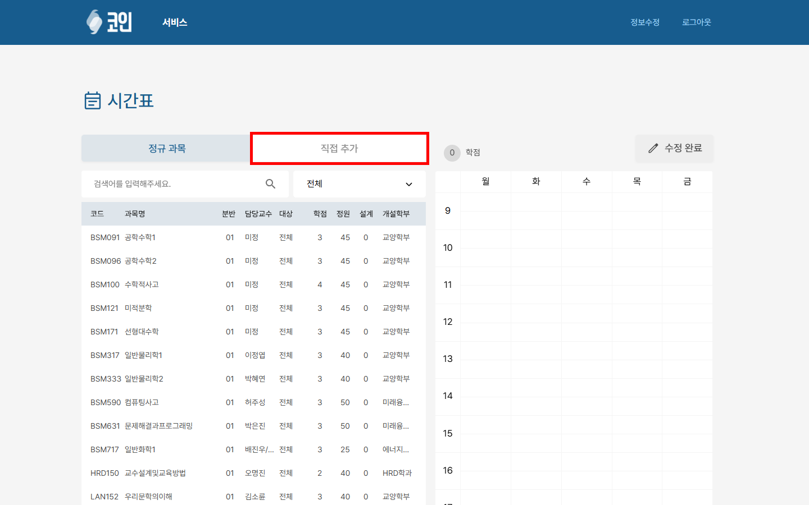

# 2-30. (웹) 시간표 수정_탭 (클릭) - 추가된 로깅

[← 시간표 로깅 목록](README.md)

플랫폼: WEB  
원문 상태: 로깅 필요

과거 로깅·새 로깅과 각 참고사진은 원문의 구간별 연결을 유지합니다.

<!-- logging-section:past:start -->
## 과거 로깅

- 없음 (새로 추가한 로깅)

<!-- logging-section:past:end -->

<!-- logging-section:new:start -->
## 새 로깅

- 설명: 웹 시간표 수정 화면에서 정규 과목 / 직접 추가 탭 중 하나를 클릭해 강의 목록과 직접 일정 입력을 오가는 경우
- screen\_view: <code>timetable_edit</code>
- event\_name: <code>DA1</code>
- event\_label: <code>timetable__timetable_edit__timetable_edit__tab__click</code>
- value: \{정규 과목 / 직접 추가\} (예: 직접 추가)
- event\_category: <code>click</code>

### 참고사진 (기능 표시)

#### 웹

웹 — 시간표 수정 탭 (출처: stage 실제 캡처, 로그인 상태, 빨간 네모 = 클릭 위치 / 직접 추가 탭)

해당 없음 (웹 전용)

<!-- logging-section:new:end -->

---

원문 정보

원본 ID: `db80221954bc82b48c1c813c9d4dac9c`  
[보존 원문](../../_archive/original/notion/pages/db80221954bc82b48c1c813c9d4dac9c.md)

